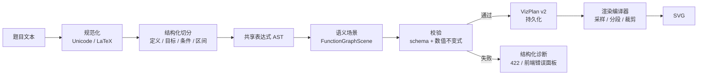

# 施工文档：统一可视化生成方案重构（VizPlan v2）

| 项 | 内容 |
| --- | --- |
| 版本 | v0.1（方案评审稿） |
| 编制时间 | 2026-11-13 |
| 事实基线 | `b415bde`；`server/src/learning/visualize-*.ts`、`web/src/components/viz/FunctionChart.vue`、`web/src/views/VisualizeView.vue` |
| 触发问题 | 统一可视化页出现整块蓝色填充，函数曲线不可见；标题为“m=0 时复合函数的三个零点”，实际只显示两个点，图例表达式被截断 |
| 方案性质 | 重构生成入口、场景模型、校验与 2D 渲染链路；不是继续给 `regions` / `function-plot` 打补丁 |
| 当前状态 | 已实施（2026-11-13）：全类型严格语义 scene、function/conic SVG 渲染、预置原生 v2、旧记录批量迁移、像素基线 CI 已落地；实施记录见文末 |

## 0. 结论摘要

截图不是“某个表达式又写错了”，而是当前可视化链路的结构性问题：

1. **生成入口不唯一**。题目明明有具体函数，`visualize_generate` 在本地建模失败后，仍允许对话模型直接塞入 `type + spec`。截图的列表元信息是“生成”而不是“题目建模”，说明它不是本地建模器产物；在当前工具链里，function2d 的非 modeler 来源只能是 agent spec 回退（或更早的 llm 记录）。
2. **spec 是渲染器方言，不是语义模型**。`regions[].where` 只被检查“非空字符串”，`regions[].fill` 可以是任意颜色字符串；前端又把它直接交给 SVG 的 `fill`。
3. **区域绘制没有边界**。`FunctionChart` 把 `where` 正则拆成左右两边，采样后首尾相连成一个闭合多边形。只要条件退化成恒真（例如 `-2<=2`），就会得到覆盖整个绘图区的矩形；若 `fill` 是 `#409eff`，就是截图中的实心蓝块。
4. **校验只看“能算”，不看“画出来是否合理”**。表达式只在 5 个采样点求值；区域条件不编译、不检查恒真/恒假、不限制面积；零点只做 400 点等距扫描，重根和边界根会漏。
5. **没有版本、原文和来源约束**。坏 spec 一旦落库就无法重建或迁移，只能在打开时继续画错。

建议分两步：

- **B0 止血（0.5 人日）**：对旧 spec 做降级保护——曲线强制 `fill=none`，非法/恒真区域直接丢弃，区域面积超限不画，图例不再截断；同时在工具层禁止 function2d 的模型 spec 回退。
- **B1–B7 重构（单人约 13 人日；B3/B4 并行约 8–10 个工作日）**：建立唯一的 `题目 → 语义场景 → VizPlan v2 → SVG` 流水线；function-graph 的所有样式由主题角色决定，模型和用户都不能直接写 `fill/attr/style`；函数图改用项目自己的 SVG 渲染器，彻底移除 `function-plot` 的隐式解析和默认填充行为。

## 1. 复现与证据

### 1.1 截图现象

截图中的可视化记录具备以下特征：

- 标题：`m=0 时复合函数的三个零点`。
- 列表元信息：`函数图像 · 生成`。按 `VisualizeView.vue` 的逻辑，只有 `source === 'modeler'` 才显示“题目建模”，否则显示“生成”。因此该条不是本地建模器产物。
- 绘图区：从 `x=-6` 到 `x=6`、`y=-2` 到 `y=2` 的整块蓝色填充，坐标轴和网格被盖住。
- 特征点：只看到 2 个黑色点，与标题“三个零点”不一致。
- 图例：只有一个被截断的表达式，没有可读的函数语义标签。

这不是单一曲线的绘制错误，而是“区域图层盖住了曲线图层”。

### 1.2 代码路径

当前 function2d 有两条入口：

```text
A. /api/visualize/generate
   → generateVisualization()
   → modelVisualization() 成功：source='modeler'
   → 失败：matchPreset() 或返回 null

B. 对话工具 visualize_generate
   → 若 question + type=function2d：先尝试 A
   → 若 A 失败且调用方传了 type+spec：createVisualization(source='agent')
   → 若仍失败且有 question：再尝试 A
```

对应代码：

- `server/src/learning/visualize-engine.ts` 第 84–135 行：工具参数包含 `type/title/spec`，并在建模失败后回退到模型 spec。
- `server/src/learning/visualize.ts` 第 120–193 行：`validateFunctionSpec` 只校验函数表达式可编译，`regions.where` 仅做非空字符串检查，`regions.fill` 仅限制长度。
- `web/src/components/viz/FunctionChart.vue` 第 126–183 行：`regionDatum` 将 `where` 拆成左右两侧，生成闭合参数曲线。
- `web/src/components/viz/FunctionChart.vue` 第 192–196 行：直接把 `region.fill` 作为 SVG 的 `fill` 传入。
- `web/src/views/VisualizeView.vue` 第 275 行：非 `modeler` 来源显示“生成”。

### 1.3 最小等价复现

下面这个 spec 可以通过当前校验，并稳定画出整块蓝色区域：

```json
{
  "type": "function2d",
  "title": "退化区域复现",
  "spec": {
    "functions": [
      { "expression": "x^2-1", "label": "f(x)=x^2-1" }
    ],
    "range": [-6, 6],
    "regions": [
      { "where": "-2<=2", "fill": "#409eff" }
    ]
  }
}
```

执行链：

1. `validateExpression('-2<=2')` 只检查非空和长度，通过。
2. `validateFunctionSpec` 认为 `functions[0].expression` 在 5 个采样点可计算，通过。
3. `regionDatum` 用正则得到 `left='-2'`、`operator='<='`、`right='2'`。
4. `holds(x)` 对所有 x 都为真，得到唯一区间 `[range[0], range[1]]`。
5. `boundary` 依次压入 `y=-2` 的上边界和 `y=2` 的下边界，首尾闭合。
6. `function-plot` 用 `attr: { fill: '#409eff', stroke: 'none' }` 绘制，得到一个覆盖绘图区的实心矩形。

截图中的蓝块形状与该复现一致。真实记录可能不是 `-2<=2`，但只要是恒真条件、链式不等式被拆坏、或左右边界退化为常数，都会触发同一条路径。

### 1.4 为什么上一轮修复没有覆盖

`施工文档-公式渲染与函数可视化修复.md` 修的是：

- 共享 AST 表达式内核；
- `abs*(x)` 归一化回归；
- 函数定义/复合；
- `\begin{cases}` 分段；
- 前端错误可见性。

它没有改：

- 模型 spec 回退入口；
- `regions` 的语义校验；
- `regions.fill` 的自由样式；
- `function-plot` 的闭合多边形绘制；
- spec 版本与原文持久化。

所以“表达式能编译”并不等于“图形能正确表达题目”。本轮要补的是生成与渲染之间的语义层。

## 2. 根因分析

### 2.1 生成入口不唯一

`visualize_generate` 同时承担“题目建模”和“模型直接画图”两种职责：

- 建模成功：`source='modeler'`，有确定性解析可追溯；
- 建模失败：模型可以传任意 `spec`，`source='agent'`，只经过浅校验。

这会产生一个危险的回退：**建模器越不覆盖，模型 spec 就越容易被使用；而模型 spec 恰恰是最不可控的部分。** 截图中的“生成”来源说明回退已经发生。

### 2.2 spec 是渲染器方言

当前 function2d spec 允许：

```json
{
  "functions": [{ "expression": "...", "label": "...", "color": "#..." }],
  "relations": [{ "kind": "intersection", "solve": "f=g" }],
  "regions": [{ "where": "-2<=2", "fill": "#409eff" }],
  "sliders": [{ "param": "a", "min": 0.5, "max": 3, "value": 1.75 }]
}
```

这些字段混合了三种东西：

- 数学语义：函数、关系、区域；
- 渲染指令：颜色、填充、线宽；
- 交互状态：滑块范围和默认值。

服务端只校验其中一小部分，前端又直接执行渲染指令。于是“数学上不成立”的区域可以变成“视觉上很显眼”的图层。

### 2.3 校验只看“能算”，不看“合理”

`validateCompilable` 只做：

```ts
for (const x of [-5, -1, 0, 1, 5]) {
  if (Number.isFinite(fn(x))) valid += 1;
}
if (valid === 0) throw ...
```

它不检查：

- 定义域是否覆盖整个显示区间；
- 值域是否会让坐标轴压缩成一条线；
- 区域条件是否恒真/恒假；
- 区域面积是否异常；
- 零点是否是重根、是否在区间端点；
- 图例是否可读；
- 是否存在多个函数互相遮挡。

### 2.4 `regions` 没有几何边界

`regionDatum` 的假设是“where 一定是左右两条关于 x 的曲线之间的区域”。但实际输入可能是：

- 常数不等式 `-2<=2`；
- 链式不等式 `-1<f(x)<2`；
- 只含 y 的不等式 `y>0`；
- 带 `&&` 的复合条件；
- 无法解析成数值的符号条件。

当前代码只处理第一种正则匹配。匹配不到就跳过；匹配到恒真条件就画满；匹配到链式不等式则把右半边当成布尔表达式，画出错误的半平面。没有任何“这个区域是否可信”的判断。

### 2.5 解析器以字符串正则为主

`visualize-modeler.ts` 里大量逻辑是：

- 用正则找 `f(x)=` / `y=`；
- 用 `cutFunctionBody` 截断题目；
- 用 `extractInequality` 在整个题目里找第一个 `<` / `>`；
- 用 `autoRange` 匹配简单二次函数；
- 用 `applyParameters` 把所有未绑定变量当滑块。

这些规则对“画出 y=x^2-4x+3”有效，但对“已知……m=0 时……有三个零点”这种多从句题目，容易把目标、条件、参数混在一起。模型 spec 回退正是用来掩盖这些失败，结果把问题从“解析失败”变成了“画错图”。

### 2.6 没有版本、原文和可迁移性

`visualizations` 表只有 `spec` 和 `source`：

```sql
CREATE TABLE visualizations (
  visualization_id TEXT PRIMARY KEY,
  learner_id TEXT NOT NULL DEFAULT 'default',
  type TEXT NOT NULL,
  title TEXT NOT NULL,
  spec TEXT NOT NULL,
  source TEXT,
  created_at INTEGER NOT NULL
);
```

没有：

- `schema_version`：无法区分新旧 spec；
- `input_text`：无法从原题重新建模；
- `plan_hash` / `modeler_version`：无法定位是哪一版生成器产出的；
- `diagnostics`：无法在列表里标记“这条记录需要重建”。

## 3. 目标与非目标

### 3.1 目标

1. **唯一生成入口**：function2d/conic 只允许“题目 → 本地建模”，不再接受模型直接提供的渲染 spec。
2. **语义化 IR**：引入 `VizPlan v2`，把函数、参数、视窗、特征、区域表达成受限的语义对象。
3. **样式与内容分离**：模型和用户不能写 `fill/stroke/attr/color/style`；颜色由主题角色决定。
4. **渲染可验证**：曲线路径必须 `fill=none`；区域必须由编译器生成、裁剪、限面积；任何异常都不能覆盖整张图。
5. **失败可见**：解析不到、区域非法、零点数量不符、定义域为空时，返回结构化诊断，不画“看起来像图”的占位图。
6. **可迁移**：旧 spec 可读、可降级、可标记；新记录保存原文和版本，能重建。
7. **可测试**：新增纯函数级编译器测试、spec 契约测试和至少 8 张视觉回归截图。

### 3.2 非目标

- 不做完整 CAS：不做符号化简、求导、积分、精确解方程。
- 不重写 3D 几何、分子、地形、生物渲染；它们先接入统一信封，几何算法保持不变。
- 不实现动画、轨迹播放、题目元素联动高亮。
- 不自动迁移所有历史坏记录；没有原文的旧记录只做降级显示。
- 不把对话模型作为默认生成器；如未来引入，只允许输出受 schema 约束的“意图”，不允许输出样式。

## 4. 新方案总览

### 4.1 五条原则

| 原则 | 含义 | 反例 |
| --- | --- | --- |
| 单一入口 | 每个类型只有一条生成路径 | 建模失败后回退到模型 spec |
| 语义优先 | 先表达“是什么”，再决定“怎么画” | spec 里直接写 `fill` |
| 不可信输入无样式 | 模型/用户只能提供语义，样式由主题映射 | 模型传 `#409eff` 覆盖整图 |
| 失败关闭 | 不能保证正确时明确报错 | 画一张无关的示意图 |
| 可验证 | 每个几何产物都有数值不变式 | 只检查 5 个点能算 |

### 4.2 流水线



关键点：**VizPlan v2 不包含采样后的像素数据，也不包含样式**。它只保存语义和视窗；前端用共享编译器在目标尺寸上生成路径。这样同一份 plan 可以在不同屏幕宽度、不同 DPI 下稳定重绘。

### 4.3 分层职责

| 层 | 负责 | 不负责 |
| --- | --- | --- |
| 规范化 | 全角/半角、π、≤、LaTeX 命令 | 猜测题目意图 |
| 切分 | 找定义、目标、条件、区间 | 求值 |
| AST | 语法、优先级、隐式乘法、绝对值、分段 | 决定画什么 |
| 场景构建 | 函数表、目标曲线、参数、视窗、特征、区域 | 颜色、线宽 |
| 校验 | schema、定义域、值域、区域面积、零点数量 | 像素绘制 |
| 渲染编译 | 采样、断点、裁剪、路径 | 解释题目 |
| 渲染器 | SVG 图层、交互、截图 | 重新解析表达式 |

## 5. VizPlan v2 数据模型

### 5.1 信封

```ts
type VizKind =
  | 'function-graph'
  | 'conic'
  | 'function-3d'
  | 'solid-geometry'
  | 'molecule'
  | 'terrain'
  | 'biology'
  | 'physics'
  | 'diagram';

interface VizDocumentV2 {
  schema: 'edupi.viz/v2';
  kind: VizKind;
  title: string;
  input: {
    text: string;
    subject?: string;
  };
  provenance: {
    generator: 'modeler' | 'manual' | 'preset';
    version: string;          // 例如 modeler@2.0.0
    questionHash?: string;
  };
  scene: FunctionGraphScene | ConicScene | Record<string, unknown>;
  diagnostics: VizDiagnostic[];
}
```

约束：

- `schema` 必填且只能是 `edupi.viz/v2`。
- `input.text` 保存原题，供重建和审计；旧记录允许为空。
- `provenance.generator` 只允许三种值；`agent` 不再是合法来源。
- `scene` 按 `kind` 做 discriminated union，未知字段一律拒绝。

### 5.2 function-graph 场景

```ts
interface FunctionGraphScene {
  definitions: FunctionDef[];
  curves: CurveRef[];
  parameters: Parameter[];
  view: ViewSpec;
  features: FeatureSpec[];
  regions: RegionSpec[];
}

interface FunctionDef {
  name: string;              // f / g / h
  params: string[];          // 目前只支持单参数，保留数组以便扩展
  body: string;              // 规范化后的 AST 序列化；分段函数可为空
  display: string;           // 人类可读，如 f(x)=2sin(2x-π/6)-m
  piecewise?: { when: string; then: string }[]; // 分段函数分支
  domain?: [number, number];
}

interface CurveRef {
  def: string;               // 引用 definitions[].name
  role: 'primary' | 'secondary' | 'reference';
  visible: boolean;
}

interface Parameter {
  name: string;              // m / a / b
  min: number;
  max: number;
  step: number;
  value: number;
}

interface ViewSpec {
  x: [number, number];
  y?: [number, number];
  mode: 'auto' | 'fixed';
}

type FeatureSpec =
  | { kind: 'roots'; of: string[]; expected?: number; limit?: number }
  | { kind: 'intersections'; of: [string, string]; limit?: number }
  | { kind: 'extrema'; of: string[]; limit?: number }
  | { kind: 'endpoints'; of: string[] };

type Boundary =
  | { kind: 'constant'; value: number }
  | { kind: 'function'; def: string };

type RegionSpec =
  | { kind: 'between'; lower: Boundary; upper: Boundary; role: 'solution' }
  | { kind: 'condition'; condition: string; role: 'solution' };
```

**禁止字段**：`fill`、`stroke`、`attr`、`color`、`style`、`opacity`、`lineWidth`。颜色只由 `role` 映射到主题：

```ts
const THEME = {
  primary:   { stroke: '#409eff', width: 2 },
  secondary: { stroke: '#f56c6c', width: 1.8 },
  reference: { stroke: '#8a94a6', width: 1.4, dash: '5 5' },
  solution:  { fill: 'rgba(64,158,255,0.14)' },
};
```

### 5.3 诊断

```ts
interface VizDiagnostic {
  code: string;
  severity: 'info' | 'warning' | 'error';
  message: string;
  hint?: string;
  path?: string;            // 如 scene.regions[0]
}
```

诊断不是日志，而是 API 和 UI 的一等公民：

- `POST /api/visualize/generate` 失败时返回 `{ code, message, diagnostics }`；
- 成功但存在警告时，`visualization.diagnostics` 随记录返回；
- 前端在图表上方显示警告/错误面板；
- 工具把诊断文本传回智能体，智能体据此告诉用户“缺少什么”，而不是重试乱画。

### 5.4 版本与存储

新增列（只增不删，先备份）：

```sql
ALTER TABLE visualizations ADD COLUMN schema_version INTEGER NOT NULL DEFAULT 1;
ALTER TABLE visualizations ADD COLUMN input_text TEXT;
```

- 旧记录：`schema_version=1`，`spec` 保持旧格式，`input_text=NULL`。
- 新记录：`schema_version=2`，`spec` 存 `VizDocumentV2`，`input_text` 存原题。
- `toVisualization()` 返回 `schema_version`、`input_text`、`diagnostics`（从 v2 文档读取）。
- SQLite 不支持 `ADD COLUMN IF NOT EXISTS`；在 `store.ts` 里用 `PRAGMA table_info(visualizations)` 检查后再执行，保证重复启动不报错。

## 6. 生成器设计

### 6.1 规范化

只做无损规范化，不做语义猜测：

| 输入 | 输出 |
| --- | --- |
| `（x）`、`，` | `(x)`、`,` |
| `≤`、`≥`、`≠` | `<=`、`>=`、`!=` |
| `π`、`√` | `pi`、`sqrt` |
| `²`、`³` | `^2`、`^3` |
| `\left`、`\right` | 删除 |
| `\frac{a}{b}` | `((a)/(b))` |
| `\sqrt{a}` | `sqrt(a)` |
| `\cdot`、`\times` | `*` |

**不要**在规范化阶段补 `*`。共享 parser 已支持隐式乘法（`2x`、`(x+1)(x-1)`、`g(x)g(|x|)`）；补 `*` 只会再次制造 `abs*(x)` 类回归。

### 6.2 切分与定义解析

用一个能识别括号/花括号/LaTeX 环境的小扫描器，而不是对整题跑正则：

```ts
function splitTopLevel(text: string, delimiters: string[]): string[];
```

规则：

1. 只在顶层 `()[]{}` 和 `\begin...\end` 之外切分。
2. 先按 `。；;` 切句，再按 `，,` 切子句。
3. 在每个子句里找 `identifier(params)=`，且左侧必须是合法函数名（`f/g/h/F/G/H`，可扩展）。
4. `y=` 单独归类为“曲线定义”，不要求函数名。
5. `\begin{cases}...\end{cases}` 作为一个整体，不参与顶层逗号切分。
6. 目标判定：
   - 出现“画出/作出/绘制/研究 + f(x)” → 目标 f；
   - 出现“f 与 g 的交点/比较” → 两条都画；
   - 只有 `y=` → 画 y；
   - 多个定义且没有明确目标 → 返回 `VIZ_AMBIGUOUS_TARGET`，不猜最后一个。

### 6.3 AST 解析

共享 `shared/expression.ts` 继续作为唯一表达式内核，但补三点：

1. **绝对值由 parser 处理**：`|expr|` 解析成 `call('abs')`，支持嵌套 `|x-3|-|x+3|`、`||x|-3|`；modeler 的 `normalizeExpression` 不再改写绝对值。
2. **隐式乘法由 parser 处理**：相邻 primary 直接组成 `binary('*')`；序列化时再决定是否加 `*`。
3. **分段是一等节点**：`piecewise` 已有 AST 节点；复合时允许 `f(x)=h(g(x))` 且 `g` 为分段函数，通过替换 + 递归展开实现，不再直接拒绝。

AST 输出必须满足：

- 只含 `num/var/unary/binary/call/compare/and/piecewise`；
- 变量只允许 `x`、参数名、`pi/e`；
- 函数调用只允许内置函数或已定义函数；
- 定义图无环；
- 序列化结果可被同一 parser 重新解析。

### 6.4 视窗与定义域

`autoRange` 不再用简单正则判断二次函数，而是基于采样和特征：

1. 先取候选 x 区间：
   - 题目显式区间（`[a,b]`、`a<x<b`）；
   - 三角函数：2 个周期；
   - 多项式：特征点范围 ± 20%；
   - 有理/根式/对数：先数值扫描定义域，再扩 10%；
   - 默认 `[-10,10]`。
2. 在候选区间采样 1024 点，过滤非有限值，得到有效定义域分段。
3. y 范围：
   - 取有效样本的 2%–98% 分位数，避免个别渐近点把坐标轴拉爆；
   - 把零点、交点、极值点纳入范围；
   - 上下各留 8% 边距；
   - 若范围退化（`max-min < 1e-9`），报 `VIZ_VIEW_DEGENERATE`。
4. 用户显式指定 `view.y` 时尊重用户，但仍做退化检查。

### 6.5 特征点

零点/交点/极值不再由前端每次渲染时扫描，而是由场景编译器生成 `FeatureSpec`，渲染编译器验证后落点：

- **零点**：自适应采样 + 符号变化 + 二分；对 `(x-a)^2` 这类偶重根，额外检查局部极小值 `|f(x)| < tol`。
- **交点**：对 `f-g` 做同样处理。
- **极值**：在采样局部极值附近做三分搜索；只用于标注，不声称解析解。
- **端点**：显式区间的左右端点，若函数有限则标注。
- **去重**：`1e-6` 内合并。
- **验证**：每个点必须满足 `|f(x)| <= 1e-6`（或 `|f(x)-g(x)| <= 1e-6`）；否则丢弃并记 warning。
- **数量核对**：题目出现“三个零点/两个交点”等数量词时，解析成 `expected`；若实际数量不符，返回 `VIZ_FEATURE_COUNT_MISMATCH` 警告，而不是静默少画。

这条直接针对截图：标题说三个零点，页面只显示两个点且没有解释。新方案要么画出三个，要么明确告诉用户“只验证到两个，第三个可能是重根/在区间外”。

### 6.6 参数与滑块

- 只把“未绑定变量”作为参数：排除 `x/y`、`pi/e`、函数名、已定义函数名。
- 题目中有 `m=0`、`a=1/2` 时，直接代入常量，不生成滑块。
- 题目中有 `a∈[-2,2]` 时，生成该范围的滑块；没有范围时用保守默认 `[-3,3]`，并在诊断里提示“默认范围”。
- 参数值必须在 `[min,max]` 内；`value` 缺省取中点。
- 滑块参数名不能是 `f/g/h`，也不能与函数名冲突。

### 6.7 区域

区域是本次事故的核心，必须从“字符串 + 自由填充”改成“受限几何”：

1. **实际支持两种形式**：
   - `between`：例如 `f(x) >= 0`，填充函数与常数（或另一函数）边界之间；
   - `condition`：例如 `x^2-3x+2>0` 或 `-1<f(x)<2`，按 x 条件生成竖条。
2. 链式不等式在 AST 层拆成 `and`，不允许前端再用正则拆。
3. 两侧都是常数、且条件恒真/恒假（如 `-2<=2`）→ `VIZ_REGION_INVALID`。
4. `condition` 只接受含 `x` 与参数的表达式；当前不把只含 `y` 或只含 `x` 的关系自动转成半平面。
5. 采样时把上下边界裁剪到 `view.y`；用“竖条多边形”而不是首尾相连的闭合曲线，避免跨无穷远闭合。
6. 面积守卫：区域覆盖超过绘图区 60% 时，默认不画并返回 `VIZ_REGION_TOO_LARGE`。
7. 区域图层必须在曲线图层下方，且 `pointer-events: none`。

### 6.8 复合与分段

- 定义表：`Map<string, FunctionDef>`。
- 展开：从目标函数 AST 出发，递归替换自定义函数调用；用 `stack` 检测循环；参数个数必须匹配。
- 分段：`piecewise` 节点保留分支条件和开闭端点；渲染时按分支边界切段，不跨分支插值。
- 复合：普通函数支持递归展开；分段函数支持顶层复合 `f(x)=g(x)`，`f(x)=g(x)+1` 这类嵌套分段仍受限制，见实施记录。

### 6.9 失败策略

| 情况 | 行为 |
| --- | --- |
| 没有定义、没有可解析结构 | `VIZ_UNSUPPORTED_STRUCTURE`，不生成 |
| 多个定义但没有目标 | `VIZ_AMBIGUOUS_TARGET`，提示用户指定 |
| 表达式不可编译 | `VIZ_EXPRESSION_INVALID`，带位置 |
| 定义域为空 | `VIZ_DOMAIN_EMPTY` |
| 视窗退化 | `VIZ_VIEW_DEGENERATE` |
| 区域非法/恒真 | `VIZ_REGION_INVALID` / `VIZ_REGION_TOO_LARGE` |
| 零点数量不符 | `VIZ_FEATURE_COUNT_MISMATCH`（warning，仍出图） |
| 旧 spec 无法升级 | `VIZ_LEGACY_SPEC`（info，降级显示） |

## 7. 渲染器设计

### 7.1 为什么替换 function-plot

`function-plot` 在当前项目里承担了四件事：解析表达式、采样、坐标轴、绘制。问题是：

- 它有自己的表达式解析器，与项目 AST 重复；
- 它接受字符串形式的 `fn` 和 `where`，异常时容易静默跳过或画出意外路径；
- 当前代码对区域显式使用 `closed: true`，任何退化的边界都会闭合成面；function-plot 对这种路径没有面积/合理性守卫；
- 它对断点、渐近线、定义域缺口的控制不够细；
- 样式通过 `attr` 透传，任何调用方都可以写 `fill`。

v2 的渲染器只做三件事：**把编译好的几何画成 SVG、处理交互、导出截图**。表达式解释和几何生成都在共享编译器里完成。

### 7.2 SVG 图层

```html
<svg class="viz-svg" role="img" :aria-label="doc.title">
  <defs>
    <clipPath id="plot-clip"><rect ... /></clipPath>
  </defs>
  <g class="viz-grid">...</g>
  <g class="viz-axes">...</g>
  <g class="viz-regions" clip-path="url(#plot-clip)">...</g>
  <g class="viz-curves" clip-path="url(#plot-clip)">
    <path class="viz-curve" fill="none" stroke="..." />
  </g>
  <g class="viz-features">...</g>
  <g class="viz-labels">...</g>
</svg>
```

硬性规则：

- 非区域路径必须 `fill="none"`。
- 区域路径必须 `data-viz-role="region"`，且只能来自编译器。
- 曲线使用 `vector-effect="non-scaling-stroke"`。
- 所有路径 `clip-path` 到绘图区，禁止溢出。
- 图例用 `display` 语义标签，不用截断后的表达式；超长时 CSS 两行省略，并保留 `title` 全文。

### 7.3 采样与断点

```ts
function sampleCurve(def: FunctionDef, view: ViewSpec, width: number): Point[][] {
  const count = clamp(Math.round(width * 1.5), 400, 4000);
  const segments: Point[][] = [];
  let current: Point[] = [];
  for (let i = 0; i <= count; i += 1) {
    const x = view.x[0] + (view.x[1] - view.x[0]) * i / count;
    const y = safeEval(def, x);
    if (!Number.isFinite(y) || Math.abs(y) > 1e6) {
      if (current.length > 1) segments.push(current);
      current = [];
      continue;
    }
    current.push({ x, y });
  }
  if (current.length > 1) segments.push(current);
  return segments;
}
```

补充：

- 每个分段至少 2 个点才输出。
- 相邻点 `|Δy|` 超过绘图区高度 50 倍时，视为断点，插入 gap。
- 分段函数在分支边界处精确插入端点；开区间不插端点。
- 渐近线可选画虚线，但必须由 `FeatureSpec` 明确请求，不能自动把所有大跳变都画成渐近线。

### 7.4 区域填充

不要用“首尾闭合的曲线”表示区域。用竖条：

```ts
for each x interval:
  upper = clamp(eval(upperBoundary, x), view.y)
  lower = clamp(eval(lowerBoundary, x), view.y)
  polygon.push([x, lower], [x, upper])
```

- 只在上下边界都有限且 `upper > lower` 的 x 上生成条带。
- 相邻条带合并成一个 `path`。
- 面积用采样条带估算；超过 60% 触发守卫。
- 区域颜色只来自 `role='solution'` 主题。

### 7.5 交互与截图

- 缩放/平移：在 SVG 上监听 wheel/pointer；只改变 `view`，重新编译路径，不改语义。
- 重置：回到 plan 的 `view`。
- 截图：继续使用 `XMLSerializer` 序列化 SVG；如果后续改用 Canvas，再切 `toDataURL`。
- 全屏：保持现有 `requestFullscreen`。

### 7.6 运行时守卫

即使编译器有 bug，渲染器也不能再画出“整块蓝”：

1. 非区域路径发现 `fill !== 'none'` → 强制设为 `none`，记 `VIZ_RENDER_GUARD`。
2. 区域路径 bbox 与绘图区 bbox 重合度 > 95% 且面积占比 > 60% → 不挂载，记 `VIZ_REGION_TOO_LARGE`。
3. 曲线路径为空且没有诊断 → 显示“未生成有效曲线”，不显示空白坐标轴。
4. 任何路径出现 `NaN`/`Infinity` → 丢弃该段，记 warning。
5. 图例标签为空 → 用函数名兜底，不显示空字符串。

## 8. 入口与 API 改造

### 8.1 智能体工具

`visualize_generate` 参数改为：

```ts
{
  question: string;          // 必填
  subject?: string;
  hint?: 'auto' | 'function' | 'geometry' | 'molecule' | 'physics' | 'diagram';
}
```

删除 `type`、`title`、`spec`。如果调用方仍传 `spec`：

```ts
throw new VisualizationError(
  'VIZ_AGENT_SPEC_FORBIDDEN',
  '可视化 spec 不能由智能体直接提供；请只传题目，由本地建模器生成。'
);
```

工具描述同步改为：

> 只传题目原文与学科。不要传 type/spec/fill/color；本地建模器会解析函数、方程、几何点与场景。解析不到时返回结构化原因，不要重试手画。

### 8.2 HTTP API

- `POST /api/visualize/generate`
  - 入参不变：`{ question, subject? }`。
  - 成功：`201 { visualization, matched, diagnostics }`。
  - 解析失败：`422 { code, message, diagnostics }`，不再返回 `visualization: null` 让前端猜。
- `POST /api/visualize`
  - function2d：只接受 `{ expression, range? }` 这种简单手工输入，由服务端构建 v2 doc；拒绝客户端直接传 `functions/regions/sliders`。
  - 其他类型：保留现有 spec，但走 v1 schema 校验；后续逐步迁移。
- `GET /api/visualize/:id`：返回 `schema_version`、`input_text`、`diagnostics`。
- `POST /api/visualize/:id/regenerate`（P2）：仅当 `input_text` 存在时可用，用当前建模器重建。

### 8.3 手动新建

`VisualizeView.vue` 的 function2d 表单改为：

- 表达式输入；
- x 区间：自动 / 手动；
- 可选：期望特征（零点/交点）仅用于核对，不参与绘制；
- 不再显示原始 JSON 编辑框。

3D/分子/物理等仍保留 JSON 编辑框，但标记“高级”，并继续走各自的 schema 校验。

### 8.4 预置模板

- 预置模板改成 v2 doc（或在读取时转换）。
- `matchPreset` 增加“具体结构优先”判断：题目里出现 `=`、函数名、数字表达式时，不允许回退到通用预置；只有纯主题（“正弦函数图像”“正方体截面”）才匹配预置。
- 这样“m=0 时复合函数的三个零点”不会被误判成通用模板。

## 9. 施工批次

### B0 · 止血与回归样本（P0，0.5 人日）

**目标**：不重构也能让截图中的蓝块消失。

**文件**：

- `web/src/components/viz/FunctionChart.vue`
- `server/src/learning/visualize.ts`
- `server/scripts/check-visualize.ts`

**步骤**：

1. `FunctionChart` 增加 `isSafeLegacyRegion(where)`：必须恰好一个比较运算符，且至少一侧含 `x`；否则不画。
2. 曲线 datum 强制 `attr: { 'stroke-width': 2, fill: 'none' }`。
3. 区域 `fill` 只允许 `rgba(...)` 且 alpha <= 0.2；其他颜色降级为默认淡蓝。
4. 区域 bbox 覆盖绘图区 95% 以上时，不挂载。
5. `createVisualizeTool` 对 `type=function2d` 删除模型 spec 回退：建模失败直接抛 `VIZ_UNSUPPORTED_STRUCTURE`。
6. 把 `-2<=2` + `#409eff` 的合成 spec 加入回归检查，断言“不产生区域 datum”。

**验收**：

- 合成 spec 不再出现整块蓝色。
- 截图记录打开后只显示曲线/点，不显示蓝块；如果旧 spec 没有可用曲线，显示明确错误。
- `check-visualize.ts` 全绿。

**回滚**：单 commit 回退，不影响数据库。

### B1 · VizPlan v2 类型与存储（P1，1 人日）

**文件**：

- `shared/viz/types.ts`（新增）
- `shared/viz/schema.ts`（新增）
- `server/src/store.ts`
- `server/src/learning/visualize.ts`
- `web/src/api/visualize.ts`

**步骤**：

1. 定义 `VizDocumentV2`、`FunctionGraphScene`、`FeatureSpec`、`RegionSpec`、`VizDiagnostic`。
2. 用 TypeBox 或手写 validator 做严格 schema；未知字段拒绝。
3. `store.ts` 增加 `schema_version`、`input_text` 列（幂等迁移）。
4. `Visualization` 类型增加 `schema_version`、`input_text`、`diagnostics`。
5. `createVisualization` 增加 v2 分支；v1 仍可读，但不再新增 v1 function2d。

**验收**：

- 旧库启动不报错，旧记录 `schema_version=1`。
- 新建 v2 记录可读回，`input_text` 存在。
- 含 `fill` 的 doc 被拒绝，错误码 `VIZ_STYLE_FORBIDDEN`。

### B2 · 生成入口收敛（P1，2 人日）

**文件**：

- `server/src/learning/visualize-engine.ts`
- `server/src/learning/visualize-modeler.ts`（拆分前先改入口）
- `server/agent-workspace/AGENTS.md` 及各角色 AGENTS.md

**步骤**：

1. 工具删除 `type/title/spec` 参数，只保留 `question/subject/hint`。
2. `generateVisualization` 只返回 `modeled | preset | none`；`none` 返回 422。
3. 更新所有提示词，搜索并删除“需要精确控制时再传 type+spec”。
4. 增加 `VIZ_AGENT_SPEC_FORBIDDEN` 回归用例。

**验收**：

- 工具 schema 中不存在 `spec`。
- 旧调用传 `spec` 返回 422。
- 截图类题目不再产生 `source='agent'` 记录。

### B3 · 函数场景编译器（P1，2.5 人日）

**文件**：

- `shared/viz/normalize.ts`
- `shared/viz/segment.ts`
- `shared/viz/function-scene.ts`
- `server/src/learning/viz/function-model.ts`

**步骤**：

1. 实现顶层切分、定义扫描、目标判定。
2. 实现视窗/定义域/值域算法。
3. 实现零点/交点/极值/端点特征。
4. 实现参数识别与滑块范围。
5. 实现区域 AST 校验与面积预估。
6. 输出 `FunctionGraphScene`，不输出样式。

**验收**：

- 第 10 节测试矩阵中 F1–F10 通过。
- 每个特征点都有数值验证。
- 没有 `fill/attr/color` 字段。

### B4 · SVG 渲染器（P1，2.5 人日）

**文件**：

- `web/src/components/viz/CartesianPlot.vue`（新增）
- `web/src/components/viz/plot/scale.ts`
- `web/src/components/viz/plot/sample.ts`
- `web/src/components/viz/plot/path.ts`
- `web/src/components/VizRenderer.vue`

**步骤**：

1. 实现线性比例尺、坐标轴、网格。
2. 实现采样分段、断点、clipPath。
3. 实现曲线/点/标签图层。
4. 实现缩放/平移/重置/截图。
5. `VizRenderer` 根据 `schema_version` 路由到 v2 或 legacy。

**验收**：

- 曲线路径 `fill="none"`。
- 断点不连线。
- 截图可用。
- 旧记录仍能打开（走 legacy 适配器）。

### B5 · 区域编译器（P2，1.5 人日）

**文件**：

- `shared/viz/region.ts`
- `web/src/components/viz/plot/region.ts`

**步骤**：

1. 支持 `y > f(x)`、`y < f(x)`、`a < f(x) < b`。
2. 链式不等式拆 `and`。
3. 恒真/恒假拒绝。
4. 竖条多边形 + 裁剪 + 面积守卫。
5. 区域图层置于曲线下方。

**验收**：

- `-2<=2` 被拒绝。
- `x^2-3x+2>0` 只填充两个解区间。
- `-1<f(x)<2` 只填充带区，不覆盖整图。

### B6 · 圆锥曲线渲染迁移（P2，1.5 人日）

**文件**：

- `shared/viz/conic.ts`
- `web/src/components/viz/CartesianPlot.vue`

**步骤**：

1. 用 marching squares 在视窗网格上求 `F(x,y)=0` 的等值线。
2. 合并线段为折线，裁剪到绘图区。
3. 复用 SVG 曲线图层。
4. `function-plot` 只保留给 legacy v1；v2 conic 不再走它。

**验收**：

- 椭圆、双曲线、抛物线截图与旧版几何一致或更好。
- 无隐式曲线填充。

### B7 · 迁移、测试与文档（P1，1.5 人日）

**文件**：

- `web/src/components/viz/LegacyFunctionChart.vue`
- `server/scripts/check-viz-plan.ts`（新增）
- `server/scripts/check-viz-render.ts`（新增）
- `server/testdata/viz/*.json`（新增）
- `PROGRESS.md`、`智学Agent项目设计文档.md` §6.14、`README.md`

**步骤**：

1. 旧 `FunctionChart` 改名 `LegacyFunctionChart`，只保留曲线/点，区域一律不画。
2. 旧记录打开时显示“旧版图形已降级显示”提示。
3. 增加纯函数测试与 8 张视觉回归截图。
4. 更新设计文档和进度记录。
5. 评估并移除 `function-plot` 依赖（确认 legacy 不再需要后）。

**验收**：

- `npm run build` 通过。
- `node --import jiti/register server/scripts/check-viz-plan.ts` 全绿。
- 视觉回归无蓝块、无空白图。
- 文档与代码一致。

## 10. 测试矩阵

### 10.1 单元/契约测试

| ID | 输入 | 期望 |
| --- | --- | --- |
| F1 | `y=x^2-4x+3` | 两条根 `1,3`；顶点 `(2,-1)`；视窗包含三者 |
| F2 | `y=|x|` | 表达式 `abs(x)`；无 `abs*` |
| F3 | `y=sin(x)+1` | 可绘制；值域包含 `[0,2]` |
| F4 | `g(x)=|x-3|-|x+3|; f(x)=g(x)g(|x|)` | 展开正确；`f(1)=4`、`f(4)=36`；无 `g` 滑块 |
| F5 | 三段 `cases` | 三个分支；`f(-4)=6`、`f(0)=0`、`f(4)=-6` |
| F6 | `m=0 时复合函数的三个零点` + 具体定义 | 期望 3 个根；若只找到 2 个，产生 `VIZ_FEATURE_COUNT_MISMATCH` |
| F7 | `x^2-3x+2>0` | 两个区域；不覆盖整图 |
| F8 | `-1<f(x)<2` | 带区；不是整图 |
| F9 | `-2<=2` | `VIZ_REGION_INVALID` |
| F10 | `f(x)=1/(x-1)` | 在 `x=1` 断点分段；不连线 |
| F11 | `f(x)=sqrt(x)` | 定义域从 0 开始；负半轴不画 |
| F12 | `y=2x+1 与 y=x^2 的交点` | 两个交点，数值验证 |
| F13 | `f(x)=a x^2, a∈[-2,2]` | 一个滑块；默认值 0；范围正确 |
| F14 | 含 `fill/attr/color` 的 doc | `VIZ_STYLE_FORBIDDEN` |
| F15 | 旧版 `regions` spec | legacy 适配器忽略区域，只画曲线/点 |

### 10.2 视觉回归

在 `server/testdata/viz/` 下保存：

- `function-quadratic.json`
- `function-abs.json`
- `function-composite.json`
- `function-piecewise.json`
- `function-trig-roots.json`（截图类题）
- `region-parabola.json`
- `conic-ellipse.json`
- `legacy-bad-region.json`

每张图断言：

- 曲线 path 存在且 `fill="none"`；
- 没有 bbox 覆盖绘图区的非区域 path；
- 区域 path 面积占比 < 60%；
- 特征点数量与诊断一致；
- 图例文本非空且不是裸表达式截断。

### 10.3 手工验收

1. 打开截图对应记录：不再出现蓝块；曲线可见；三个零点或明确警告。
2. 输入 `y=x^2-4x+3`：曲线、两个根、顶点标注正常。
3. 输入分段函数：三段正确，断点不连。
4. 输入不等式：区域只覆盖解集。
5. 输入无法解析的题：显示“未解析到具体结构”，不生成空白坐标轴。
6. 对话里让智能体画图：工具不再接受 spec；失败时回答解释原因。

## 11. 验收标准

### 11.1 功能

- 截图类题目：无整块填充；曲线可见；零点数量与标题一致，或出现可读警告。
- 所有 F1–F15 通过。
- 旧记录打开不崩，最差显示“旧版图形已降级”。
- 手动新建函数仍可用。
- 3D/分子/物理现有功能不回归。

### 11.2 质量

- `npm run build` 通过。
- `check-viz-plan.ts`、`check-viz-render.ts` 全绿。
- 新增代码中不存在 `eval`、`new Function`、自由 `innerHTML`。
- v2 function doc 中不存在 `fill/stroke/attr/color/style`。
- 单张图 p95 生成 + 渲染 < 500ms（本机，1200px 宽）。

### 11.3 安全

- 模型/用户不能注入 SVG 属性或 CSS。
- 表达式长度、函数数量、区域数量、采样数量均有上限。
- 区域面积有上限，路径有裁剪。
- 截图只序列化 SVG，不执行外部脚本。

## 12. 风险与回滚

| 风险 | 影响 | 缓解 |
| --- | --- | --- |
| 切分器覆盖不足 | 新题目解析失败率上升 | 保留旧 modeler 作为 fallback 只读；加 30 条真实题目回归；失败可见 |
| SVG 渲染器交互回归 | 缩放/截图不可用 | 保留 legacy 适配器；先只读后交互；视觉回归 |
| 圆锥曲线 marching squares 质量 | 曲线断裂/锯齿 | 先用 240×240 网格 + 线段合并；不达标则 B6 暂缓，v2 conic 继续用 function-plot 但禁止填充 |
| 旧数据无法重建 | 旧记录仍难看 | legacy 降级 + 标记“待重建”；有 input_text 的提供重建按钮 |
| 智能体提示词未同步 | 工具调用失败 | 全局搜索 `type+spec`；工具错误信息明确；角色提示词一起改 |
| SQLite 迁移失败 | 服务启动失败 | 迁移前 `npm run backup`；`PRAGMA table_info` 幂等；失败不破坏旧表 |
| 性能下降 | 大图卡顿 | 采样上限 4000；rAF 节流；按宽度缓存；必要时 Web Worker |

**回滚策略**：

- 代码回滚：B0–B7 每个批次独立 commit，可单独 revert。
- 数据回滚：只加列，不删列；旧 `spec` 原样保留。
- 渲染回滚：`VizRenderer` 保留 legacy 分支；v2 出问题时按 `schema_version` 降级。
- 生成回滚：环境变量 `EDUPI_VIZ_GENERATOR=modeler|legacy`；默认 `modeler`，出问题切回旧 modeler，但不恢复 agent spec。

## 13. 交付物与排期

| 批次 | 交付物 | 人日 |
| --- | --- | --- |
| B0 | 止血补丁 + 回归样本 | 0.5 |
| B1 | v2 类型、schema、数据库列 | 1 |
| B2 | 工具/入口收敛 | 2 |
| B3 | 函数场景编译器 | 2.5 |
| B4 | SVG 渲染器 | 2.5 |
| B5 | 区域编译器 | 1.5 |
| B6 | 圆锥曲线迁移 | 1.5 |
| B7 | 迁移、测试、文档 | 1.5 |
| 合计 |  | 13 人日（单人）；B3/B4 可并行，约 8–10 个工作日 |

## 附录 A · 文件清单

### 新增

```text
shared/viz/types.ts
shared/viz/schema.ts
shared/viz/cartesian.ts
server/src/learning/viz/function-scene.ts
server/src/learning/viz/document.ts
web/src/components/viz/CartesianPlot.vue
web/src/utils/vizPlan.ts
server/scripts/check-viz-plan.ts
server/scripts/check-viz-render.ts
server/scripts/migrate-viz-v2.ts
server/testdata/viz/*.json
server/src/types/word-extractor.d.ts
```

### 修改

```text
server/src/learning/visualize-engine.ts
server/src/learning/visualize-modeler.ts
server/src/learning/visualize.ts
server/src/store.ts
server/src/routes/visualize.ts
server/src/documents/parsers.ts
server/src/rag/milvus.ts
server/src/routes/media.ts
web/src/api/visualize.ts
web/src/components/VizRenderer.vue
web/src/components/viz/FunctionChart.vue（CartesianPlot 薄别名）
web/src/views/VisualizeView.vue
PROGRESS.md
智学Agent项目设计文档.md
README.md
```

### 已移除

```text
web/package.json / package-lock.json 中的 function-plot 依赖
```

## 附录 B · 截图类题目的 v2 doc 结构示例

以下是结构示例，不是原题复刻；用于说明“参数、特征、无区域、无样式”长什么样：

```json
{
  "schema": "edupi.viz/v2",
  "kind": "function-graph",
  "title": "m=0 时复合函数的三个零点",
  "input": {
    "text": "已知 f(x)=2(sin(2x-π/6)-2)(2sin(2x-π/6)+m)，m=0，求 f(x) 的三个零点",
    "subject": "数学"
  },
  "provenance": {
    "generator": "modeler",
    "version": "modeler@2.0.0"
  },
  "scene": {
    "definitions": [
      {
        "name": "f",
        "params": ["x"],
        "body": "2*(sin(2*x-pi/6)-2)*(2*sin(2*x-pi/6)+m)",
        "display": "f(x)=2(sin(2x-π/6)-2)(2sin(2x-π/6)+m)"
      }
    ],
    "curves": [
      { "def": "f", "role": "primary", "visible": true }
    ],
    "parameters": [
      { "name": "m", "min": -3, "max": 3, "step": 0.1, "value": 0 }
    ],
    "view": { "x": [-6.283, 6.283], "mode": "auto" },
    "features": [
      { "kind": "roots", "of": ["f"], "expected": 3, "limit": 20 }
    ],
    "regions": []
  },
  "diagnostics": []
}
```

注意：

- `scene` 中没有 `fill`、`color`、`attr`；
- `regions` 为空，因为题目没有要求区域填充；
- `expected: 3` 来自“三个零点”，若实际只验证到 2 个，返回 warning；
- `parameters` 有 `m`，但 `m=0` 已在 body 中代入时也可删掉该参数；两种都可，由建模器决定。

## 附录 C · 诊断码

| 码 | 级别 | 含义 |
| --- | --- | --- |
| `VIZ_UNSUPPORTED_STRUCTURE` | error | 题目没有可建模结构 |
| `VIZ_AMBIGUOUS_TARGET` | error | 多个函数但无法确定画哪个 |
| `VIZ_EXPRESSION_INVALID` | error | 表达式无法解析/编译 |
| `VIZ_DOMAIN_EMPTY` | error | 定义域为空 |
| `VIZ_VIEW_DEGENERATE` | error | 视窗退化 |
| `VIZ_REGION_INVALID` | error | 区域条件非法/恒真恒假 |
| `VIZ_REGION_UNSUPPORTED` | error | 区域形式暂不支持 |
| `VIZ_REGION_TOO_LARGE` | warning | 区域覆盖过大，已丢弃 |
| `VIZ_FEATURE_COUNT_MISMATCH` | warning | 特征点数量与题目描述不符 |\n| `VIZ_CONIC_EMPTY` | warning | 当前视窗内没有找到隐式曲线 |\n| `VIZ_CURVE_EMPTY` | warning | 函数在当前区间内没有可绘制曲线 |
| `VIZ_PIECEWISE_TOO_COMPLEX` | error | 分段/复合展开过深 |
| `VIZ_STYLE_FORBIDDEN` | error | doc 中出现禁止的样式字段 |
| `VIZ_AGENT_SPEC_FORBIDDEN` | error | 智能体试图直接传 spec |
| `VIZ_RENDER_GUARD` | warning | 渲染器守卫触发 |
| `VIZ_LEGACY_SPEC` | info | 旧版 spec 已降级显示 |

## 附录 D · 与上一份施工文档的关系

`施工文档-公式渲染与函数可视化修复.md` 已完成：

- `shared/expression.ts` AST/求值/序列化；
- `abs/sin/复合/分段` 的表达式修复；
- `MarkdownView` 公式保护；
- 前端错误可见性；
- `check-visualize.ts` 基础回归。

本文不重开 B1–B6，只处理它们没有覆盖的“生成入口、spec 语义、区域几何、渲染器、版本化”问题。两篇文档的关系是：

```text
上一轮：让表达式能编译、能画出曲线
本轮：让“画什么”由题目语义决定，让“怎么画”由受控渲染器决定
```

## 附录 E · 评审时需要确认的决策

1. 是否同意 **function2d 不再接受智能体 spec**（推荐：是）。
2. 是否同意 **v2 先覆盖 function-graph/conic，3D 等后续接入**（推荐：是）。
3. 是否同意 **用自研 SVG 替换 function-plot**（推荐：是；若排期紧，B4 可先只做曲线，B6 圆锥曲线暂留 function-plot）。
4. 是否同意 **旧记录区域一律不画，只保留曲线/点**（推荐：是）。
5. 是否需要在 B7 之后提供“按原题重建旧记录”的批量脚本（推荐：先做单条重建，批量后置）。

## 实施记录（2026-11-13）

### 状态

VizPlan v2 已完成收尾：9 种可视化类型全部使用严格语义 scene（不再使用“v2 信封 + 任意原 scene”），预置模板直接保存 v2，`FunctionChart.vue` 已删除，`function-plot` 依赖已移除；函数解析器拆分为独立模块；区域条件支持 x/y 两种方向；新增确定性 SVG 像素基线并接入 CI。旧 v1 记录可批量迁移；本地开发库 12/12 条已迁移，生产库仍需按备份流程手工执行。

### 实际落地文件

| 文件 | 状态 | 实际内容 |
| --- | --- | --- |
| `shared/viz/types.ts` | 新增 | 9 类 v2 scene 类型、诊断、渲染模型与 `condition.axis` |
| `shared/viz/schema.ts` | 新增 | 全类型严格校验：未知字段拒绝、引用完整性、数值/长度/数量上限；function-graph 额外拒绝样式字段 |
| `shared/viz/cartesian.ts` | 新增 | 函数采样、断点分段、根/交点/极值/端点、区域多边形与面积守卫、x/y 条件区域、自适应圆锥曲线 marching squares |
| `shared/viz/svg.ts` | 新增 | 与 `CartesianPlot.vue` 同坐标/同图层的确定性 SVG 输出，用于像素基线 |
| `server/src/learning/viz/function-scene.ts` | 新增 | modeler spec → v2 function/conic 文档；手动函数/圆锥曲线文档；旧区域条件转换 |
| `server/src/learning/viz/document.ts` | 新增 | 历史 v1 scene → v2 严格 scene 适配；类型到 kind 映射 |
| `server/src/learning/viz/modeler/*.ts` | 新增 | 将原 52KB modeler 拆为 core / function / conic / geometry / molecule / physics / biology 七个模块 |
| `server/src/learning/visualize-presets.ts` | 修改 | 12 条预置直接写 v2 scene，不再走 legacy 转换 |
| `server/src/learning/visualize-engine.ts` | 修改 | 所有类型建模后写 v2；删除模型 spec 回退；工具只接受 question/subject/hint；多函数歧义返回 `VIZ_AMBIGUOUS_TARGET` |
| `server/src/learning/visualize.ts` | 修改 | 全类型 v2 校验与写入、`schema_version`/`input_text`/`diagnostics`、v1 → v2 覆盖升级 |
| `server/src/store.ts` | 修改 | `visualizations` 增加 `schema_version`、`input_text`，含幂等迁移 |
| `server/src/routes/visualize.ts` | 修改 | 所有类型手动创建走 v2；解析失败返回 422 + diagnostics |
| `web/src/components/viz/CartesianPlot.vue` | 新增 | v2 SVG 渲染器：坐标轴、网格、曲线、区域、特征点、图例、滑块、诊断、截图 |
| `web/src/components/viz/FunctionChart.vue` | 删除 | 已无引用；路由统一使用 `CartesianPlot.vue` |
| `web/src/utils/vizPlan.ts` | 新增 | v1 function2d/conic → v2 降级转换；旧区域一律丢弃 |
| `web/src/components/VizRenderer.vue` | 修改 | function/conic 路由到 CartesianPlot；其他类型解包 v2 `scene`；辅助线列表从 scene 读取 |
| `web/src/api/visualize.ts` | 修改 | `Visualization` 增加 `schema_version`、`input_text`、`diagnostics` |
| `server/scripts/check-viz-plan.ts` | 新增 | v2 落库、组合、分段、圆锥曲线、全类型样式/未知字段拒绝、预置原生 v2、x/y 条件区域、工具拒绝 spec |
| `server/scripts/check-viz-render.ts` | 新增 | 采样有限性、根/极值/区域数量、圆锥曲线自适应分辨率、分段断点、golden fixtures |
| `server/scripts/check-viz-snapshots.ts` | 新增 | 8 个 SVG 像素快照（5 fixture + 3 函数/圆锥曲线预置），`--update` 生成基线 |
| `server/scripts/migrate-viz-v2.ts` | 新增 | v1 → v2 批量迁移；`--apply`、`--limit`、`--batch-size`、`--strict-input` |
| `server/testdata/viz/snapshots/*.png` | 新增 | 已提交的像素基线 |
| `.github/workflows/viz-ci.yml` | 新增 | 类型检查、Web 构建、契约/渲染/像素快照 CI |
| `server/testdata/viz/*.json` | 新增 | 二次函数、绝对值、分段、区域、椭圆 golden fixture |
| `server/src/types/word-extractor.d.ts` | 新增 | 补 `word-extractor` 模块声明 |
| `server/src/documents/parsers.ts` | 修改 | pdfjs 参数类型兼容，保留 `isEvalSupported: false` |
| `server/src/rag/milvus.ts` | 修改 | BM25 `params` 与稀疏向量类型兼容 |
| `server/src/routes/media.ts` | 修改 | Buffer 响应改为 `Uint8Array`，满足 Hono Data 类型 |

### 实际行为

- 所有 9 种新记录写 `schema_version=2`，且 scene 都经过严格 schema：
  - function-graph：函数定义、曲线、参数、视图、特征、区域；
  - conic：隐式方程、标签、视图；
  - solid-geometry：点/棱/面/辅助元素，引用必须存在；
  - molecule：format/style/data 白名单；
  - function-3d / terrain：expression 或等宽数值 grid；
  - biology：结构点、半径、颜色；
  - physics / diagram：line/arrow/rect/circle/text 元素白名单。
- 非函数类型保留受控的领域样式字段（如几何辅助线 `style.color/opacity/dash`、物理箭头 `color`、生物结构 `color`），但未知字段一律拒绝，不能再把渲染器方言塞进 scene。
- 预置模板直接保存 v2；每次命中预置都用最新 scene 刷新同 id 记录（保留首次 input_text），打开预置不再出现“旧版图形已降级显示”。
- `visualize_generate` 工具只接受 `question`、`subject`、`hint`；传 `spec` 返回 `VIZ_AGENT_SPEC_FORBIDDEN`。
- v2 function-graph 场景中不存在 `fill/stroke/attr/color/style/opacity/lineWidth`；样式由 `role` 在渲染器内映射。
- 根/交点/极值/端点由 `compileCartesian` 验证后生成；题目出现“三个零点”等数量词时，数量不符返回 `VIZ_FEATURE_COUNT_MISMATCH` warning。
- 区域支持 `between`（两条 y 边界之间）与 `condition`；`condition.axis` 可为 `x`（竖条，默认）或 `y`（水平带），覆盖超过绘图区 60% 时丢弃并返回 `VIZ_REGION_TOO_LARGE`。
- 旧 v1 记录打开时由 `legacyToVizDocument` 转换：保留曲线/点，区域全部丢弃，并显示“旧版图形已降级显示”提示；批量迁移脚本可把 v1 记录写成 v2。
- 圆锥曲线 v2 使用自适应 marching squares（初始网格 + 交叉单元递归细分）生成线段，不再走 `function-plot`。
- `POST /api/visualize` 的 function2d/conic 手动输入只接受 `expression`/`range`；其他类型必须提供符合严格 scene 的结构。
- 共享 parser 原生支持 `|...|`（含嵌套 `||x|-3|`）；目标歧义返回 `VIZ_AMBIGUOUS_TARGET`；分段函数支持顶层复合 `f(x)=g(x)`。
- 迁移脚本对缺少 `input_text` 的记录用标题回填，写入 `input.recovered=true` 与 `VIZ_INPUT_RECOVERED` 诊断；`--strict-input` 可跳过这类记录。
- `server` 全量 `tsc --noEmit` 0 error。

### 验证结果

- `npm run check:viz`：ALL PASS，包含契约、渲染、自适应圆锥曲线、x/y 条件区域、全预置原生 v2、8 个像素快照。
- `node --import jiti/register server/scripts/check-visualize.ts`：ALL PASS。
- `npm run build --workspace web`：通过。
- `npx tsc -p server/tsconfig.json --noEmit`：通过（0 error）。
- `migrate:viz` 在本地开发库 dry-run + `--apply` 通过：12 条 v1 记录全部迁移为 v2，`v1 remaining = 0`，逐条 `validateVizDocument` 通过。
- 手工浏览器验证：v2 二次函数、旧版 `-2<=2` 坏区域、v2 正方体、椭圆、区域填充、参数滑块均正常；旧版坏区域不再出现整块蓝色。
- CI：`.github/workflows/viz-ci.yml` 已加入类型检查、Web 构建、契约/渲染/像素快照。

### 未执行 / 保留限制

1. **嵌套分段复合仍有限制**：支持顶层 `f(x)=g(x)`；`f(x)=g(x)+1` 这类在分段函数外再套运算的写法仍可能失败。
2. **生产库尚未在本工作区执行迁移**：本地开发库已迁移；生产需先 `npm run backup`，再运行 `npm run migrate:viz -- --apply`。
3. **像素基线是确定性 SVG 栅格，不是 WebGL 浏览器截图**：函数/圆锥曲线覆盖完整图层；3D 几何、分子、地形仍需手工浏览器回归，CI 不替代 WebGL 截图。
4. **截图中原始 `m=0` 题目不在本地库**：已用同类复合函数验证数量警告与降级行为，无法对原记录逐像素复刻。
5. **圆锥曲线自适应细分有深度上限**：`maxDepth=4`，极窄视窗或极高曲率曲线可能仍有折线感。
6. 仓库原有未跟踪的 `deploy/nginx/*` 文件未改动。

### 需要确认的点

- 生产库迁移时机：建议低峰期先备份，再 `npm run migrate:viz -- --apply`。
- 是否接受“确定性 SVG 像素基线 + 手工 WebGL 回归”作为当前 CI 方案；若要求真实浏览器截图，需要再引入 Playwright/Chromium 与稳定的字体/GPU 环境。
- 是否需要继续支持 `f(x)=g(x)+1` 这类分段函数外层复合；当前只保证顶层复合。
