# 智学 Agent（EduPi）项目设计文档


| 项目   | 内容                         |
| ---- | -------------------------- |
| 文档版本 | v0.26（草案，扫描件 OCR 已落地并补质量校验） |
| 编写日期 | 2026-11-06                 |
| 项目代号 | EduPi（中文名 "智学"，可改名）        |
| 基础框架 | Pi Coding Agent（pi.dev）    |
| 文档状态 | 待评审                        |


***

## 1. 项目概述

### 1.1 背景与问题

高中生在日常学习中存在以下痛点：


* 答疑不及时：课堂之外遇到难题无人讲解，普通聊天机器人只能给答案，缺少 "引导式" 教学。

* 缺少个性化：刷题量大但无法针对个人薄弱点，错题记了却难以系统复盘。

* 知识无沉淀：学习资料、试卷、错题分散，缺少长期记忆和持续的学习者画像。

* 隐私与成本顾虑：希望本地优先、数据可控，并能使用低成本或本地模型。

### 1.2 项目定位

智学 Agent 是一个**面向高中生的本地优先、单用户、可长期陪伴的 AI 学习智能体**。它以 Pi 为内核，通过扩展工具、技能（Skill）、MCP 服务和子智能体，把教材资料变成 "会答疑、会出题、会诊断、会复盘" 的个性化私教；前端采用 Vue3 构建，浏览器访问本地服务即可使用。

### 1.3 项目目标


1. 支持教材 / 资料的知识库问答（RAG），答案可溯源。

2. 建立长期记忆与学习者画像，越用越懂学生。

3. 自动出题、组卷、模考，并按掌握度动态调整难度。

4. 提供错题本、拍照答疑、交互课件等完整学习闭环。

5. 本地优先、隐私可控，支持云端与本地（Ollama）两种模型。

### 1.4 目标用户


* 主要用户：高中阶段学生（单用户、个人电脑使用）。

* 次要用户：家长（查看学习情况）、教师（后续可扩展备课能力，本期不做）。


***

## 2. 使用场景与用户故事


| 编号    | 场景    | 用户故事                                                           |
| ----- | ----- | -------------------------------------------------------------- |
| US-01 | 资料答疑  | 作为学生，我上传教材 PDF 后提问，希望得到基于教材、带引用的讲解，而不是泛泛而谈。                    |
| US-02 | 引导解题  | 作为学生，我遇到难题时，希望老师先启发我思考，而不是直接给答案。                               |
| US-03 | 自动出题  | 作为学生，我希望针对刚学的知识点自动出题，并根据我的作答校准难度。                              |
| US-04 | 模考练习  | 作为学生，我希望上传试卷后自动提取题目，进行每日练习和模拟考试。                               |
| US-05 | 错题复盘  | 作为学生，我希望自动收录错题、标注原因，并定期推送复习。                                   |
| US-06 | 掌握度诊断 | 作为学生，我希望看到每个知识点的掌握程度和薄弱点报告。                                    |
| US-07 | 拍照答疑  | 作为学生，我希望拍一道题的照片就能识别并讲解。                                        |
| US-08 | 交互课件  | 作为学生，我希望把几何 / 化学难点生成可交互的 3D 课件帮助理解。                            |
| US-09 | 考试复盘  | 作为学生，我希望考完拍照上传整卷，自动识别题目、作答与批改分数，生成逐题分析、错因归类和提分建议的复盘报告，并自动收录错题。 |


***

## 3. 产品功能需求

### 3.1 功能清单


| 模块     | 功能                                 | 优先级 | 参考来源                   |
| ------ | ---------------------------------- | --- | ---------------------- |
| Web 前端 | 对话 / 答题 / 错题 / 复盘等界面、流式输出、公式与图表渲染  | P0  | 自研（Vue3）               |
| 知识库问答  | 混合检索、RRF 粗融合、Cross-Encoder 精排、答案引用 | P0  | DeepTutor / StudyAlpha |
| 记忆与画像  | 长期记忆、学习者画像、跨会话持久化                  | P0  | DeepTutor              |
| 智能出题   | 按知识点出题、难度校准、解析生成                   | P0  | DeepTutor / StudyAlpha |
| 错题本    | 自动收录、错因标注、复习推送                     | P0  | Hermes / DeepTutor     |
| 题库与模考  | 试卷抽题、每日练习、模拟考试                     | P1  | DeepStudent            |
| 掌握度评估  | BKT 知识追踪、薄弱点预测                     | P1  | OATutor / StudyAlpha   |
| 子智能体   | 主讲、出题、诊断、解题多角色协作                   | P1  | DeepTutor              |
| 双层任务编排 | Router/Worker 调度、可续任务、事件驱动         | P1  | DSH Super-agent        |
| 拍照答疑   | 图片识别（OCR / 多模态）、讲解                 | P1  | Hermes                 |
| 考试复盘   | 拍照 / 上传整卷识别、逐题判分、错因归类、复盘报告、历史对比    | P1  | 自研（OCR / 多模态）          |
| 交互课件   | 几何 / 化学 3D 交互 HTML 课件              | P2  | edulab                 |
| 解题视频   | 中文配音、双语字幕解题视频                      | P2  | edulab                 |
| 安全治理   | 防注入、输出过滤、隐私脱敏                      | P2  | SuperAgent（安全 SDK）     |

### 3.2 功能边界（本期不做）


* 多用户、班级管理、登录计费等 SaaS 能力。

* 教师备课、家校沟通平台。

* 完整的视频生成管线（P2 优先接外部 MCP，不自研渲染）。


***

## 4. 技术选型

### 4.1 选型结论

**采用 Pi 的 "极简内核 + 扩展原语" 思路，不采用平台化（SuperAgent 旧形态 / Dify 类）思路。**

### 4.2 选型依据


| 维度         | Pi（内核派）                              | 平台化框架（Dify/SuperAgent 类） | 本项目适配       |
| ---------- | ------------------------------------ | ------------------------ | ----------- |
| 形态         | 极简内核 + Tool/Skill/MCP/ 子 Agent       | 后端 + 数据库 + 队列 + Web 仪表盘  | 单用户本地，Pi 更轻 |
| 部署         | 本地 CLI/TUI，文件持久化                     | docker-compose 多服务，运维重   | Pi 胜出       |
| 定制深度       | 教学逻辑自由扩展                             | 受平台抽象约束                  | Pi 胜出       |
| 复用成本       | 原生支持 Skill 与 MCP，可直接复用 edulab/Hermes | 需按平台规范改造                 | Pi 胜出       |
| 本地模型       | 系统提示精简，本地模型友好、成本低                    | 资源占用高                    | Pi 胜出       |
| 多用户 / SaaS | 需自行实现                                | 开箱即用                     | 本期不需要       |

### 4.3 尽职调查说明（重要事实）

经核查官方仓库当前状态：`superagent-ai/superagent` **已从 "用 API 跑 Agent 的应用框架" 转型为 AI 安全 SDK**，当前定位是防护 prompt 注入、PII 脱敏、仓库扫描与红队测试（MIT 协议，提供 TS/Python SDK 与 MCP）。因此它不能作为本项目主框架，仅在 P2 作为可选安全组件接入。选型结论以官方仓库当前 About/topics/README 为准，而非旧文章描述。

### 4.4 技术栈


| 层         | 技术                                                             |
| --------- | -------------------------------------------------------------- |
| 内核        | Pi Coding Agent（`@earendil-works/pi-coding-agent`）             |
| 开发语言      | TypeScript（jiti 免编译，直接运行 .ts）                                  |
| 参数校验      | TypeBox                                                        |
| 持久化       | SQLite（better-sqlite3）+ 本地 Markdown/JSON 文件                    |
| 扩展协议      | MCP（pi-mcp-adapter / pi-mcp-extension）                         |
| 子智能体      | pi-subagents / pi-workflow-engine                              |
| 模型        | 云端（Anthropic/OpenAI/Google）或本地 Ollama（OpenAI 兼容接口）             |
| RAG       | Milvus 混合检索（Dense + 原生 BM25）→ RRFRanker 粗融合 → Cross-Encoder 精排 |
| 向量数据库     | Milvus：Standalone（Docker，Node SDK）为主，Lite（Python 嵌入式）为备选       |
| Embedding | BGE / E5（支持本地部署）                                               |
| Reranker  | BGE-reranker（本地）/ Cohere Rerank（云端）                            |
| 前端框架      | Vue3 + Vite + TypeScript                                       |
| 前端生态      | Pinia、Vue Router、Element Plus、Axios、KaTeX、ECharts              |
| 后端服务      | Node.js + Hono（内嵌 Pi，提供 REST + SSE；可替换 Express）                |


***

## 5. 系统架构

### 5.1 总体分层架构图（核心架构图）


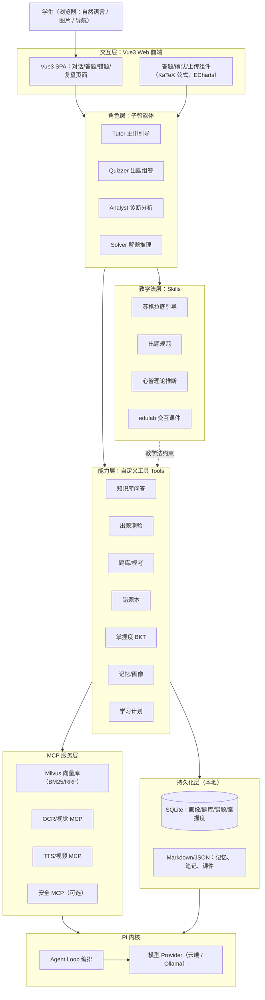

### 5.2 智能体运行流程图


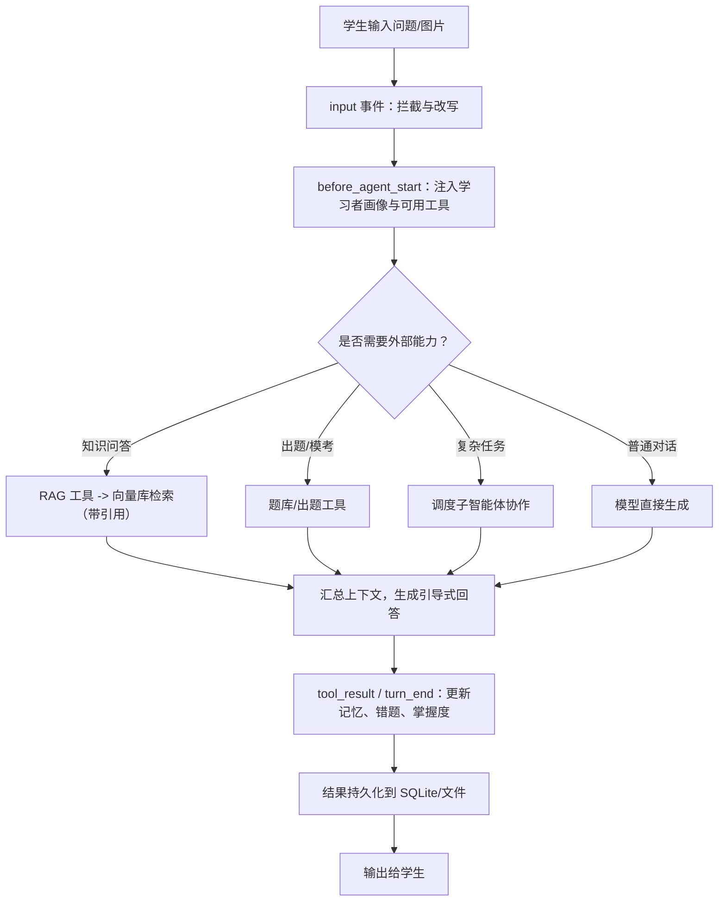

### 5.3 子智能体协作图


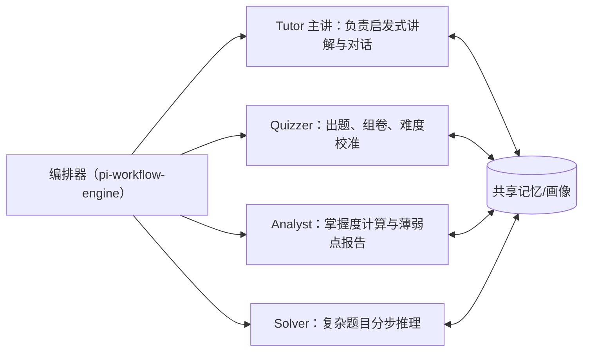

### 5.4 工程目录结构

扩展放置于 Pi 自动发现目录 `~/.pi/agent/extensions/edu-agent/`：


```
edu-agent/
├── package.json              # 依赖与 pi.extensions 入口
├── src/
│   ├── index.ts              # 注册工具/命令/钩子
│   ├── tools/                # 自定义工具
│   │   ├── document.ts       # 文档上传与解析
│   │   ├── knowledge.ts      # 知识库问答
│   │   ├── quiz.ts           # 出题测验
│   │   ├── question-bank.ts  # 题库/模考
│   │   ├── wrong-book.ts     # 错题本
│   │   ├── mastery.ts        # BKT 掌握度
│   │   ├── memory.ts         # 记忆/画像
│   │   └── plan.ts           # 学习计划
│   ├── hooks/                # before_agent_start、压缩等
│   └── store/                # SQLite 与文件读写封装
├── skills/                   # SKILL.md 教学法技能
│   ├── socratic/SKILL.md
│   ├── quiz-gen/SKILL.md
│   └── edulab/               # 移植 edulab
└── mcp.json                  # RAG / OCR / TTS / 安全 MCP
```

前端为独立 Vue3 工程（建议与后端同仓库的 `web/` 目录）：


```
web/
├── package.json
├── vite.config.ts
├── index.html
├── src/
│   ├── main.ts               # 应用入口
│   ├── App.vue
│   ├── router/               # Vue Router
│   ├── stores/               # Pinia（会话/错题/掌握度）
│   ├── api/                  # Axios 封装 + SSE EventSource
│   ├── views/                # 对话/模考/错题本/掌握度/考试复盘/计划/课件页
│   ├── components/           # 答题、上传、公式渲染组件
│   └── assets/
└── tsconfig.json
```

### 5.5 DSH Super-agent 概念的融合设计

#### 5.5.1 概念来源

DSH（DeepSeek Harness）团队提出的 **Super-agent** 是一种分层任务调度架构，核心不是 "更强的智能"，而是解决 "多个任务如何持续、可控地协同"。其要点：


* **双层架构**：Router（常驻、轻量的全局协调节点，维护跨任务上下文，通常不挂重型执行工具）+ Worker（各自独立隔离上下文、专注执行单一任务，完成后向 Router 汇报）。

* **事件驱动、异步多信道**：外部事件可主动触发任务，耗时工作进入后台后，用户仍可继续发新指令。

* **spawn 子 Agent 协议化**：分一次性（one-shot，完成即止）与可续（continuable，持久化子会话，可跨对话 / 冷启动恢复）两种生命周期。

* **上下文即日志投影**：append-only 会话日志，模型可见即可记录，支持恢复、分叉与回放；另有外部 Watchdog 负责监督与超时兜底。

* 与传统 Multi-Agent 的区别：传统 Multi-Agent 围绕 "一个复杂任务" 拆分协作；Super-agent 面向 "多个持续存在的任务"，把跨任务协调提升为独立系统层。

#### 5.5.2 融合后的 Router/Worker 架构图


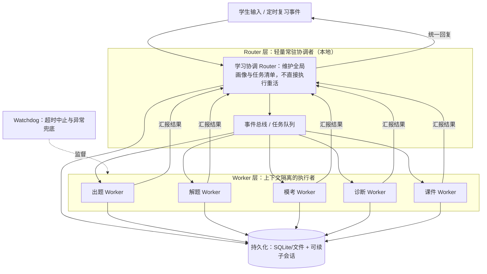

#### 5.5.3 概念映射：DSH 概念如何落到 Pi


| DSH Super-agent 概念           | 在 Pi 上的实现方式                             | 学习场景用途                   |
| ---------------------------- | --------------------------------------- | ------------------------ |
| Router（常驻全局协调，不挂重工具）         | 轻量编排扩展 + pi-workflow-engine，维护画像 / 任务清单 | 统一接收指令、分派任务、汇总回复         |
| Worker（独立上下文、单任务）            | pi-subagents spawn 隔离上下文的子智能体           | 出题 / 解题 / 模考 / 诊断互不污染主对话 |
| 事件驱动、异步后台                    | 事件总线 + 后台任务，turn\_end 续接                | 后台生成试卷 / 课件时，学生仍可继续提问    |
| spawn：one-shot / continuable | 一次性子调用 vs 持久化子会话（appendEntry + SQLite）  | 长期复习计划、错题攻克可跨会话恢复        |
| 上下文即日志、可回放                   | append-only 会话日志 + 本地存储                 | 回放 "当时怎么错的"，复盘可追溯        |
| 外部 Watchdog                  | 超时 / 工具看门狗 + 安全 MCP                     | 卡住任务超时中止、异常兜底            |

#### 5.5.4 裁剪与适配（不照搬）


1. DSH Super-agent 面向多渠道（群聊 / GitHub / 邮件）、高并行、长期在线的软件开发协作；本项目是**单用户、本地、学习场景，不做多信道接入，Router 简化为本地协调器**。

2. 学习多为串行，双层架构的主要价值在**上下文隔离 + 长程可续任务**，而非高并发。

3. Pi 默认不内置完整 Router/Worker 运行时，需用 pi-workflow-engine + pi-subagents + 自研持久化实现，**放在 P1/P2，不进入 P0 MVP**。

### 5.6 考试复盘流程（拍照识别 + 复盘）

#### 5.6.1 流程图


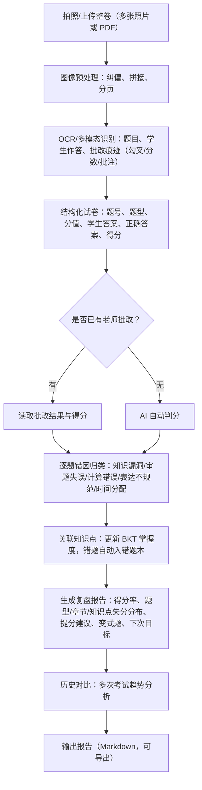

#### 5.6.2 复盘报告内容


* **总体情况**：总分、得分率、用时、与上次考试对比。

* **失分分布**：按题型、章节、知识点三个维度统计失分。

* **错因归类**：知识漏洞、审题失误、计算错误、表达不规范、时间分配。

* **行动建议**：薄弱知识点清单、变式题 / 同类题推荐、下次目标分。

* **自动联动**：错题进入错题本、更新掌握度、调整后续复习计划。

### 5.7 RAG 混合检索与重排流程

检索采用 "**混合检索 → RRF 粗融合 → Cross-Encoder 精排**" 三级管线，先保证召回覆盖，再逐步提升精度。

#### 5.7.1 检索流程图


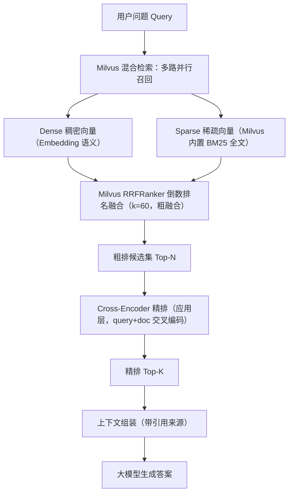

#### 5.7.2 各阶段说明


| 阶段   | 方法                              | 作用               | 典型组件 / 模型                            |
| ---- | ------------------------------- | ---------------- | ------------------------------------ |
| 混合召回 | Dense 向量 + Sparse BM25 并行       | 兼顾语义相似与关键词精确匹配   | Milvus（BGE/E5 向量 + 内置 BM25 Function） |
| 粗融合  | RRF：score = Σ 1/(k + rank)，k≈60 | 无需分数归一化，鲁棒融合多路排名 | Milvus 原生 RRFRanker（k=60）            |
| 精排   | Cross-Encoder 对 query+doc 拼接后打分 | 高精度相关性重排（应用层）    | BGE-reranker（本地）/ Cohere Rerank（云端）  |
| 生成   | 精排 Top-K 组装带引用上下文               | 交给 LLM 生成可溯源答案   | Pi 模型                                |

#### 5.7.3 关键参数（建议初始值，按评测调优）


* 每路召回：Top 50–100。

* RRF 常数：k = 60。

* 精排候选：粗排 Top 50，最终取 Top 5–10。

* 文档切片：语义 / 固定窗口 chunk，保留章节与页码元数据用于引用。

#### 5.7.4 设计理由


* 纯向量检索对专有名词、公式、术语编号等精确匹配弱，BM25 补齐关键词能力。

* 两路分数尺度不同，RRF 只看排名、免归一化，简单稳健。

* Cross-Encoder 精度高但计算慢，只对粗排后的少量候选做，兼顾效果与延迟。

#### 5.7.5 Milvus 部署形态与选型


| 形态                | 部署方式                                  | SDK / 限制                                                                   | 适配情况                 |
| ----------------- | ------------------------------------- | -------------------------------------------------------------------------- | -------------------- |
| Milvus Standalone | Docker 容器（含 etcd/MinIO），gRPC 端口 19530 | Node.js（`@zilliz/milvus2-sdk-node`）等全语言，功能完整（BM25/RRF/HNSW）                | **本项目 TS/Node 后端首选** |
| Milvus Lite       | 嵌入式本地 .db 文件，零 Docker                 | 仅 Python（PyMilvus），仅 FLAT 索引；官方仅支持 Ubuntu/macOS，**原生 Windows 不支持（需 WSL2）** | 适合 Python 路线、小规模     |
| Zilliz Cloud      | 全托管云服务                                | 全 SDK                                                                      | 数据上云，不符合本地优先，仅备选     |

**结论**：本机为 Windows + TS/Node 后端，采用 Docker 运行 Milvus Standalone；若后续确定 Python 二次开发路线，在 WSL2 或 macOS 环境下可改用 Milvus Lite 嵌入式。

#### 5.7.6 Collection 与字段设计

共两个集合：`edu_chunks`（教材 / 资料切片）与 `edu_questions`（题库 / 错题向量化，用于相似题、变式题）。

**Collection 1：edu\_chunks（知识块）**


| 字段             | 类型                    | 说明                    |
| -------------- | --------------------- | --------------------- |
| chunk\_id      | VARCHAR(100)          | 主键，auto\_id           |
| text           | VARCHAR(65535)        | 切片原文，启用 jieba 分词与文本匹配 |
| sparse\_vector | SPARSE\_FLOAT\_VECTOR | BM25 Function 自动生成    |
| dense\_vector  | FLOAT\_VECTOR(1024)   | 语义向量                  |
| subject        | VARCHAR(32)           | 学科，标量过滤               |
| source\_id     | VARCHAR(100)          | 来源文档 ID               |
| source\_name   | VARCHAR(256)          | 文档名                   |
| chapter        | VARCHAR(256)          | 章节                    |
| page           | INT64                 | 页码（引用溯源）              |
| created\_at    | INT64                 | 入库时间戳                 |

**Collection 2：edu\_questions（题库向量化）**


| 字段               | 类型                    | 说明          |
| ---------------- | --------------------- | ----------- |
| question\_id     | VARCHAR(100)          | 主键          |
| text             | VARCHAR(65535)        | 题干，jieba 分词 |
| sparse\_vector   | SPARSE\_FLOAT\_VECTOR | BM25 自动生成   |
| dense\_vector    | FLOAT\_VECTOR(1024)   | 语义向量        |
| subject          | VARCHAR(32)           | 学科          |
| knowledge\_point | VARCHAR(128)          | 知识点         |
| difficulty       | VARCHAR(16)           | 难度          |
| created\_at      | INT64                 | 入库时间戳       |

#### 5.7.7 向量维度与 Embedding 对照


| Embedding 模型      | 维度   | 适用                  |
| ----------------- | ---- | ------------------- |
| BGE-small-zh-v1.5 | 512  | 轻量、本地推理快            |
| BGE-base-zh-v1.5  | 768  | 均衡                  |
| BGE-M3            | 1024 | 中文 / 多语言强，**本项目默认** |
| BGE-large-zh-v1.5 | 1024 | 精度高、资源占用大           |

维度必须与所选模型一致，建集合后不可改；更换模型需重建集合并重新灌库。

#### 5.7.8 索引与检索参数


| 字段             | 索引类型                    | 度量     | 参数                               |
| -------------- | ----------------------- | ------ | -------------------------------- |
| dense\_vector  | HNSW（Standalone）        | COSINE | M=16，efConstruction=200，查询 ef=64 |
| sparse\_vector | SPARSE\_INVERTED\_INDEX | BM25   | —                                |


* 混合检索：dense、sparse 各发一个 AnnSearchRequest（各 limit 50），用 RRFRanker (k=60) 融合出粗排 50 条，再交应用层 Cross-Encoder 取精排 Top 5–10。

* 分区策略：单用户数据量有限，**不强制分区**，用 subject/chapter 标量字段过滤即可；确需物理隔离再按学科建 Partition（Lite 不支持分区）。

#### 5.7.9 建表 Schema 示例（Node SDK，结构化示意）


```
import { MilvusClient, DataType, FunctionType, MetricType } from '@zilliz/milvus2-sdk-node';

const client = new MilvusClient({ address: 'localhost:19530' });

// 中文分词：jieba + 仅保留中文、字母、数字
const analyzerParams = { tokenizer: 'jieba', filter: ['cnalphanumonly'] };

await client.createCollection({
  collection_name: 'edu_chunks',
  schema: [
    { field_name: 'chunk_id', data_type: DataType.VarChar, is_primary: true, autoID: true, max_length: 100 },
    { field_name: 'text', data_type: DataType.VarChar, max_length: 65535,
      analyzer_params: analyzerParams, enable_match: true, enable_analyzer: true },
    { field_name: 'sparse_vector', data_type: DataType.SparseFloatVector },
    { field_name: 'dense_vector', data_type: DataType.FloatVector, dim: 1024 },
    { field_name: 'subject', data_type: DataType.VarChar, max_length: 32 },
    { field_name: 'source_id', data_type: DataType.VarChar, max_length: 100 },
    { field_name: 'source_name', data_type: DataType.VarChar, max_length: 256 },
    { field_name: 'chapter', data_type: DataType.VarChar, max_length: 256 },
    { field_name: 'page', data_type: DataType.Int64 },
    { field_name: 'created_at', data_type: DataType.Int64 },
  ],
  functions: [{
    name: 'bm25',
    function_type: FunctionType.BM25,
    input_field_names: ['text'],
    output_field_names: ['sparse_vector'],
  }],
  index_params: [
    { field_name: 'dense_vector', index_type: 'HNSW', metric_type: MetricType.COSINE,
      params: { M: 16, efConstruction: 200 } },
    { field_name: 'sparse_vector', index_type: 'SPARSE_INVERTED_INDEX', metric_type: 'BM25' },
  ],
});
```

字段命名（如 data\_type、autoID）以实际使用的 Node SDK 版本 API 参考为准；`edu_questions` 结构同理。

#### 5.7.10 文档灌库流程


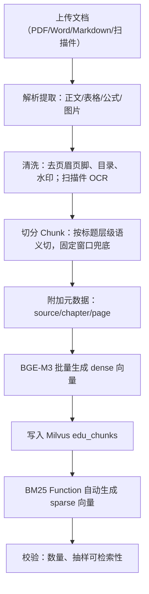

#### 5.7.11 切片策略与参数


* 优先按文档结构（标题 / 章节 / 段落）做语义切分，固定窗口兜底。

* 切片长度：500–800 中文字符，重叠 overlap 50–100，避免语义断裂。

* 表格、公式（LaTeX）整体保留，避免被切断。

* 每个 chunk 保留章节路径与页码，用于引用溯源。

* 进阶可选父子切片：小块负责精准检索，大块负责提供完整上下文。

#### 5.7.12 检索评测指标

先构建标注评测集：学生真实问题 + 人工标注相关 chunk 与标准答案，按学科分组。


| 指标          | 含义                | 关注理由           |
| ----------- | ----------------- | -------------- |
| Recall@K    | 前 K 个结果中包含相关文档的比例 | RAG 召回核心，漏检即答错 |
| Precision@K | 前 K 中相关文档占比       | 衡量噪声多少         |
| MRR         | 首个相关文档排名倒数的平均     | 正确结果是否靠前       |
| nDCG@K      | 考虑相关性等级与位置的折损增益   | 整体排序质量         |
| Hit Rate@K  | 是否至少命中一个相关文档      | 粗看可用性          |
| 引用正确率       | 答案引用是否真实支撑结论      | 防幻觉            |
| 延迟 P50/P95  | 检索 + 生成耗时         | 本地体验           |

#### 5.7.13 评测方法与方案对比


* 离线对比四种方案：纯 dense、纯 BM25、混合 + RRF、混合 + RRF + Cross-Encoder。

* 每次调整 chunk 大小、RRF k、召回数、reranker 后跑回归，比较 Recall@K、nDCG、MRR。

* 端到端小批量人工复核答案与引用，记录拒答率与引用正确率。

* 评测脚本纳入工程，保证后续改动可回归、可量化。

### 5.8 前后端分离架构（Vue3 + Node 服务）

Pi 内核不直接面向浏览器，由 Node 后端包装为本地 HTTP 服务；Vue3 SPA 通过 REST + SSE 调用。数据仍全部保存在本机，本地优先不变。

#### 5.8.1 前后端架构图


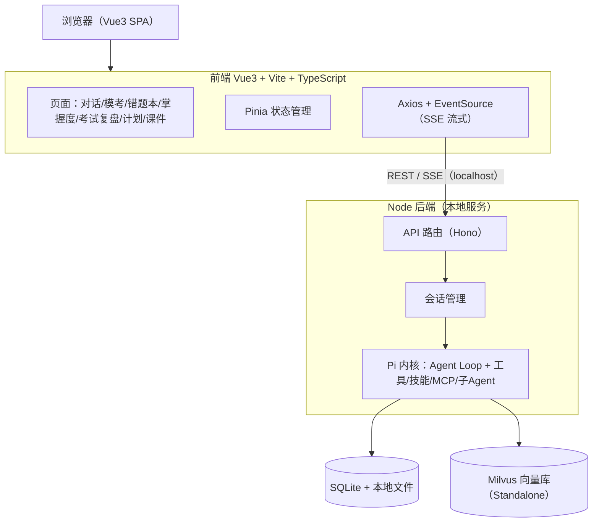

#### 5.8.2 前端页面


| 页面    | 主要功能                   |
| ----- | ---------------------- |
| 对话页   | 流式问答、图片 / 拍照上传、引用与公式渲染 |
| 模考页   | 答题、计时、交卷、解析            |
| 错题本页  | 错题列表、错因、复习推送           |
| 掌握度页  | BKT 掌握度、薄弱点、ECharts 图表 |
| 考试复盘页 | 上传整卷、复盘报告、历史趋势         |
| 计划页   | 学习计划查看与调整              |
| 课件页   | 3D 交互 HTML 课件（iframe）  |

#### 5.8.3 通信方式


* **REST**：普通查询与写入、文件上传（multipart）。

* **SSE**：对话流式输出，逐字返回（P0）。

* **WebSocket**：后台任务、可续任务的事件推送（P1）。


***

## 6. 核心模块设计

### 6.1 自定义工具（registerTool）


| 工具名                   | 输入（要点）         | 输出                              | 持久化            |
| --------------------- | -------------- | ------------------------------- | -------------- |
| knowledge.search      | 问题、学科、教材范围     | 混合检索 + RRF+Cross-Encoder 精排，带引用 | 读知识库           |
| quiz.generate         | 知识点、难度、题量      | 题目 + 答案 + 解析                    | 写测验记录          |
| bank.extract          | 试卷文件           | 结构化题目集                          | 写题库            |
| wrongbook.add         | 题目、学生答案、错因     | 错题记录                            | 写错题本           |
| mastery.update        | 知识点、作答结果       | 更新后的掌握概率                        | 写掌握度           |
| memory.recall / write | 记忆内容           | 画像 / 记忆                         | 写画像            |
| plan.make             | 目标、时间、薄弱点      | 学习计划                            | 写计划            |
| exam.recognize        | 整卷照片 / PDF（多页） | 结构化试卷（题目 / 作答 / 批改 / 分数）        | 写考试记录          |
| exam.analyze          | 考试 ID          | 逐题判分、错因、复盘报告                    | 写复盘 / 掌握度 / 错题 |
| exam.compare          | 科目、时间范围        | 多次考试趋势对比                        | 读考试记录          |

### 6.2 技能（Skills，SKILL.md）


* socratic：规定 "先提问启发、不直接给答案" 的对话流程。

* quiz-gen：出题规范、难度分级与解析模板。

* mind：心智理论，先推断学生理解状态再讲解。

* edulab：生成可离线打开的 MathJax/3D 交互 HTML 课件。

### 6.3 MCP 服务（mcp.json）


| 服务           | 用途                                   | 阶段 |
| ------------ | ------------------------------------ | -- |
| Milvus 向量库   | 文档向量化、BM25 与混合检索（Node SDK 直连，可选 MCP） | P0 |
| OCR / 视觉 MCP | 拍照题目识别、整卷 OCR 与批改痕迹识别                | P1 |
| TTS / 视频 MCP | 解题配音与视频                              | P2 |
| 安全 MCP       | 防注入、脱敏、输出过滤                          | P2 |

### 6.4 关键钩子（Hooks）


* `before_agent_start`：注入学习者画像、动态选择工具。

* `tool_call`：对危险操作做拦截（本地安全）。

* `turn_end`：在每轮结束时更新记忆与掌握度。

* `session_before_compact`：自定义压缩，保留关键学习信息。

### 6.5 后端 API 接口（REST）


| 方法   | 路径                    | 用途                             |
| ---- | --------------------- | ------------------------------ |
| POST | /api/chat             | 发起对话（SSE 流式返回）                 |
| POST | /api/documents        | 上传知识库文件（PDF/Word/TXT/MD，见 6.8） |
| GET  | /api/wrongbook        | 错题列表                           |
| POST | /api/quiz/generate    | 生成题目                           |
| POST | /api/quiz/answer      | 提交作答                           |
| GET  | /api/mastery          | 掌握度                            |
| POST | /api/exam/recognize   | 上传试卷识别                         |
| GET  | /api/exam/{id}/review | 复盘报告                           |
| GET  | /api/plan             | 学习计划                           |

### 6.6 BKT 贝叶斯知识追踪

BKT 把每个知识点视为二元隐状态（已掌握 / 未掌握），根据每次答题对错用贝叶斯更新掌握概率。

#### 6.6.1 模型参数（每个知识点一组）


| 参数    | 含义                 | 建议初始值 |
| ----- | ------------------ | ----- |
| P(L₀) | 初始掌握概率             | 0.3   |
| P(T)  | 学习转移概率（一次练习后由不会变会） | 0.1   |
| P(S)  | 失误概率（已掌握却答错）       | 0.1   |
| P(G)  | 猜测概率（未掌握却答对）       | 0.2   |

P (S)、P (G) 一般限制在 0.3 以下，避免模型把答对都解释为猜测、答错都解释为失误而退化。

#### 6.6.2 状态更新流程


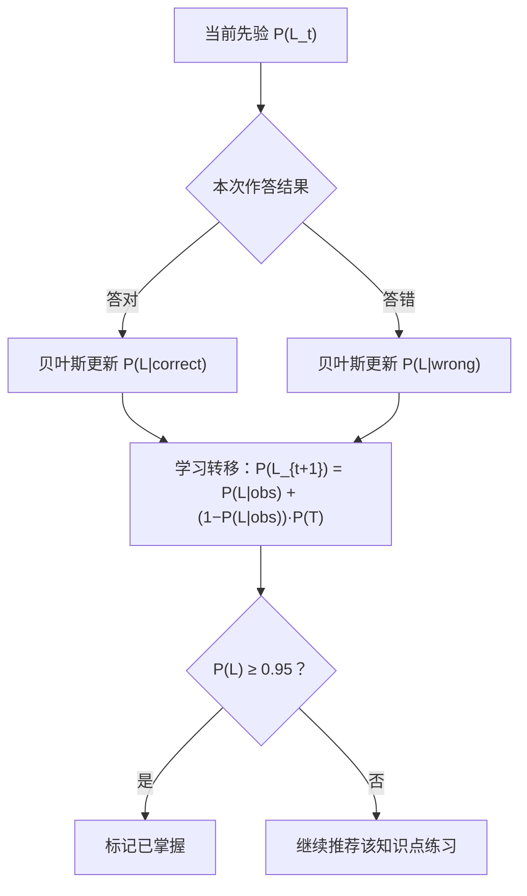

#### 6.6.3 贝叶斯更新公式

答对时：

$P(L_t \mid correct) = \frac{P(L_t)(1-P(S))}{P(L_t)(1-P(S)) + (1-P(L_t))P(G)}$

答错时：

$P(L_t \mid wrong) = \frac{P(L_t)P(S)}{P(L_t)P(S) + (1-P(L_t))(1-P(G))}$

再经学习转移得到下一次先验：

$P(L_{t+1}) = P(L_t\mid obs) + (1-P(L_t\mid obs))P(T)$

#### 6.6.4 参数估计与冷启动


* 单用户数据少，冷启动先用保守经验先验，随答题在线更新。

* 数据积累后用观测序列拟合（MLE/EM 或网格搜索），可先借用题库全局先验再做个体调整。

* 掌握阈值取 P (L) ≥ 0.95。

#### 6.6.5 与其他模块联动


* 出题 / 组卷：优先选 P (L) 低的知识点，难度自适应。

* 考试复盘：错题对应知识点 P (L) 下调，复习答对后回升。

* 掌握度页面：展示各知识点 P (L) 与趋势（ECharts）。

#### 6.6.6 局限与扩展

标准 BKT 假设知识点相互独立、不区分题目难度。后续可加入题目难度、知识点前置依赖（知识图谱约束），或升级为深度知识追踪（DKT），P1 阶段先采用标准 BKT。

### 6.7 子智能体职责与系统提示词

#### 6.7.1 职责总表


| 子智能体       | 核心职责            | 可调用工具                                    | 触发场景         |
| ---------- | --------------- | ---------------------------------------- | ------------ |
| Tutor 主讲   | 启发式对话、概念讲解、统一入口 | knowledge.search、memory.recall           | 日常答疑、概念讲解    |
| Quizzer 出题 | 出题、组卷、难度校准、解析   | quiz.generate、mastery.update             | 自动出题、模考、每日练习 |
| Analyst 诊断 | 掌握度、薄弱点、考试复盘、趋势 | mastery.update、exam.analyze、exam.compare | 诊断报告、考试复盘    |
| Solver 解题  | 复杂题分步推理、验算      | knowledge.search                         | 难题、多步推理、拍照答疑 |

#### 6.7.2 系统提示词


```
# Tutor 主讲引导
你是"智学"的主讲老师，面向一名高中生。
目标：通过启发式对话帮助学生真正理解，而不是直接给答案。
规则：
1. 先判断学生卡在哪一步，再针对性讲解。
2. 优先用提问引导学生自己思考（苏格拉底式），学生实在不会再给提示。
3. 一次只讲一个点，由浅入深，语言通俗，必要时举例。
4. 涉及教材内容时调用 knowledge.search，并标注引用来源。
5. 公式与术语规范书写；学生情绪低落时给予鼓励。
输出：简洁、分点、可直接看懂。

# Quizzer 出题组卷
你是"智学"的出题老师。
目标：按知识点和难度产出高质量题目，并依据作答校准难度。
规则：
1. 题干表述严谨、选项无歧义、答案唯一，附完整解析。
2. 难度分基础/中等/拔高，覆盖指定知识点，避免偏题怪题。
3. 根据 BKT 掌握度选择知识点与难度，薄弱点多出题。
4. 调用 quiz.generate 出题，作答后调用 mastery.update 更新掌握度。
输出：题目 + 答案 + 解析，结构清晰。

# Analyst 诊断分析
你是"智学"的诊断分析师。
目标：基于数据客观呈现掌握情况与考试问题。
规则：
1. 只用已有数据说话，不臆测、不夸大。
2. 输出结构化报告：总体、失分分布、错因归类、薄弱点、行动建议。
3. 调用 exam.analyze / exam.compare 完成复盘与趋势对比。
4. 建议要具体可执行，给出下次目标和变式题方向。
输出：Markdown 报告，结论先行。

# Solver 解题推理
你是"智学"的解题专家。
目标：对复杂题目给出严谨、可复核的分步解法。
规则：
1. 分步推理，每步写清依据，关键步骤显式标注。
2. 完成后回代验算，确认答案正确。
3. 先给完整严谨解法，再提炼给学生的引导要点（不直接代做）。
4. 必要时调用 knowledge.search 查证公式与定理。
输出：解题过程 + 验算 + 引导要点。
```

#### 6.7.3 协作与路由规则


* Tutor 为默认入口，简单问题自行处理；需出题转 Quizzer，需诊断 / 复盘转 Analyst，复杂推理转 Solver。

* 子智能体上下文隔离，结果经共享记忆 / 画像回传，由编排器统一汇总回复。

* 对应 5.5 的 Router/Worker：Tutor 侧协调逻辑即轻量 Router，其余子智能体为 Worker。

### 6.8 知识库文件上传与解析

用户可上传属于自己的资料构建个人知识库，支持 PDF、Word、TXT、Markdown 四类文件。

#### 6.8.1 上传接口规范


| 项            | 内容                                    |
| ------------ | ------------------------------------- |
| 接口           | POST /api/documents                   |
| Content-Type | multipart/form-data                   |
| 表单字段         | file（单 / 多文件）、subject（学科，可选）、tags（可选） |
| 支持格式         | .pdf、.docx、.doc、.txt、.md、.markdown    |
| 大小限制         | 单文件建议 ≤ 50MB（可配置）                     |
| 校验           | 扩展名 + MIME 双重校验，非法类型直接拒绝              |

响应字段：


| 字段                    | 说明                          |
| --------------------- | --------------------------- |
| document\_id          | 文档唯一 ID                     |
| filename / file\_type | 文件名、类型                      |
| chunk\_count          | 解析后的切片数                     |
| status                | uploaded → parsed → indexed |

#### 6.8.2 多格式解析方案


| 格式         | 解析库（Node/TS）       | 说明                      |
| ---------- | ------------------ | ----------------------- |
| PDF        | pdfjs-dist         | 提取文本；扫描件后续走 OCR         |
| Word .docx | mammoth            | 转文本 / Markdown，保留标题层级   |
| Word .doc  | word-extractor     | 老二进制格式，建议优先使用 .docx     |
| TXT        | fs + iconv-lite    | 自动识别 UTF-8/GBK 编码       |
| Markdown   | 直接读取 + gray-matter | 保留标题结构，可选处理 frontmatter |

#### 6.8.3 处理流程


1. 接收并校验文件，原文件保存到本地 `uploads/`。

2. 按类型选择解析器提取纯文本。

3. 清洗多余空白、页眉页脚。

4. 按 5.7.11 切片策略切分，附 source/chapter/page 元数据。

5. 写文档记录，状态置为 parsed；后续向量化灌库（S06）后置为 indexed。

6. 返回 document\_id 与切片数。

#### 6.8.4 文档管理接口


| 方法     | 路径                          | 用途            |
| ------ | --------------------------- | ------------- |
| GET    | /api/documents              | 文档列表          |
| GET    | /api/documents/{id}         | 文档详情与切片       |
| DELETE | /api/documents/{id}         | 删除文档（连同切片与向量） |
| POST   | /api/documents/{id}/reparse | 重新解析          |

#### 6.8.5 前端上传组件


* 基于 el-upload：支持拖拽与点选、多文件，accept 限定四类格式。

* 前置校验格式与大小，显示上传进度条。

* 列表展示处理状态（解析中 / 已入库 / 失败），支持删除与重新解析。

#### 6.8.6 错误码与异常返回约定

统一错误响应结构：


```
{
  "code": "FILE_TYPE_UNSUPPORTED",
  "message": "不支持的文件类型",
  "detail": { "filename": "notes.epub", "allowed": ["pdf", "docx", "doc", "txt", "md"] }
}
```

常见错误码：


| HTTP | code                    | 含义                 | 处理建议    |
| ---- | ----------------------- | ------------------ | ------- |
| 400  | FILE\_TYPE\_UNSUPPORTED | 不支持的文件类型           | 检查扩展名   |
| 400  | FILE\_EMPTY             | 空文件                | 重新选择    |
| 409  | DOCUMENT\_EXISTS        | 重复上传（哈希命中）         | 去重或覆盖   |
| 413  | FILE\_TOO\_LARGE        | 超过大小限制             | 拆分或调高限制 |
| 415  | INVALID\_MIME           | MIME 与扩展名不符        | 确认真实格式  |
| 422  | PARSE\_FAILED           | 解析失败（损坏 / 加密 / 乱码） | 解密或换文件  |
| 500  | STORAGE\_ERROR          | 本地存储 / 磁盘异常        | 检查磁盘与权限 |
| 507  | DISK\_FULL              | 磁盘空间不足             | 清理空间    |

多文件上传采用 "部分成功"：每个文件独立返回状态，整体返回 207 Multi-Status，成功的入库、失败的给出原因。

#### 6.8.7 文件夹批量导入


* 前端：通过 webkitdirectory 选择整个文件夹（或拖拽文件夹），递归收集四类文件，相对路径作为章节 / 分类元数据。

* 后端：接口仍走 /api/documents（多文件），或新增 POST /api/documents/batch；按目录结构组织，逐个解析并汇总，按文件哈希去重。

* 限制：设文件总数与总大小上限，超限分批；返回每个文件的处理状态汇总。

#### 6.8.8 扫描件 / 图片型 PDF 的 OCR 兜底

部分 PDF 正文为整页图片（如本资料 108 页全为位图，仅页脚有文字），常规文本提取为空，需走 OCR。

**判定与处理流程：**

- 提取文本后若正文长度低于阈值（或页面含大图、文本极少），判定为图片型。
- 页面按 200–300 DPI 渲染为图片，逐页 OCR，版面恢复为 Markdown 后再切片。

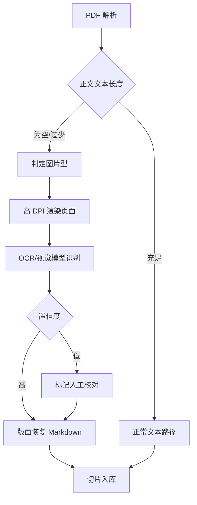

**OCR 技术选型：**

| 方案 | 技术 | 优点 | 适用 |
|---|---|---|---|
| 本地 OCR | RapidOCR / PaddleOCR、Tesseract(chi_sim) | 离线、隐私、免费 | 常规中文文字 |
| 公式 OCR | pix2tex(LaTeX-OCR)、UniMERNet | 公式转 LaTeX | 数学公式 |
| 视觉大模型 | GPT-4o / Qwen-VL / Gemini 整页识别 | 排版、表格、公式结构好，直接出 Markdown | 复杂版面（本资料推荐） |

本实现默认走视觉大模型（本资料推荐）：提示词要求保留标题/段落/列表/表格、公式转 LaTeX、插图标注 `[图]`，直接产出 Markdown；本地 RapidOCR/PaddleOCR 作为可选的隐私离线路径（`scripts/rapidocr_bridge.py`），未安装时自动回退视觉模型；本地识别置信度低或公式密度高时也会升级到视觉模型。公式转 LaTeX 由视觉模型统一完成，无需单独的 pix2tex/UniMERNet 服务。

**工程与前端：**

- 多页 OCR 异步执行，复用可续任务与 WS 进度，结果缓存不重复识别；文本页直接提取、图片页 OCR 混合处理。
- 质量校验：按 OCR 平均置信度逐页打分，低于阈值的页面标记待校对，提供原文图与识别文本对照的人工校对界面，校对后写回。
- 前端检测到图片型 PDF 时提示"扫描件将进行 OCR，需几分钟"，显示进度与低置信页校对入口。

**本版本落地（v0.26，2026-11-08）：**

- 判定：逐页提取文本 + OperatorList 大图覆盖率；单页正文少于 30 字且整页图片覆盖 ≥ 40% 记为需 OCR，需 OCR 页达到 50% 即判为图片型 PDF 并进入异步任务；文本充足页仍直接提取（混合处理）。
- 渲染：`pdfjs-dist` + `@napi-rs/canvas`，默认 200 DPI（`OCR_DPI`，150–320），页面 JPEG 存 `uploads/ocr/<document_id>/page-xxxx.jpg`，同时供 OCR 与人工校对。
- 引擎：`OCR_ENGINE=auto|vision|local`。`auto` 优先本地 RapidOCR（`server/scripts/rapidocr_bridge.py`，需 `python -m pip install rapidocr onnxruntime`），不可用或结果不可靠时用视觉模型；视觉模型直接输出 Markdown + LaTeX，覆盖公式与复杂版面。
- 质量分：逐页置信度 = 模型自评 + 乱码/重复/“无法识别”惩罚 + 图像清晰度上限（拉普拉斯高频能量/灰度对比度，防模糊页虚高），默认阈值 0.8（`OCR_CONFIDENCE_THRESHOLD`）；低于阈值或识别为空/失败标记待校对。
- 任务：`ocr_jobs` / `ocr_pages` 落库；服务重启恢复 queued/running 任务，已完成页与已确认页直接复用；`OCR_CONCURRENCY`（默认 2）并发识别，`OCR_TIMEOUT_MS`（默认 180s）单页超时。
- 接口：`GET /api/documents/:id/ocr`（进度与逐页结果）、`GET /api/documents/:id/ocr/pages/:page/image`（原文图）、`PUT /api/documents/:id/ocr/pages/:page`（校对保存/标记已校对）、`POST /api/documents/:id/ocr/confirm`（重新切片并灌库）、`POST /api/documents/:id/ocr/retry`（重跑）。
- 前端：图片型 PDF 上传返回 202 + `ocr_queued`；资料列表显示“待 OCR / OCR 中 / 待校对”、页数进度条与校对入口；校对弹层左侧原文图、右侧 Markdown 编辑，全部低置信页标记后“写回并重新入库”。

### 6.9 模型与密钥管理

用户可输入自己的 API Key 接入并切换不同厂商模型，并设置思考强度（推理预算）。密钥仅本地加密存储，不上传。

#### 6.9.1 支持的 Provider


| Provider  | 接入方式               | 典型模型           |
| --------- | ------------------ | -------------- |
| OpenAI    | 官方 API / OpenAI 兼容 | GPT、o 系列       |
| Anthropic | 官方 API             | Claude 系列      |
| Google    | 官方 API             | Gemini 系列      |
| DeepSeek  | OpenAI 兼容          | DeepSeek-V3/R1 |
| 通义 / 智谱等  | OpenAI 兼容          | Qwen、GLM 等     |
| Ollama 本地 | OpenAI 兼容，无需 Key   | 本地开源模型         |

#### 6.9.2 API Key 安全存储


* 各 provider 的 key 独立保存，本地 AES 加密（密钥结合本机信息派生）。

* 前端密码框掩码输入、可切换显隐，回显仅显示掩码；支持更新与删除。

* 保存前做一次最小调用校验 key 有效性；切换 / 删除不影响已有学习数据。

#### 6.9.3 思考强度（Reasoning Effort）


| 档位    | 映射参数                                     | 适用           |
| ----- | ---------------------------------------- | ------------ |
| 低（节能） | reasoning\_effort=low / 小 budget\_tokens | 日常对话、快速问答    |
| 中（均衡） | medium / 中等预算                            | 一般讲解、出题      |
| 高（深度） | high / 大 budget\_tokens                  | 难题、多步推理、考试复盘 |


* 不同厂商参数名不同，由后端统一映射；非推理模型忽略该参数。

* 可设全局默认，也可单次对话临时调整；强度越高推理越充分，但延迟更长、消耗更多。

#### 6.9.4 接口


| 方法   | 路径                      | 用途                   |
| ---- | ----------------------- | -------------------- |
| GET  | /api/settings/providers | 可用 provider 与模型列表    |
| GET  | /api/settings/model     | 当前模型与思考强度            |
| PUT  | /api/settings/model     | 切换 provider / 模型     |
| PUT  | /api/settings/apikey    | 保存 / 更新 / 删除 API Key |
| PUT  | /api/settings/reasoning | 设置思考强度               |
| POST | /api/settings/test      | 测试连接、校验 Key          |

#### 6.9.5 前端设置页


* Provider 与模型下拉选择；API Key 密码输入（掩码、显隐切换）+ 测试连接状态提示。

* 思考强度分段控件，附各档说明；本地 Ollama 无需 key，仅配置 base\_url。

#### 6.9.6 生成参数配置


| 参数              | 含义                | 建议值             |
| --------------- | ----------------- | --------------- |
| temperature     | 采样温度，控制随机性        | 0.3–0.7（学习场景偏低） |
| top\_p          | 核采样比例             | 0.9–1           |
| max\_tokens     | 单次最大输出长度          | 按模型能力设置         |
| context\_length | 上下文窗口，超出触发压缩 / 截断 | 按模型上限配置         |

可按场景（答疑 / 出题 / 复盘）设默认值，前端可调整并保存。

#### 6.9.7 多 Key 与故障切换


* 同一 provider 支持配置多个 key，按轮询 / 随机负载分担。

* 出现 429 限流、401 失效、5xx、超时等自动切换下一个 key 或备用模型。

* 连续失败的 key 进入冷却熔断，健康检查通过后恢复；记录每次失败与切换原因。

### 6.10 模型用量统计

#### 6.10.1 记录字段（USAGE\_RECORD）


| 字段                                                  | 说明                |
| --------------------------------------------------- | ----------------- |
| usage\_id                                           | 主键                |
| provider / model                                    | 厂商、模型             |
| scenario                                            | 场景（答疑 / 出题 / 复盘等） |
| prompt\_tokens / completion\_tokens / total\_tokens | token 用量          |
| reasoning\_tokens                                   | 思考 token          |
| latency\_ms                                         | 延迟                |
| cost                                                | 估算费用（本地模型为 0）     |
| success / error                                     | 是否成功、错误信息         |
| created\_at                                         | 时间                |

#### 6.10.2 统计维度


* 按天 / 模型 / 场景 / 学科统计调用次数、token、成本、成功率、平均延迟。

* 支持累计与趋势；可设月度预算 / 配额，接近阈值告警。

* 数据取自模型响应的 usage 字段，本地模型按可用字段估算。

#### 6.10.3 接口


| 方法  | 路径                 | 用途           |
| --- | ------------------ | ------------ |
| GET | /api/usage/summary | 汇总（时间范围、维度）  |
| GET | /api/usage/daily   | 每日明细         |
| GET | /api/usage/cost    | 成本统计         |
| GET | /api/usage/export  | 导出（CSV/JSON） |

#### 6.10.4 前端


* ECharts 展示 token 用量、成本趋势、调用次数、成功率与延迟。

* 预算进度条与超阈值告警提示。

### 6.11 回复完整性保障（防截断与自动续写）

针对回复在中途被截断（如句子未说完、括号未闭合、代码 / Mermaid 未结束）的问题，建立 "检测 — 自动续写 — 手动兜底" 机制。

#### 6.11.1 根因与信号


| 根因             | 检测信号                   |
| -------------- | ---------------------- |
| max\_tokens 不足 | finish\_reason=length  |
| 流式中断 / 网络异常    | SSE 断开、未收到结束事件         |
| 上下文超限          | 输入长度超过 context\_length |
| 结构未闭合          | 代码围栏数为奇数、括号 / 表格未闭合    |
| 模型 / 网关错误      | 5xx、多 key 切换失败         |

#### 6.11.2 截断检测


* 响应 finish\_reason 为 length 即判定截断。

* 文本末尾无句末标点，或括号、Markdown 围栏、Mermaid、表格未成对闭合。

* 流式未收到正常结束事件即按异常中断处理。

#### 6.11.3 自动续写流程


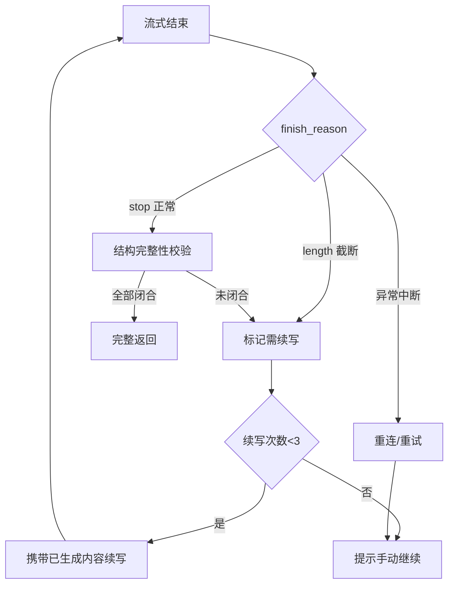

#### 6.11.4 续写与重试策略


* 自动续写：携带已生成内容，提示 "从断点继续，不要重复"，最多 3 次，防止死循环。

* 动态 max\_tokens：按场景给足上限，长输出（讲解 / 复盘）预留空间并结合 context 预算。

* 异常中断先重连 / 重试再续写，续写片段去重后拼接。

#### 6.11.5 处理逻辑（伪代码）


```
流式结束(响应, 已生成文本):
    截断 = 响应.finish_reason == "length" 或 结构不完整(已生成文本)
    if 截断:
        if 续写次数 < 3:
            追加 = 调用模型("从断点继续，勿重复", 前缀=已生成文本)
            已生成文本 += 追加
            流式结束(追加, 已生成文本)
        else:
            显示"点击继续"按钮
    else:
        返回完整文本
```

#### 6.11.6 前端兜底


* 检测到截断显示 "输出被截断，点击继续" 按钮，支持手动续写与重新生成。

* 展示加载 / 重试状态和异常提示，已生成内容不丢失。

### 6.12 会话管理与多模态输入

#### 6.12.1 历史会话缓存与继续


* 每个会话与消息持久化到本地 SQLite，开新对话后旧会话完整保留。

* 历史会话列表支持按时间分组、自动摘要标题、搜索、重命名、置顶、删除。

* 重新打开即加载历史消息，可在原上下文继续对话；消息分页加载，前端缓存最近会话。


| 方法     | 路径                               | 用途            |
| ------ | -------------------------------- | ------------- |
| GET    | /api/conversations               | 会话列表（搜索 / 分页） |
| POST   | /api/conversations               | 新建会话          |
| GET    | /api/conversations/{id}          | 会话详情与消息       |
| PUT    | /api/conversations/{id}          | 重命名 / 置顶      |
| DELETE | /api/conversations/{id}          | 删除会话          |
| POST   | /api/conversations/{id}/messages | 在该会话继续对话      |

#### 6.12.2 拍照与图片发送


* 对话框支持拍照（调用摄像头）或选择本地图片，可多图、预览、压缩。

* 图片本地存储，以 base64/URL 传入视觉模型（GPT-4o、Gemini、Qwen-VL 等）。

* 非视觉模型先走 OCR 提取文字；用于拍照答疑、试卷识别、错题截图。

* 接口：POST /api/media/upload；对话接口支持 image 类型消息。

#### 6.12.3 语音输入与语音识别


* 麦克风录音，支持按住说话 / 点击录音，显示波形与时长。

* ASR 方案：本地 faster-whisper /whisper.cpp（隐私优先）或云端 ASR API。

* 识别文字进入输入框，可编辑后再发送。

* 接口：POST /api/asr（音频转文字）。语音播报（TTS）可作为后续扩展。

#### 6.12.4 输入处理流程


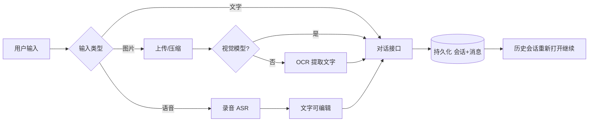

#### 6.12.5 语音播报（TTS）


* 模型回复支持一键朗读，可开启自动播放。


| 方案                 | 说明         |
| ------------------ | ---------- |
| 本地 edge-tts /piper | 离线、免费，隐私优先 |
| 云端 TTS API         | 音色丰富、效果好   |


* 支持音色选择、语速 / 音量调节、播放控制（暂停 / 停止）与逐句跟读，适合英语听力与发音练习。

* 接口：POST /api/tts（文字转音频）。

#### 6.12.6 多媒体存储与清理


* 图片、录音、TTS 音频统一存本地 media 目录，按日期 / 类型分目录，数据库只存路径引用。

* 清理策略：删除会话连带删除关联媒体；定期检测孤儿文件（无引用）并清理；可配置保留周期与存储配额，超阈值告警；图片压缩、音频统一码率。

* 接口：GET /api/media/storage（用量）、POST /api/media/cleanup（清理）。

### 6.13 MCP 自选接入

**结论：可行。** Pi 原生支持 MCP，用户可像安装浏览器扩展一样自选接入 MCP server，其暴露的工具自动注册给智能体调用。

#### 6.13.1 配置结构


```
{
  "name": "web-search",
  "transport": "stdio",
  "command": "npx",
  "args": ["-y", "@modelcontextprotocol/server-xxx"],
  "env": { "API_KEY": "***" },
  "enabled": true
}
```

远程服务改用 transport=http/sse 并填写 url；env 中的密钥加密存储。

#### 6.13.2 接入流程


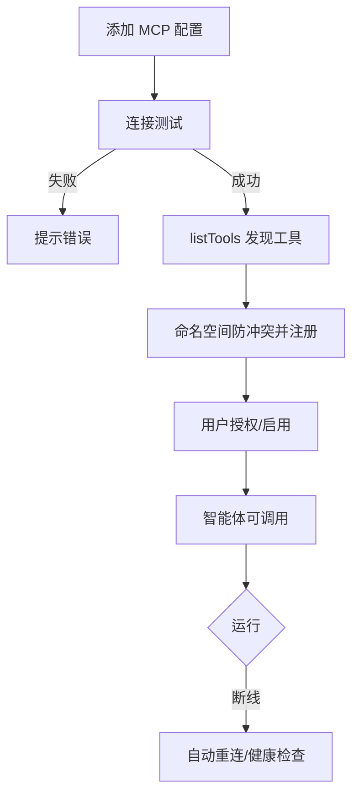

#### 6.13.3 工具发现与注册


* 连接后 listTools 自动发现工具，注册到 Pi 工具表，与内置 / 自定义工具统一管理。

* 以 server 名加前缀避免命名冲突，工具可单独启用 / 禁用。

* 传输支持 stdio 本地进程（npx/uvx）与远程 SSE/HTTP，含断线重连、超时与健康检查。

#### 6.13.4 安全与权限


* 安装前提示来源与权限风险（本地命令、远程服务）。

* 敏感 env/key 加密存储，不回传给模型。

* 有副作用的工具首次调用需确认，支持白名单与最小权限；远程来源校验并结合安全 SDK 防注入。

#### 6.13.5 接口


| 方法     | 路径                         | 用途            |
| ------ | -------------------------- | ------------- |
| GET    | /api/mcp/servers           | MCP server 列表 |
| POST   | /api/mcp/servers           | 添加配置          |
| PUT    | /api/mcp/servers/{id}      | 编辑 / 启停       |
| DELETE | /api/mcp/servers/{id}      | 删除并断开         |
| POST   | /api/mcp/servers/{id}/test | 连接测试          |
| GET    | /api/mcp/tools             | 已发现工具与授权状态    |

#### 6.13.6 前端与生态


* MCP 管理页：添加向导、连接状态、工具列表、授权开关与日志。

* 内置常用 MCP 推荐清单与一键安装模板（本地维护，不做中心化商店）。

### 6.14 统一可视化引擎（交互课件 + 自动可视化合并）

将原 "交互课件" 与 "自动可视化" 两个入口合并为一个统一可视化模块，前端只保留一个入口，后端同一套 spec 与渲染组件。


* 统一入口：拍照 / 提问后自动判定，优先匹配预置交互课件库（edulab），命中即调用；未命中则按题目动态生成 spec，两条路径输出统一可视化对象。

* 统一渲染：3D 用 Three.js、函数用 function-plot、分子用 3Dmol，预置课件与动态生成共用渲染器，交互能力一致。

* 统一管理：课件与生成结果在同一面板展示，支持旋转缩放、标注、辅助线、动画与截图。

后续 6.14.1–6.14.8 为该引擎的判定、规格与渲染细节。

#### 6.14.1 识别与判定


* 拍照后经多模态 / OCR 识别题目（复用 exam.recognize）。

* 模型理解题目，判定学科与可视化类型，由 visualize.generate 工具输出结构化规格（spec）。

* 类型：geometry3d（立体几何）、function2d/function3d（函数）、conic（圆锥曲线）、molecule（化学分子）、terrain（地理地形）、biology（生物结构）、physics（受力 / 电路 / 光路）、diagram（通用示意）。

#### 6.14.2 可视化规格（spec）


```
{
  "type": "geometry3d",
  "title": "正方体与截面",
  "points": [
    { "id": "A", "coord": [0, 0, 0] },
    { "id": "B", "coord": [1, 0, 0] }
  ],
  "edges": [["A", "B"]],
  "faces": [["A", "B", "C", "D"]],
  "auxiliary": [{ "kind": "plane", "points": ["A", "C", "E"] }],
  "labels": true
}
```

函数类型使用 type=function2d，字段含 expression（表达式）、variable（变量）、range（区间）、features（交点 / 极值 / 面积）。

#### 6.14.3 分学科渲染方案


| 类型    | 渲染技术                           | 能力                          |
| ----- | ------------------------------ | --------------------------- |
| 立体几何  | Three.js                       | 旋转 / 缩放、点线面标注、辅助线、截面、展开、动画  |
| 函数 2D | function-plot / SVG / GeoGebra | 显式 / 隐式 / 参数方程、坐标轴、交点、极值、面积 |
| 函数 3D | Three.js 曲面                    | 二元函数曲面、等高线                  |
| 化学分子  | 3Dmol.js                       | 分子 / 蛋白结构、球棍 / 空间填充模型       |
| 地理    | Three.js 地形 / 地图               | 地形、等高线、地球仪、洋流大气             |
| 生物    | 预置 3D 模型库 + 标注                 | 细胞、器官、生态系统                  |
| 物理    | SVG / Three.js                 | 受力、电路、光路、运动轨迹               |

#### 6.14.4 生成流程


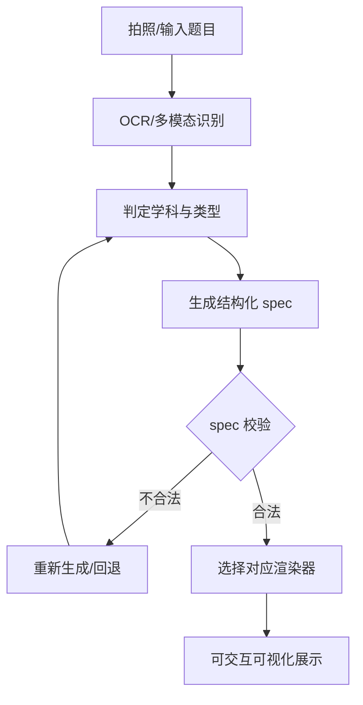

#### 6.14.5 前端交互


* 可视化内嵌对话，支持旋转、缩放、重置视角、全屏与截图。

* 标注 / 辅助线 / 截面开关与动画播放；题目元素与模型联动高亮。

#### 6.14.6 安全与兜底


* 函数表达式用 math.js 安全解析，禁用 eval，防注入。

* spec 做类型、数值与范围校验；无法自动生成时回退预置模型库或 GeoGebra 嵌入。

#### 6.14.7 几何辅助元素增强

模型根据解题需要自动补全辅助元素，可逐条显示 / 隐藏。


| 辅助元素           | 说明                   |
| -------------- | -------------------- |
| 辅助线 / 延长线      | 连接关键点，虚线表示           |
| 辅助平面 / 截面      | 半透明延展平面              |
| 垂线 / 高         | 点到面 / 线垂线、垂足         |
| 中点 / 中线 / 角平分线 | 等分标记                 |
| 平行线            | 平移关系                 |
| 投影             | 点在面 / 线投影及投影线        |
| 标注             | 直角符号、角弧、等长记号、长度 / 角度 |
| 隐藏线            | 被遮挡棱用虚线              |
| 动点轨迹 / 旋转翻折    | 动画呈现                 |


* 模型输出每条辅助线的添加理由（为什么加、用来证什么），跟随讲解步骤逐条出现。

* spec 用 auxiliary 数组，kind 区分类型，style 控制虚线 / 颜色 / 透明度。

#### 6.14.8 多函数数形结合

同一坐标系叠加多个函数并做关系分析。


```
{
  "type": "function2d",
  "functions": [
    { "expression": "x^2", "color": "#409eff", "label": "y=x²" },
    { "expression": "x+2", "color": "#f56c6c", "label": "y=x+2" }
  ],
  "range": [-3, 4],
  "relations": [{ "kind": "intersection", "solve": "x^2=x+2" }],
  "regions": [{ "where": "x^2 < x+2", "fill": "rgba(64,158,255,0.2)" }],
  "sliders": []
}
```


* 多函数同图：不同颜色 / 线型 / 图例，可单独显隐。

* 自动标注：交点（解方程 f=g）、零点、极值、渐近线、切点、对称轴。

* 数形结合：方程看交点、不等式看区域填充、分段函数分段绘制。

* 动态：参数滑块驱动动直线 / 动曲线，观察根与交点变化；并与解析几何（直线与圆锥曲线）联动。

### 6.15 响应速度优化方案

针对回答过慢，从 "感知速度" 与 "实际速度" 两条线优化，按优先级落地。

#### 6.15.1 优化措施总表


| 类别   | 措施                                | 优先级 | 主要收益          |
| ---- | --------------------------------- | --- | ------------- |
| 流式体验 | 全程 SSE，首字优先返回（TTFT）               | P0  | 降低感知等待        |
| 模型路由 | 快模型默认、思考强度默认调低                    | P0  | 降低实际生成耗时      |
| 上下文  | 精简 RAG 片段、历史与提示词                  | P0  | 减少 prefill 耗时 |
| 缓存   | 语义缓存、embedding 缓存、预热              | P1  | 命中即秒回         |
| 检索链路 | 简化 Cross-Encoder、减少 agent 层数、并行调用 | P1  | 减少串行等待        |
| 工程网络 | 就近节点、连接池、本地 GPU / 量化              | P1  | 降低网络与推理延迟     |

#### 6.15.2 关键措施说明


* **首字优先**：后端先建立 SSE 连接并推送起始事件，模型流式输出，用户无需等待完整结果。

* **模型分级路由**：简单问题走 mini/flash 等快模型，难题才用大模型或推理模型；推理模型默认 low 思考强度，深度任务再调高；高频简单问答可用本地小模型，零网络往返。

* **精简输入**：RAG 只传 Top 3–5 最相关片段；历史对话摘要加截断，只保留近期与摘要；画像 / 记忆按需注入，控制 context\_length。

* **缓存与预热**：语义缓存让相似问题直接命中答案；prompt 哈希精确缓存；embedding 结果缓存，文档不变不重算；常见知识点讲解预生成。

* **检索与链路**：简单查询跳过 Cross-Encoder（额外模型推理）或换轻量 reranker；减少子智能体跳转层数，简单问题单轮直出；可并行的工具与子任务并发执行；限制 max\_tokens 避免冗长。

* **工程网络**：选择就近低延迟 endpoint，连接池 keep-alive 复用；本地模型用 GPU 与量化加速，媒体 / 模型服务本地部署减少往返。

#### 6.15.3 效果度量

借助 6.10 用量统计的 latency\_ms，持续监控首字延迟与端到端 P50/P95，按数据验证每项优化的实际收益。


***

## 7. 数据设计

### 7.1 数据模型关系图（ER 图）


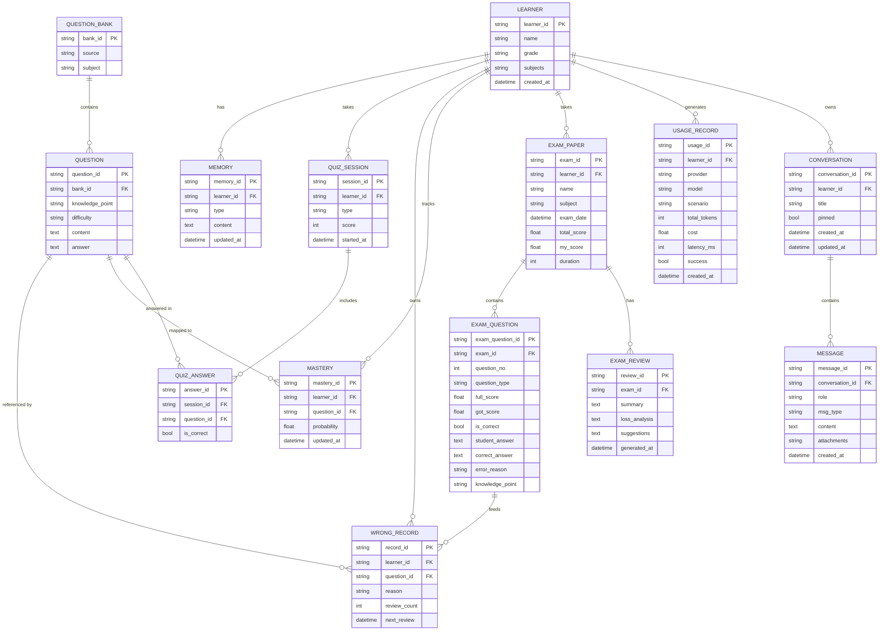

### 7.2 存储策略


* 结构化数据（画像、题库、错题、掌握度、测验）：本地 SQLite。

* 非结构化内容（长期记忆、笔记、生成的课件）：Markdown/JSON 文件，便于查看与迁移。

* 全部数据默认仅存本地，不上传；云端模型仅在调用时发送必要内容。


***

## 8. 开发路线


| 阶段     | 目标       | 交付内容                                                                       | 参考周期  |
| ------ | -------- | -------------------------------------------------------------------------- | ----- |
| P0 MVP | 跑通最小学习闭环 | Node 本地服务 + Vue3 前端（对话 / 错题 / 出题页面）+ 记忆画像、错题本、出题 3 个工具 + 1 个 RAG MCP       | 数天    |
| P1     | 完整学习与诊断  | 前端完整页面（模考 / 复盘 / 掌握度）、题库提取、模考、BKT 掌握度、4 个子智能体、拍照答疑、考试复盘、Router/Worker 双层编排 | 1–2 周 |
| P2     | 体验增强与安全  | edulab 交互课件、解题视频、安全 MCP、事件驱动后台与 Watchdog                                   | 数周    |


***

## 9. 部署与运行环境

### 9.1 环境要求


* 操作系统：Windows /macOS/ Linux（本机为 Windows）。

* 运行时：Node.js（Pi 运行环境）。

* 向量库：Docker Desktop（运行 Milvus Standalone）；Python 路线在 WSL2/macOS 下可用 Milvus Lite。

* 可选本地模型：Ollama，提供 OpenAI 兼容接口（`http://localhost:11434/v1`）。

### 9.2 模型配置策略


| 模式        | 适用            | 特点                       |
| --------- | ------------- | ------------------------ |
| 云端模型      | 追求效果、有网络      | 能力强，按 token 计费，需 API Key |
| 本地 Ollama | 隐私优先、零 API 费用 | 数据不出本机，对硬件有一定要求          |

### 9.3 启动方式（规划）


* 后端服务：`npm run dev:server` 启动 Node 本地服务（内嵌 Pi）。

* 前端开发：`npm run dev` 启动 Vite（默认 [http://localhost:5173](http://localhost:5173)）。

* 生产运行：`npm run build` 构建前端，由后端托管，浏览器访问本地端口。

* 扩展调试：`pi -e ./src/index.ts` 可单独快速测试扩展逻辑。


***

## 10. 安全与隐私


1. 本地优先：学习数据默认存储在本机，不主动外发。

2. 扩展安全：扩展拥有系统权限，仅加载可信来源，危险工具调用经 `tool_call` 拦截。

3. 预留安全 MCP：P2 接入安全 SDK，实现 prompt 注入防护、不当输出过滤、PII 脱敏。

4. 最小上传：调用云端模型时仅发送必要上下文，敏感信息先脱敏。


***

## 11. 风险与权衡


| 风险 / 问题     | 说明                         | 应对                          |
| ----------- | -------------------------- | --------------------------- |
| 代码不能直接搬运    | DeepTutor 为 Python，Pi 为 TS | 复用思路、Skill、MCP，有状态工具用 TS 重写 |
| 掌握度 / 题库需自研 | BKT、抽题、记忆为确定性逻辑            | 算法复杂度可控，分阶段实现并单测            |
| 解题视频工作量大    | 涉及 TTS 与渲染管线               | 优先接外部 MCP，不早期自研             |
| 本地模型能力受限    | 小模型在复杂推理上较弱                | 关键任务可切换云端模型，混合使用            |
| 框架演进风险      | 依赖 Pi 与 MCP 生态             | 关注官方仓库活跃度，核心逻辑与框架解耦         |


***

## 12. 验收标准（P0 MVP）


1. 扩展可被 Pi 自动发现并加载，无报错。

2. 可上传一份资料并完成一次带引用的 RAG 问答。

3. 可针对指定知识点生成题目并记录作答。

4. 答错的题目可自动进入错题本并持久化，重启后仍存在。

5. 学习者画像可在新会话中被读取并注入上下文。

6. 可通过浏览器访问 Vue3 前端，完成一次流式对话并看到引用来源。


***

## 13. 多轮对话实施计划

本项目无法在一次对话内完成，按 "**每次对话只做一个可独立验收的小闭环**" 拆分为 8 个阶段、18 次对话，严格按依赖推进。

### 13.1 总体原则


* 单次对话只完成表中一个任务（S01–S23），不贪多；任务过大当场再拆。

* 每次产出必须可运行、可验证，再进入下一次对话。

* 本计划基于当前 TS + Node + Vue3 技术栈；若最终改用 Pi Python 路线，工具 / 服务实现语言改为 Python，对话拆分与验收逻辑不变。

### 13.2 会话衔接机制

每次新对话的固定开场动作：让 AI 先读 ①本设计文档 ②`PROGRESS.md` ③本次模块相关代码，确认进度后再动手。每次对话收尾：更新 `PROGRESS.md` 并 git commit。

`PROGRESS.md` 模板：


```
# 智学 实施进度
当前阶段：
已完成对话：
下一步对话（编号+目标）：
关键文件/接口：
遗留问题与风险：
```

### 13.3 阶段路线图


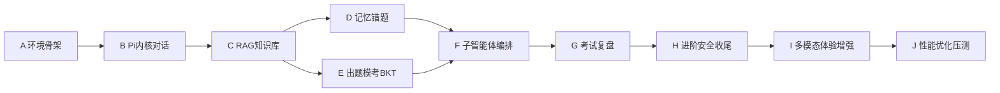

### 13.4 对话任务表

**阶段 A：环境与骨架**


| 编号  | 主题   | 目标与产出                                                  | 验收               | 前置  |
| --- | ---- | ------------------------------------------------------ | ---------------- | --- |
| S01 | 环境搭建 | Node、Docker Desktop、Milvus Standalone（19530）、可选 Ollama | Milvus 健康检查通过    | —   |
| S02 | 工程骨架 | monorepo：server (Hono)+web (Vite/Vue3)、目录与 TS 配置       | 前后端启动，/health 联通 | S01 |

**阶段 B：Pi 内核与对话**


| 编号  | 主题     | 目标与产出                                      | 验收       | 前置  |
| --- | ------ | ------------------------------------------ | -------- | --- |
| S03 | 接入 Pi  | 后端内嵌 Pi，封装 /api/chat（非流式）+ provider/key 配置 | 接口可完成对话  | S02 |
| S04 | 流式与对话页 | SSE 流式 + 前端对话页（EventSource、气泡、KaTeX）       | 浏览器可流式对话 | S03 |

**阶段 C：RAG 知识库**


| 编号  | 主题        | 目标与产出                                            | 验收           | 前置  |
| --- | --------- | ------------------------------------------------ | ------------ | --- |
| S05 | 文档解析切片    | /api/documents 上传，PDF/Word/MD 解析与 chunk          | 切片结果正确、带元数据  | S04 |
| S06 | Milvus 灌库 | 建 collection，BGE-M3 dense + BM25 Function sparse | 数据可写入并检索     | S05 |
| S07 | 混合检索闭环    | 混合检索 + RRFRanker+Cross-Encoder + 引用，前端问答 / 引用展示  | 带引用 RAG 问答跑通 | S06 |

**阶段 D：记忆与错题（可与 E 并行）**


| 编号  | 主题     | 目标与产出                                 | 验收          | 前置  |
| --- | ------ | ------------------------------------- | ----------- | --- |
| S08 | 记忆画像   | SQLite 表、memory 工具、钩子注入、wrongbook.add | 画像可跨会话读取    | S07 |
| S09 | 错题本与复习 | 错题前端列表 + 间隔复习调度（SM-2 简化）              | 错题持久化、复习可推送 | S08 |

**阶段 E：出题模考与 BKT（可与 D 并行）**


| 编号  | 主题      | 目标与产出                                | 验收       | 前置  |
| --- | ------- | ------------------------------------ | -------- | --- |
| S10 | 出题工具    | quiz.generate + 前端答题组件               | 可出题并记录作答 | S07 |
| S11 | 题库与模考   | bank.extract、模考计时 / 交卷 / 解析          | 完整模考流程跑通 | S10 |
| S12 | BKT 掌握度 | BKT 算法、mastery.update、掌握度页面（ECharts） | 掌握度随作答更新 | S11 |

**阶段 F：子智能体与编排**


| 编号  | 主题   | 目标与产出                                  | 验收         | 前置      |
| --- | ---- | -------------------------------------- | ---------- | ------- |
| S13 | 子智能体 | Tutor/Quizzer/Analyst/Solver 封装、提示词与路由 | 任务可正确分派    | S09、S12 |
| S14 | 双层编排 | Router/Worker、可续任务、WebSocket           | 后台任务可续、不阻塞 | S13     |

**阶段 G：考试复盘**


| 编号  | 主题   | 目标与产出                           | 验收        | 前置  |
| --- | ---- | ------------------------------- | --------- | --- |
| S15 | 整卷识别 | OCR / 多模态 exam.recognize        | 整卷可结构化    | S14 |
| S16 | 复盘报告 | exam.analyze、exam.compare、前端复盘页 | 生成报告与趋势对比 | S15 |

**阶段 H：进阶、安全与收尾**


| 编号  | 主题       | 目标与产出                                    | 验收            | 前置  |
| --- | -------- | ---------------------------------------- | ------------- | --- |
| S17 | 统一可视化与安全 | 统一可视化引擎（预置课件 + 题目自动生成，含辅助线 / 多函数）、安全 SDK | 可视化可交互、安全策略生效 | S16 |
| S18 | 评测与交付    | 评测集回归、构建托管、文档收尾                          | 全流程回归通过       | S17 |

**阶段 I：多模态与体验增强**


| 编号  | 主题      | 目标与产出                                          | 验收          | 前置      |
| --- | ------- | ---------------------------------------------- | ----------- | ------- |
| S19 | 会话管理    | CONVERSATION/MESSAGE 持久化、历史列表、重开继续             | 旧会话可重开续聊    | S18     |
| S20 | 图片输入    | 拍照 / 上传、视觉模型 / OCR、图片存储                        | 可发图并获解答     | S19     |
| S21 | 语音能力    | ASR 识别 + TTS 播报                                | 语音可输入、回复可朗读 | S19     |
| S22 | 存储治理    | 媒体清理、配额、孤儿文件回收                                 | 用量可查、可清理    | S20、S21 |
| S23 | 性能优化与压测 | 语义缓存、模型分级路由、上下文精简、Cross-Encoder 裁剪，TTFT/P95 压测 | 延迟达标、缓存命中   | S22     |

> 提速为贯穿性要求：P0 措施（流式、快模型、精简上下文）自 S04 起即执行，S23 集中优化与压测。

### 13.5 里程碑与裁剪


* 里程碑 1（S04）：浏览器可流式对话。

* 里程碑 2（S07）：带引用 RAG 闭环，对应 P0 MVP。

* 里程碑 3（S12）：个性化出题、错题与掌握度闭环，对应 P1。

* 里程碑 4（S18）：全功能 + 安全 + 可部署，对应 P2。

* 里程碑 5（S22）：多模态输入、语音与历史会话体验完善。

* 里程碑 6（S23）：响应延迟达标（TTFT/P95），语义缓存生效。

* D、E 两阶段可并行；时间紧时 S17 可视化、S14 WebSocket 可后置，S23 性能压测与功能开发迭代进行。

### 13.6 风险备注


* Milvus 全文 BM25 需 Standalone，Lite 不支持；Windows 原生不可用 Lite，需 WSL2。

* 每次对话务必先核对 `PROGRESS.md`，避免重复造轮子或遗漏依赖。

* 核心教学逻辑与框架解耦，降低 Pi/Milvus 版本演进带来的返工风险。


***

## 14. 逐次对话详细实施手册

每次对话开场先读 `PROGRESS.md` 与本章对应编号，按步骤执行；收尾更新进度并 git commit。

### 阶段 A：环境与骨架

#### S01 环境搭建


* 目标：就绪 Node、Docker、Milvus 与版本管理。

* 步骤：

1. 校验 Node ≥ 22.19；安装并启动 Docker Desktop。

2. 编写 docker-compose.yml，启动 Milvus Standalone（含 etcd、minio），映射 19530、9091。

3. 可选安装 Ollama 并拉取一个本地模型。

4. git init，配置 .gitignore（忽略 node\_modules、.env、data、uploads、media）。

* 产出：docker-compose.yml、运行中的 Milvus。

* 验收：docker ps 三容器正常，Milvus 健康检查返回 ok。

#### S02 工程骨架


* 目标：搭建前后端 monorepo 并打通。

* 步骤：

1. 建 server/（Hono + tsx + TS）、web/（Vite + Vue3 + TS + Element Plus + Pinia）。

2. 配置 tsconfig；Vite 配置 /api 代理到后端端口。

3. server 实现 GET /health，前端启动页调用并展示。

* 产出：基础目录与 package.json。

* 验收：前后端均可启动，页面显示后端健康状态。

### 阶段 B：Pi 内核与对话

#### S03 接入 Pi（非流式）


* 目标：后端能调用模型完成对话。

* 步骤：

1. server 安装 Pi 内核依赖，封装 LLM 客户端与 provider 配置加载。

2. 实现 POST /api/chat，接收 messages 并返回完整回复。

3. provider/key 从 settings 配置读取（对应 6.9）。

* 产出：chat 服务、配置模块。

* 验收：调用 /api/chat 能返回模型回答。

#### S04 SSE 流式与对话页


* 目标：浏览器可流式对话。

* 步骤：

1. /api/chat 改为流式，Hono 以 SSE 逐 chunk 推送。

2. 前端读取流并实时渲染气泡，集成 KaTeX 渲染公式。

3. 加输入框、发送、停止按钮与加载态。

* 产出：流式接口、对话主界面。

* 验收：浏览器可流式输出、可中途停止、公式正常。

### 阶段 C：RAG 知识库

#### S05 文档解析切片


* 目标：上传四类文件并解析切片。

* 步骤：

1. 实现 POST /api/documents（multipart），校验类型与大小（对应 6.8）。

2. 安装 pdfjs-dist、mammoth、word-extractor、iconv-lite、gray-matter。

3. 原文件存 uploads/，按类型提取文本并清洗。

4. 图片型 PDF 判定：检查正文文本长度与整页图片，文本过少且含大图即按 6.8.8 高 DPI 渲染并 OCR（本地 OCR/公式 OCR/视觉模型）。

5. OCR 质量校验：按置信度筛查，低置信页标记人工校对，校对通过后再进入下一步。

6. 按 500–800 字、overlap 50–100 切片，附 source/chapter/page 元数据。

* 产出：`server/src/documents/` 解析模块（`parsers.ts`、`service.ts`、`chunker.ts`、`pdf-ocr.ts`，含 OCR 兜底与校对标记）。

* 验收：四类文件及扫描件均可解析，切片正确带元数据，低置信页有校对入口。

* 实现（2026-11-08）：图片型 PDF 判定、200 DPI 逐页渲染、视觉/本地 OCR、逐页置信度与待校对标记、异步进度、原文图对照校对与写回重新入库均已落地；验收脚本 `server/scripts/check-ocr.ts` ALL PASS，测试样本 `server/testdata/scanned-sample.pdf`（2 页全位图，第 2 页模糊低置信）。

#### S06 Milvus 灌库


* 目标：切片向量化写入 Milvus。

* 步骤：

1. 安装 @zilliz/milvus2-sdk-node，创建 collection 与 schema（dense 1024 + sparse + 元数据）。

2. 接入 BGE-M3 生成 dense，配置 BM25 Function 生成 sparse。

3. 批量 upsert 并建 HNSW 索引，文档状态置 indexed。

* 产出：灌库服务、collection。

* 验收：数据写入成功，基础向量 / 稀疏检索可用。

#### S07 混合检索闭环


* 目标：RRF + Cross-Encoder 带引用问答跑通。

* 步骤：

1. 实现 hybrid\_search：dense/sparse 各取 50，RRFRanker (k=60) 粗融合。

2. Cross-Encoder 精排取 Top 5–10。

3. 拼接上下文与引用交 LLM，生成带出处回答。

4. 前端支持上传、问答并展示引用。

* 产出：knowledge.ts 全链路。

* 验收：带引用 RAG 问答完整跑通（P0 里程碑）。

### 阶段 D：记忆与错题

#### S08 记忆画像


* 目标：记忆与画像可跨会话。

* 步骤：

1. SQLite 建 learner\_profile、memory\_entry、wrong\_record 等表。

2. 实现 memory.recall/save 与 wrongbook.add 工具。

3. 用生命周期钩子在会话开始注入画像、结束保存记忆。

* 产出：memory.ts、SQLite 初始化与钩子。

* 验收：画像与记忆在新会话可读取并注入。

#### S09 错题本与复习


* 目标：错题持久化与间隔复习。

* 步骤：

1. 前端错题列表页（筛选 / 搜索 / 重做）。

2. 实现 SM-2 简化间隔算法，计算下次复习时间。

3. 到期复习推送与重做闭环。

* 产出：错题页、复习调度。

* 验收：错题重启后仍存在，到期可推送复习。

### 阶段 E：出题模考与 BKT

#### S10 出题工具


* 目标：按知识点出题并作答。

* 步骤：

1. 实现 quiz.generate（选择 / 填空 / 解答，结构化输出）。

2. 前端答题组件（选项、提交、判定、解析）。

* 产出：quiz.ts、答题组件。

* 验收：可出题、作答并记录结果。

#### S11 题库与模考


* 目标：题库提取与完整模考。

* 步骤：

1. 实现 bank.extract 从资料提取题目入题库。

2. 模考流程：组卷、计时、交卷、评分、解析。

* 产出：题库模块、模考页。

* 验收：完整模考流程可跑通。

#### S12 BKT 掌握度


* 目标：BKT 建模并可视化。

* 步骤：

1. 实现四参数 BKT 与 mastery.update（对应 9.3）。

2. 作答后更新各知识点掌握概率。

3. 前端掌握度页（ECharts 热力 / 进度）。

* 产出：BKT 算法、掌握度页。

* 验收：掌握度随作答正确更新（P1 里程碑）。

### 阶段 F：子智能体与编排

#### S13 子智能体


* 目标：四子智能体封装与路由。

* 步骤：

1. 按 6.7 封装 Tutor/Quizzer/Analyst/Solver，配置提示词与可用工具。

2. 实现 Tutor 入口的任务路由（答疑 / 出题 / 复盘 / 推理分派）。

3. 上下文隔离，结果经共享记忆回传汇总。

* 产出：子智能体模块、路由。

* 验收：不同任务可正确分派。

#### S14 双层编排


* 目标：可续任务与 WebSocket。

* 步骤：

1. 实现 Router/Worker、任务队列与状态持久化（可续）。

2. 引入 WebSocket 推送后台任务进度，长任务不阻塞主对话。

* 产出：编排层、WS 通道。

* 验收：后台任务可续跑、进度实时推送。

### 阶段 G：考试复盘

#### S15 整卷识别


* 目标：拍照 / 上传整卷结构化。

* 步骤：

1. 实现 exam.recognize，多模态 / OCR 识别题号、题型、作答、得分。

2. 结构化存储 EXAM\_PAPER/EXAM\_QUESTION。

* 产出：识别服务。

* 验收：整卷可识别为结构化数据。

#### S16 复盘报告


* 目标：生成复盘与趋势。

* 步骤：

1. 实现 exam.analyze（失分分析、薄弱点、建议）与 exam.compare（趋势）。

2. 前端复盘页展示报告与图表。

* 产出：复盘模块、复盘页。

* 验收：可生成报告并做跨次对比。

### 阶段 H：进阶、安全与收尾

#### S17 统一可视化与安全


* 目标：统一可视化引擎与安全加固。

* 步骤：

1. 合并交互课件与自动可视化，统一入口与 spec，前端同一渲染组件。

2. 接入预置课件库（edulab）与题目自动生成（Three.js/function-plot/3Dmol，含辅助线、多函数）。

3. 接入安全 SDK：注入防护、PII 脱敏、工具调用校验。

* 产出：统一可视化模块、安全策略。

* 验收：预置课件与动态生成均可交互，安全策略对恶意输入生效。

#### S18 评测与交付


* 目标：回归、构建与托管。

* 步骤：

1. 跑检索评测集（Recall/MRR/nDCG）与全流程回归。

2. 前后端构建打包，配置本地一键启动。

3. 完善文档与使用说明。

* 产出：构建产物、完整文档。

* 验收：全流程回归通过、可一键启动（P2 里程碑）。

### 阶段 I：多模态与体验增强

#### S19 会话管理


* 目标：历史会话持久化与重开续聊。

* 步骤：

1. SQLite 建 CONVERSATION、MESSAGE 表（对应 7.1）。

2. 对话落库并自动生成标题摘要。

3. 实现历史列表（搜索 / 重命名 / 置顶 / 删除）、重开加载与继续对话。

4. 消息分页加载，前端缓存最近会话。

* 产出：会话服务与历史侧栏。

* 验收：新开对话后旧会话可重开并在原上下文续聊。

#### S20 图片输入


* 目标：拍照 / 发图可获解答。

* 步骤：

1. 前端调用摄像头 / 选图，支持多图预览压缩。

2. 实现 POST /api/media/upload，图片本地存储。

3. 视觉模型直接读图，非视觉模型先走 OCR。

* 产出：图片上传与多模态链路。

* 验收：可发图并获得对应解答。

#### S21 语音能力


* 目标：ASR 输入与 TTS 播报。

* 步骤：

1. 前端录音（按住说话 / 波形 / 时长），实现 POST /api/asr，接入 faster-whisper 或云端。

2. 识别文字进入输入框可编辑。

3. 实现 POST /api/tts（edge-tts/piper 或云端），回复可朗读、音色语速可调。

* 产出：ASR/TTS 服务与语音组件。

* 验收：语音可转文字发送，回复可播报。

#### S22 存储治理


* 目标：多媒体用量可控、可清理。

* 步骤：

1. 实现 GET /api/media/storage 用量统计与配额告警。

2. 实现 POST /api/media/cleanup：孤儿文件回收、按周期清理、删会话连带删除。

* 产出：存储治理服务。

* 验收：用量可查、清理生效（体验增强里程碑）。

#### S23 性能优化与压测


* 目标：响应延迟达标、缓存生效。

* 步骤：

1. 实现语义缓存（相似问题命中）、prompt 精确缓存与 embedding 缓存。

2. 落地模型分级路由（快模型默认、思考强度调低）与上下文精简（RAG Top 3–5、历史摘要截断）。

3. 简单查询跳过 Cross-Encoder，减少 agent 层数，工具并行调用。

4. 配置就近节点与连接池，用 6.10 数据压测 TTFT 与端到端 P50/P95。

* 产出：缓存与路由模块、性能压测报告。

* 验收：TTFT/P95 达标，缓存命中可秒回（性能里程碑）。


***

## 附录：参考项目与来源


* Pi 官方文档：[https://pi.dev/docs/latest/extensions](https://pi.dev/docs/latest/extensions)

* DeepTutor：[https://github.com/HKUDS/DeepTutor](https://github.com/HKUDS/DeepTutor)

* StudyAlpha：[https://github.com/ShubhamMahajan880/studyAlpha-Ai-Agent](https://github.com/ShubhamMahajan880/studyAlpha-Ai-Agent)

* Open TutorAI：[https://github.com/Open-TutorAi/open-tutor-ai-CE](https://github.com/Open-TutorAi/open-tutor-ai-CE)

* OATutor：[https://github.com/CAHLR/OATutor](https://github.com/CAHLR/OATutor)

* edulab：[https://github.com/wy51ai/edulab](https://github.com/wy51ai/edulab)

* SuperAgent（当前为安全 SDK）：[https://github.com/superagent-ai/superagent](https://github.com/superagent-ai/superagent)

* DSH（DeepSeek Harness）：[https://dshai.org/](https://dshai.org/) ；官方介绍：[https://www.deepseek.com/harness/en/](https://www.deepseek.com/harness/en/)