# 智学 Agent（EduPi）项目设计文档


| 项目   | 内容                         |
| ---- | -------------------------- |
| 文档版本 | v0.32（实现对齐版） |
| 编写日期 | 2026-11-06                 |
| 修订日期 | 2026-11-13（v0.32）          |
| 项目代号 | EduPi（中文名 "智学"，可改名）        |
| 基础框架 | Pi Coding Agent（pi.dev）    |
| 文档状态 | 已按实现对齐                        |

> v0.32 变更：新增 §5.10 多用户运行护栏；同步会话固定 key、会话互斥、全局/单用户并发门限、Session LRU/TTL、运行时表清理、SQLite `busy_timeout`、容器 healthcheck/日志轮转与生产部署口径；更新 §6.9、§6.12、§6.16、§9.4、§11、§12 与附录 B。
> v0.31 变更：以当前代码为事实基线，同步技术选型、扩展机制、数据模型、配置项、接口与验收口径；规划态但尚未实现的条目统一标注「未实现」。详见附录 B。
> v0.30 变更：账号方案收敛为“简单账号密码”——注册只填用户名、密码、手机号、邮箱（可选，不验证）；移除邮箱验证码、邮件找回、CAPTCHA、管理员 2FA、邀请码、按账号配额；保留服务端会话、数据隔离、管理员重置密码与上线最低要求。S32–S34 精简，取消 S35。
> v0.29（历史）：按公网个人网站标准扩展过邮箱验证、邮件 DNS、CAPTCHA、2FA、配额与完整上线清单；因当前只需要简单登录，已在 v0.30 收回。

> v0.28 变更：新增 §5.9 认证架构、§6.16 用户注册登录、§7.3 账号数据表与迁移、§10 账号安全要求、§12 验收项、§13 阶段 K（S32–S34）与第 14 章实施手册；同步调整 §1.2 定位、§1.4 目标用户、§2 用户故事、§3.1 功能清单与 §3.2 功能边界。原 §3.2 “不做多用户”调整为“不做计费、班级管理与教师端，账号与数据隔离纳入本期”。


***

## 1. 项目概述

### 1.1 背景与问题

高中生在日常学习中存在以下痛点：


* 答疑不及时：课堂之外遇到难题无人讲解，普通聊天机器人只能给答案，缺少 "引导式" 教学。

* 缺少个性化：刷题量大但无法针对个人薄弱点，错题记了却难以系统复盘。

* 知识无沉淀：学习资料、试卷、错题分散，缺少长期记忆和持续的学习者画像。

* 隐私与成本顾虑：希望本地优先、数据可控，并能使用低成本或本地模型。

### 1.2 项目定位

智学 Agent 是一个**面向高中生的本地优先、可长期陪伴的 AI 学习智能体**。它以 Pi 为内核，通过扩展工具、技能（Skill）、MCP 服务和子智能体，把教材资料变成 "会答疑、会出题、会诊断、会复盘" 的个性化私教；前端采用 Vue3 构建，浏览器访问本地服务即可使用。

部署形态以公网个人网站为生产目标：账号使用简单的用户名 + 密码，注册时可填手机号、邮箱作为联系信息，不发送验证码；保留 HTTPS、数据隔离、管理员重置密码、基本限流与每日备份。也保留本地单机模式用于开发与家庭内使用。

### 1.3 项目目标


1. 支持教材 / 资料的知识库问答（RAG），答案可溯源。

2. 建立长期记忆与学习者画像，越用越懂学生。

3. 自动出题、组卷、模考，并按掌握度动态调整难度。

4. 提供错题本、拍照答疑、交互课件等完整学习闭环。

5. 本地优先、隐私可控，支持云端与本地（Ollama）两种模型。

### 1.4 目标用户


* 主要用户：高中阶段学生（单机单账号，或多账号实例中的一名学生）。

* 公开访客：用用户名 + 密码直接注册，手机号与邮箱仅作联系信息。

* 次要用户：家长（后续查看学习情况，本期不做）、教师（后续可扩展备课能力，本期不做）、实例管理员（管理账号与模型配置，不读取他人学习内容）。


***

## 2. 使用场景与用户故事


| 编号    | 场景    | 用户故事                                                           |
| ----- | ----- | -------------------------------------------------------------- |
| US-01 | 资料答疑  | 作为学生，我上传教材 PDF 后提问，希望得到基于教材、带引用的讲解，而不是泛泛而谈。                    |
| US-02 | 引导解题  | 作为学生，我遇到难题时，希望老师先启发我思考，而不是直接给答案。                               |
| US-03 | 自动出题  | 作为学生，我希望针对刚学的知识点自动出题，并根据我的作答校准难度。                              |
| US-04 | 模考练习  | 作为学生，我希望上传试卷后自动提取题目，进行每日练习和模拟考试。                               |
| US-05 | 错题复盘  | 作为学生，我希望自动收录错题、标注原因，并定期推送复习。                                   |
| US-06 | 掌握度诊断 | 作为学生，我希望看到每个知识点的掌握程度和薄弱点报告。                                    |
| US-07 | 拍照答疑  | 作为学生，我希望拍一道题的照片就能识别并讲解。                                        |
| US-08 | 交互课件  | 作为学生，我希望把几何 / 化学难点生成可交互的 3D 课件帮助理解。                            |
| US-09 | 考试复盘  | 作为学生，我希望考完拍照上传整卷，自动识别题目、作答与批改分数，生成逐题分析、错因归类和提分建议的复盘报告，并自动收录错题。 |
| US-10 | 账号与隔离 | 作为学生，我希望注册并登录自己的账号，只看到自己的资料、对话、错题与掌握度；作为管理员，我希望控制谁能注册，并能重置密码或停用账号。 |
| US-11 | 简单注册与维护 | 作为访客，我希望用用户名和密码快速注册，手机号/邮箱只作联系方式；作为管理员，我希望建号、停用账号和重置密码，不需要邮件验证码。 |


***

## 3. 产品功能需求

### 3.1 功能清单


| 模块     | 功能                                 | 优先级 | 参考来源                   |
| ------ | ---------------------------------- | --- | ---------------------- |
| Web 前端 | 对话 / 答题 / 错题 / 复盘等界面、流式输出、公式与图表渲染  | P0  | 自研（Vue3）               |
| 知识库问答  | 混合检索、RRF 粗融合、Cross-Encoder 精排、答案引用 | P0  | DeepTutor / StudyAlpha |
| 记忆与画像  | 长期记忆、学习者画像、跨会话持久化                  | P0  | DeepTutor              |
| 智能出题   | 按知识点出题、难度校准、解析生成                   | P0  | DeepTutor / StudyAlpha |
| 错题本    | 自动收录、错因标注、复习推送                     | P0  | Hermes / DeepTutor     |
| 题库与模考  | 试卷抽题、每日练习、模拟考试                     | P1  | DeepStudent            |
| 掌握度评估  | BKT 知识追踪、薄弱点预测                     | P1  | OATutor / StudyAlpha   |
| 子智能体   | 主讲、出题、诊断、解题多角色协作                   | P1  | DeepTutor              |
| 双层任务编排 | Router/Worker 调度、可续任务、事件驱动         | P1  | DSH Super-agent        |
| 拍照答疑   | 图片识别（OCR / 多模态）、讲解                 | P1  | Hermes                 |
| 考试复盘   | 拍照 / 上传整卷识别、逐题判分、错因归类、复盘报告、历史对比    | P1  | 自研（OCR / 多模态）          |
| 交互课件   | 几何 / 化学 3D 交互 HTML 课件              | P2  | edulab                 |
| 解题视频   | 中文配音、双语字幕解题视频                      | P2  | edulab                 |
| 安全治理   | 防注入、输出过滤、隐私脱敏                      | P2  | SuperAgent（安全 SDK）     |
| 账号与认证  | 用户名密码注册登录、手机号/邮箱联系信息、会话管理、按账号隔离学习数据、管理员建号/停用/重置密码 | P1（公网部署必需） | 自研（会话 Cookie + scrypt） |

### 3.2 功能边界（本期不做）


* 多用户 SaaS 的计费、班级管理、教师端与家长独立账号；本期只做账号注册登录与个人数据隔离，不做组织架构和付费能力。

* 第三方登录（OAuth/SSO）、短信验证、邮箱验证码、邮件找回密码、CAPTCHA、管理员 2FA；本期只用用户名 + 密码，手机号/邮箱仅作联系信息。

* 按账号用量配额与邀请码；本期用注册开关、登录限流与现有月预算控制成本。

* 教师备课、家校沟通平台。

* 完整的视频生成管线（P2 优先接外部 MCP，不自研渲染）。


***

## 4. 技术选型

### 4.1 选型结论

**采用 Pi 的 "极简内核 + 扩展原语" 思路，不采用平台化（SuperAgent 旧形态 / Dify 类）思路。**

### 4.2 选型依据


| 维度         | Pi（内核派）                              | 平台化框架（Dify/SuperAgent 类） | 本项目适配       |
| ---------- | ------------------------------------ | ------------------------ | ----------- |
| 形态         | 极简内核 + Tool/Skill/MCP/ 子 Agent       | 后端 + 数据库 + 队列 + Web 仪表盘  | 小规模本地，Pi 更轻 |
| 部署         | 本地 CLI/TUI，文件持久化                     | docker-compose 多服务，运维重   | Pi 胜出       |
| 定制深度       | 教学逻辑自由扩展                             | 受平台抽象约束                  | Pi 胜出       |
| 复用成本       | 原生支持 Skill 与 MCP，可直接复用 edulab/Hermes | 需按平台规范改造                 | Pi 胜出       |
| 本地模型       | 系统提示精简，本地模型友好、成本低                    | 资源占用高                    | Pi 胜出       |
| 多用户 / SaaS | 需自行实现                                | 开箱即用                     | 本期自研轻量账号与数据隔离，不做 SaaS |

### 4.3 尽职调查说明（重要事实）

经核查官方仓库当前状态：`superagent-ai/superagent` **已从 "用 API 跑 Agent 的应用框架" 转型为 AI 安全 SDK**，当前定位是防护 prompt 注入、PII 脱敏、仓库扫描与红队测试（MIT 协议，提供 TS/Python SDK 与 MCP）。因此它不能作为本项目主框架，仅在 P2 作为可选安全组件接入。选型结论以官方仓库当前 About/topics/README 为准，而非旧文章描述。

### 4.4 技术栈


| 层         | 技术                                                             |
| --------- | -------------------------------------------------------------- |
| 内核        | Pi Coding Agent（`@earendil-works/pi-coding-agent`）             |
| 开发语言      | TypeScript（jiti 免编译，直接运行 .ts）                                  |
| 参数校验      | typebox@1.3.27（仅工具参数 schema）                            |
| 持久化       | node:sqlite（Node ≥22.5，实际 Node 24）+ 本地 Markdown/JSON 文件  |
| 扩展协议      | 自研 @modelcontextprotocol/sdk 客户端 + Pi customTools            |
| 子智能体      | 规则 + LLM 路由（单 AgentSession + 角色目录）                     |
| 模型        | 云端（Anthropic/OpenAI/Google）或本地 Ollama（OpenAI 兼容接口）             |
| RAG       | Milvus 混合检索（Dense + 原生 BM25）→ RRFRanker 粗融合 → Cross-Encoder 精排 |
| 向量数据库     | Milvus：Standalone（Docker，Node SDK）为主，Lite（Python 嵌入式）为备选       |
| Embedding | text-embedding-v4（云端 OpenAI 兼容 /embeddings，1024 维）         |
| Reranker  | gte-rerank-v2（云端 DashScope 风格端点）                          |
| 前端框架      | Vue3 + Vite + TypeScript                                       |
| 前端生态      | Pinia、Vue Router、Element Plus、Axios、KaTeX、ECharts              |
| 后端服务      | Node.js + Hono（内嵌 Pi，提供 REST + SSE；可替换 Express）                |
| 认证        | 自研服务端会话（HttpOnly Cookie）+ Node `crypto.scrypt` 密码哈希；不引入 JWT/OAuth 依赖 |
| 反代与 TLS  | Caddy（自动 HTTPS）或 Nginx + Let's Encrypt；应用层限流 |
| 生产部署      | Linux VPS + Docker Compose；应用、Milvus、Docling 分服务；运行时 Node.js 24 |
| 监控与备份    | 健康检查 + 外部 uptime；SQLite/uploads 每日备份 |


***

## 5. 系统架构

### 5.1 总体分层架构图（核心架构图）


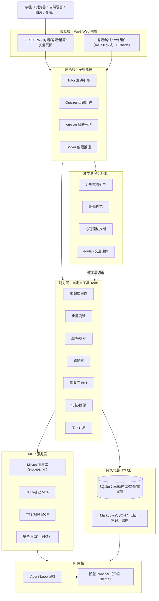

### 5.2 智能体运行流程图


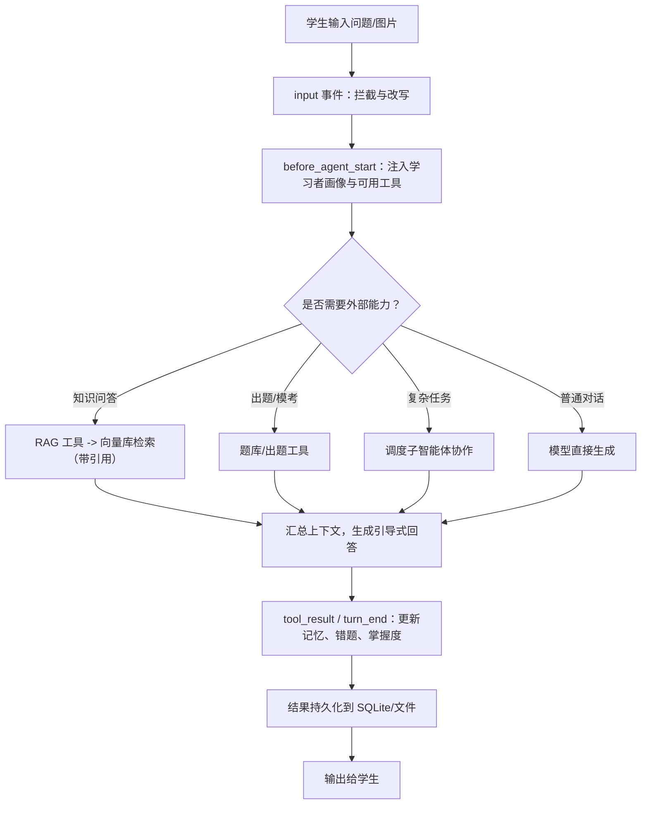

> 实现补充（v0.32）：上述流程图描述模型内部路径；HTTP 入口在进入模型前还会经过 CSRF/认证 → 会话锁（同会话并发返回 409）→ 用户/全局并发门限（超限返回 429）→ 固定 provider key → Session LRU/TTL。详见 §5.10。

### 5.3 子智能体协作图


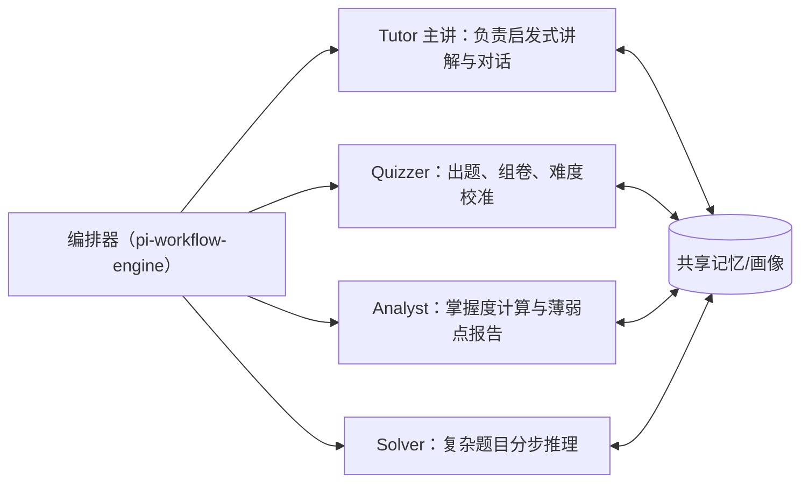

### 5.4 工程目录结构

扩展放置于 Pi 自动发现目录 `~/.pi/agent/extensions/edu-agent/`：

> 实现对齐（v0.31）：以上为规划态目录。实际目录为 `server/src/**` 扁平模块（rag/、learning/、auth/、chat/、mcp/、documents/、config.ts、pi.ts、store.ts）+ `server/agent-workspace/roles/<role>/.pi/skills/`；`mcp.json` 生成在 `server/data/pi-agent/mcp.json`；`src/hooks/` 不存在；Skills 按角色分发（tutor: socratic/mind/edulab，quizzer: quiz-gen/mind，analyst: mind，solver: mind/edulab）。


```
edu-agent/
├── package.json              # 依赖与 pi.extensions 入口
├── src/
│   ├── index.ts              # 注册工具/命令/钩子
│   ├── tools/                # 自定义工具
│   │   ├── document.ts       # 文档上传与解析
│   │   ├── knowledge.ts      # 知识库问答
│   │   ├── quiz.ts           # 出题测验
│   │   ├── question-bank.ts  # 题库/模考
│   │   ├── wrong-book.ts     # 错题本
│   │   ├── mastery.ts        # BKT 掌握度
│   │   ├── memory.ts         # 记忆/画像
│   │   └── plan.ts           # 学习计划
│   ├── hooks/                # before_agent_start、压缩等
│   └── store/                # SQLite 与文件读写封装
├── skills/                   # SKILL.md 教学法技能
│   ├── socratic/SKILL.md
│   ├── quiz-gen/SKILL.md
│   └── edulab/               # 移植 edulab【未实现，v0.31】
└── mcp.json                  # RAG / OCR / TTS / 安全 MCP
```

前端为独立 Vue3 工程（建议与后端同仓库的 `web/` 目录）：


```
web/
├── package.json
├── vite.config.ts
├── index.html
├── src/
│   ├── main.ts               # 应用入口
│   ├── App.vue
│   ├── router/               # Vue Router
│   ├── stores/               # Pinia（会话/错题/掌握度）
│   ├── api/                  # Axios 封装 + SSE EventSource
│   ├── views/                # 对话/模考/错题本/掌握度/考试复盘/计划/课件页
│   ├── components/           # 答题、上传、公式渲染组件
│   └── assets/
└── tsconfig.json
```

### 5.5 DSH Super-agent 概念的融合设计

#### 5.5.1 概念来源

DSH（DeepSeek Harness）团队提出的 **Super-agent** 是一种分层任务调度架构，核心不是 "更强的智能"，而是解决 "多个任务如何持续、可控地协同"。其要点：


* **双层架构**：Router（常驻、轻量的全局协调节点，维护跨任务上下文，通常不挂重型执行工具）+ Worker（各自独立隔离上下文、专注执行单一任务，完成后向 Router 汇报）。

* **事件驱动、异步多信道**：外部事件可主动触发任务，耗时工作进入后台后，用户仍可继续发新指令。

* **spawn 子 Agent 协议化**：分一次性（one-shot，完成即止）与可续（continuable，持久化子会话，可跨对话 / 冷启动恢复）两种生命周期。

* **上下文即日志投影**：append-only 会话日志，模型可见即可记录，支持恢复、分叉与回放；另有外部 Watchdog 负责监督与超时兜底。

* 与传统 Multi-Agent 的区别：传统 Multi-Agent 围绕 "一个复杂任务" 拆分协作；Super-agent 面向 "多个持续存在的任务"，把跨任务协调提升为独立系统层。

#### 5.5.2 融合后的 Router/Worker 架构图


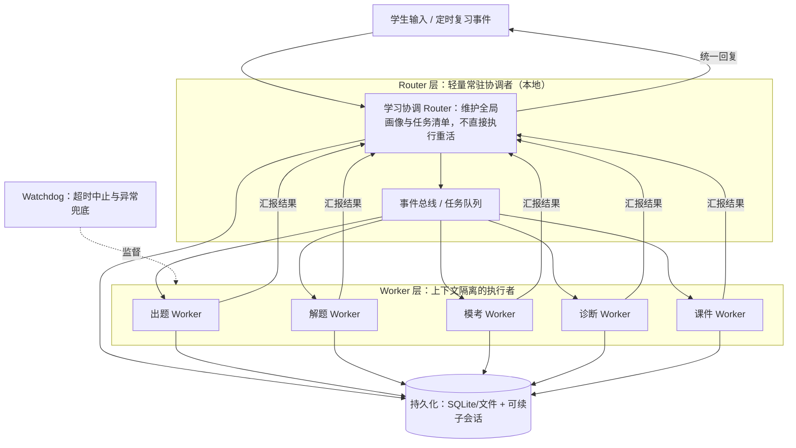

#### 5.5.3 概念映射：DSH 概念如何落到 Pi


| DSH Super-agent 概念           | 在 Pi 上的实现方式                             | 学习场景用途                   |
| ---------------------------- | --------------------------------------- | ------------------------ |
| Router（常驻全局协调，不挂重工具）         | 轻量编排扩展 + pi-workflow-engine，维护画像 / 任务清单 | 统一接收指令、分派任务、汇总回复         |
| Worker（独立上下文、单任务）            | pi-subagents spawn 隔离上下文的子智能体           | 出题 / 解题 / 模考 / 诊断互不污染主对话 |
| 事件驱动、异步后台                    | 事件总线 + 后台任务，turn\_end 续接                | 后台生成试卷 / 课件时，学生仍可继续提问    |
| spawn：one-shot / continuable | 一次性子调用 vs 持久化子会话（appendEntry + SQLite）  | 长期复习计划、错题攻克可跨会话恢复        |
| 上下文即日志、可回放                   | append-only 会话日志 + 本地存储                 | 回放 "当时怎么错的"，复盘可追溯        |
| 外部 Watchdog                  | 超时 / 工具看门狗 + 安全 MCP                     | 卡住任务超时中止、异常兜底            |

#### 5.5.4 裁剪与适配（不照搬）


1. DSH Super-agent 面向多渠道（群聊 / GitHub / 邮件）、高并行、长期在线的软件开发协作；本项目是**小规模、本地优先的学习场景（默认单账号）**，不做多信道接入，Router 简化为本地协调器。

2. 学习多为串行，双层架构的主要价值在**上下文隔离 + 长程可续任务**，而非高并发。

3. Pi 默认不内置完整 Router/Worker 运行时，需用 pi-workflow-engine + pi-subagents + 自研持久化实现，**放在 P1/P2，不进入 P0 MVP**。

> 实现状态（v0.31）：Router/Worker 运行时、spawn 子智能体、append-only 会话日志、外部 Watchdog 均未实现；当前为 7 条带权正则 + LLM 分类的单层路由（server/src/agents/router.ts），后台任务由 server/src/tasks/queue.ts 单 Worker 队列承担，watchdog 用 AbortController 真正中止。

### 5.6 考试复盘流程（拍照识别 + 复盘）

#### 5.6.1 当前实现流程图

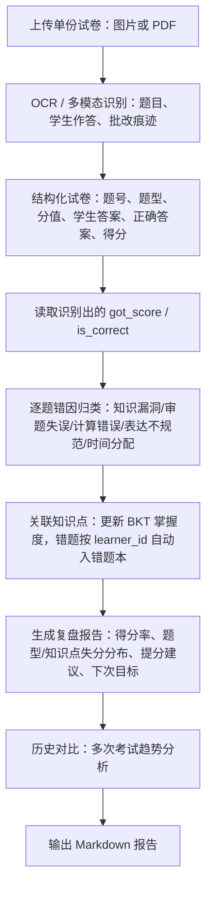

【未实现，v0.31】多图自动拼接、图像纠偏、分页处理、确定性自动判分、报告导出。

#### 5.6.2 复盘报告内容（当前实现）

* **总体情况**：总分、得分率。
* **失分分布**：按题型与知识点统计；章节维度未实现。
* **错因归类**：知识漏洞、审题失误、计算错误、表达不规范、时间分配。
* **行动建议**：薄弱知识点清单、下次目标分；变式题推荐未实现。
* **自动联动**：错题进入错题本、更新掌握度、调整后续复习计划。
* **未实现**：用时统计、与上次考试对比、报告导出；当前仅保留已实现的趋势页与 Markdown 报告展示。
### 5.7 RAG 混合检索与重排流程

检索采用 "**混合检索 → RRF 粗融合 → Cross-Encoder 精排**" 三级管线，先保证召回覆盖，再逐步提升精度。

#### 5.7.1 检索流程图


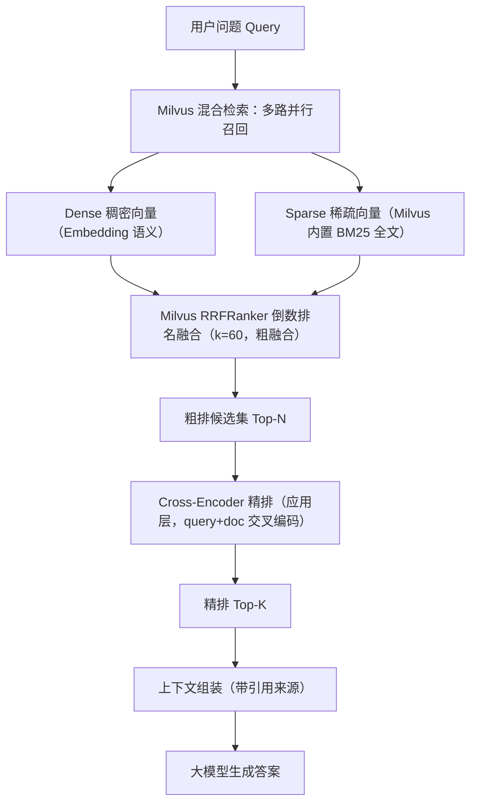

#### 5.7.2 各阶段说明


| 阶段   | 方法                              | 作用               | 典型组件 / 模型                            |
| ---- | ------------------------------- | ---------------- | ------------------------------------ |
| 混合召回 | Dense 向量 + Sparse BM25 并行       | 兼顾语义相似与关键词精确匹配   | Milvus（BGE/E5 向量 + 内置 BM25 Function） |
| 粗融合  | RRF：score = Σ 1/(k + rank)，k≈60 | 无需分数归一化，鲁棒融合多路排名 | Milvus 原生 RRFRanker（k=60）            |
| 精排   | Cross-Encoder 对 query+doc 拼接后打分 | 高精度相关性重排（应用层）    | BGE-reranker（本地）/ Cohere Rerank（云端）  |
| 生成   | 精排 Top-K 组装带引用上下文               | 交给 LLM 生成可溯源答案   | Pi 模型                                |

#### 5.7.3 关键参数（建议初始值，按评测调优）


* 每路召回：Top 50–100。

* RRF 常数：k = 60。

* 精排候选：召回上限 50（`RAG_RECALL_LIMIT`），粗排候选 30（`RAG_CANDIDATE_K`），最终取 Top 5（`RAG_TOP_K`）。

* 文档切片：语义 / 固定窗口 chunk，保留章节与页码元数据用于引用。

#### 5.7.4 设计理由


* 纯向量检索对专有名词、公式、术语编号等精确匹配弱，BM25 补齐关键词能力。

* 两路分数尺度不同，RRF 只看排名、免归一化，简单稳健。

* Cross-Encoder 精度高但计算慢，只对粗排后的少量候选做，兼顾效果与延迟。

#### 5.7.5 Milvus 部署形态与选型


| 形态                | 部署方式                                  | SDK / 限制                                                                   | 适配情况                 |
| ----------------- | ------------------------------------- | -------------------------------------------------------------------------- | -------------------- |
| Milvus Standalone | Docker 容器（含 etcd/MinIO），gRPC 端口 19530 | Node.js（`@zilliz/milvus2-sdk-node`）等全语言，功能完整（BM25/RRF/HNSW）                | **本项目 TS/Node 后端首选** |
| Milvus Lite       | 嵌入式本地 .db 文件，零 Docker                 | 仅 Python（PyMilvus），仅 FLAT 索引；官方仅支持 Ubuntu/macOS，**原生 Windows 不支持（需 WSL2）** | 适合 Python 路线、小规模     |
| Zilliz Cloud      | 全托管云服务                                | 全 SDK                                                                      | 数据上云，不符合本地优先，仅备选     |

**结论**：本机为 Windows + TS/Node 后端，采用 Docker 运行 Milvus Standalone；若后续确定 Python 二次开发路线，在 WSL2 或 macOS 环境下可改用 Milvus Lite 嵌入式。

#### 5.7.6 Collection 与字段设计

共两个集合：`edu_chunks`（教材 / 资料切片）与 `edu_questions`（题库 / 错题向量化，用于相似题、变式题）。【未实现，v0.31】

**Collection 1：edu\_chunks（知识块）**


| 字段             | 类型                    | 说明                    |
| -------------- | --------------------- | --------------------- |
| chunk\_id      | VARCHAR(100)          | 主键，auto\_id           |
| text           | VARCHAR(65535)        | 切片原文，启用 jieba 分词与文本匹配 |
| sparse\_vector | SPARSE\_FLOAT\_VECTOR | BM25 Function 自动生成    |
| dense\_vector  | FLOAT\_VECTOR(1024)   | 语义向量                  |
| subject        | VARCHAR(32)           | 学科，标量过滤               |
| source\_id     | VARCHAR(100)          | 来源文档 ID               |
| source\_name   | VARCHAR(256)          | 文档名                   |
| chapter        | VARCHAR(256)          | 章节                    |
| page           | INT64                 | 页码（引用溯源）              |
| created\_at    | INT64                 | 入库时间戳                 |

**Collection 2：edu\_questions（题库向量化）**


| 字段               | 类型                    | 说明          |
| ---------------- | --------------------- | ----------- |
| question\_id     | VARCHAR(100)          | 主键          |
| text             | VARCHAR(65535)        | 题干，jieba 分词 |
| sparse\_vector   | SPARSE\_FLOAT\_VECTOR | BM25 自动生成   |
| dense\_vector    | FLOAT\_VECTOR(1024)   | 语义向量        |
| subject          | VARCHAR(32)           | 学科          |
| knowledge\_point | VARCHAR(128)          | 知识点         |
| difficulty       | VARCHAR(16)           | 难度          |
| created\_at      | INT64                 | 入库时间戳       |

#### 5.7.7 向量维度与 Embedding 对照


| Embedding 模型      | 维度   | 适用                  |
| ----------------- | ---- | ------------------- |
| BGE-small-zh-v1.5 | 512  | 轻量、本地推理快            |
| BGE-base-zh-v1.5  | 768  | 均衡                  |
| text-embedding-v4 | 1024 | 本项目默认（云端）                |
| BGE-large-zh-v1.5 | 1024 | 精度高、资源占用大           |

维度必须与所选模型一致，建集合后不可改；更换模型需重建集合并重新灌库。

embedding 与 rerank 会把 query / chunk 原文发往云端模型服务，不是本地部署；检索链路默认无 PII 脱敏（DOCUMENT_PII_REDACT 可选开关）。

#### 5.7.8 索引与检索参数


| 字段             | 索引类型                    | 度量     | 参数                               |
| -------------- | ----------------------- | ------ | -------------------------------- |
| dense\_vector  | HNSW（Standalone）        | COSINE | M=16，efConstruction=200，查询 ef=64 |
| sparse\_vector | SPARSE\_INVERTED\_INDEX | BM25   | —                                |


* 混合检索：dense、sparse 各发一个 AnnSearchRequest（各 limit 50），用 RRFRanker (k=60) 融合出粗排 50 条，再交应用层 Cross-Encoder 取精排 Top 5–10。

* 分区策略：单个账号数据量有限，**不强制分区**，用 subject/chapter 标量字段过滤即可；确需物理隔离再按学科建 Partition（Lite 不支持分区）。

#### 5.7.9 建表 Schema 示例（Node SDK，结构化示意）


```
import { MilvusClient, DataType, FunctionType, MetricType } from '@zilliz/milvus2-sdk-node';

const client = new MilvusClient({ address: 'localhost:19530' });

// 中文分词：jieba + 仅保留中文、字母、数字
const analyzerParams = { tokenizer: 'jieba', filter: ['cnalphanumonly'] };

await client.createCollection({
  collection_name: 'edu_chunks',
  schema: [
    { field_name: 'chunk_id', data_type: DataType.VarChar, is_primary: true, autoID: true, max_length: 100 },
    { field_name: 'text', data_type: DataType.VarChar, max_length: 65535,
      analyzer_params: analyzerParams, enable_match: true, enable_analyzer: true },
    { field_name: 'sparse_vector', data_type: DataType.SparseFloatVector },
    { field_name: 'dense_vector', data_type: DataType.FloatVector, dim: 1024 },
    { field_name: 'subject', data_type: DataType.VarChar, max_length: 32 },
    { field_name: 'source_id', data_type: DataType.VarChar, max_length: 100 },
    { field_name: 'source_name', data_type: DataType.VarChar, max_length: 256 },
    { field_name: 'chapter', data_type: DataType.VarChar, max_length: 256 },
    { field_name: 'page', data_type: DataType.Int64 },
    { field_name: 'created_at', data_type: DataType.Int64 },
  ],
  functions: [{
    name: 'bm25',
    function_type: FunctionType.BM25,
    input_field_names: ['text'],
    output_field_names: ['sparse_vector'],
  }],
  index_params: [
    { field_name: 'dense_vector', index_type: 'HNSW', metric_type: MetricType.COSINE,
      params: { M: 16, efConstruction: 200 } },
    { field_name: 'sparse_vector', index_type: 'SPARSE_INVERTED_INDEX', metric_type: 'BM25' },
  ],
});
```

字段命名（如 data\_type、autoID）以实际使用的 Node SDK 版本 API 参考为准；`edu_questions` 结构同理。【未实现，v0.31】

#### 5.7.10 文档灌库流程


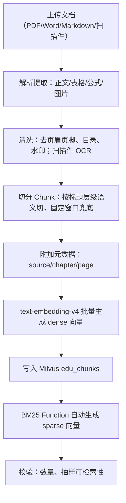

#### 5.7.11 切片策略与参数


* 优先按文档结构（标题 / 章节 / 段落）做语义切分，固定窗口兜底。

* 切片长度：500–800 中文字符，重叠 overlap 50–100，避免语义断裂。

* 表格、公式（LaTeX）整体保留，避免被切断。

* 每个 chunk 保留章节路径与页码，用于引用溯源。

* 进阶可选父子切片：小块负责精准检索，大块负责提供完整上下文。

#### 5.7.12 检索评测指标

评测集为 8 题小样本：学生真实问题 + 人工标注相关 chunk 与标准答案，按学科分组。

已实现指标：Hit@1/3/5、Recall@5、MRR、P50/P95、Precision@5、nDCG@5、引用命中率（Citation Precision@5）。


| 指标          | 含义                | 关注理由           |
| ----------- | ----------------- | -------------- |
| Recall@K    | 前 K 个结果中包含相关文档的比例 | RAG 召回核心，漏检即答错 |
| Precision@K | 前 K 中相关文档占比       | 衡量噪声多少         |
| MRR         | 首个相关文档排名倒数的平均     | 正确结果是否靠前       |
| nDCG@K      | 考虑相关性等级与位置的折损增益   | 整体排序质量         |
| Hit Rate@K  | 是否至少命中一个相关文档      | 粗看可用性          |
| 引用正确率       | 答案引用是否真实支撑结论      | 防幻觉            |
| 延迟 P50/P95  | 检索 + 生成耗时         | 本地体验           |

> 引用正确率：答案级判定不可计算，需 expected_citations 与生成答案标注；脚本仅输出检索级代理并明确标注。高级指标标注缺失时输出「不可计算」且退出码 0。

#### 5.7.13 评测方法与方案对比


* 离线对比四种方案：纯 dense、纯 BM25、混合 + RRF、混合 + RRF + Cross-Encoder。【未实现】

* 每次调整 chunk 大小、RRF k、召回数、reranker 后跑回归，比较 Recall@K、nDCG、MRR。

* 端到端小批量人工复核答案与引用，记录拒答率与引用正确率。

* 评测脚本纳入工程，保证后续改动可回归、可量化。

### 5.8 前后端分离架构（Vue3 + Node 服务）

Pi 内核不直接面向浏览器，由 Node 后端包装为本地 HTTP 服务；Vue3 SPA 通过 REST + SSE 调用。数据仍全部保存在本机，本地优先不变。

#### 5.8.1 前后端架构图


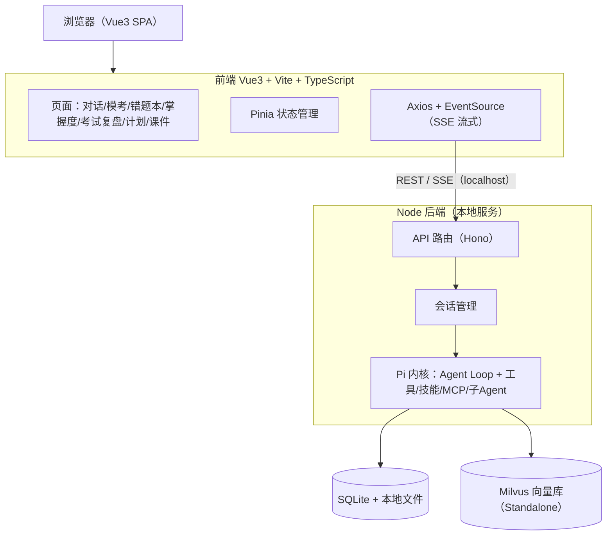

#### 5.8.2 前端页面


| 页面    | 主要功能                   |
| ----- | ---------------------- |
| 首页学习台 | 学习概览与快捷入口 |
| /documents | 资料上传与管理 |
| /quiz | 出题测验 |
| /tasks | 后台任务列表与状态 |
| /visualize | 交互课件与可视化 |
| /settings | 设置 |
| /usage | 用量统计 |
| /storage | 存储用量与清理 |
| /mcp | MCP 服务管理 |
| 对话页   | 流式问答、图片 / 拍照上传、引用与公式渲染 |
| 模考页   | 答题、计时、交卷、解析            |
| 错题本页  | 错题列表、错因、复习推送           |
| 掌握度页 | BKT 掌握度、薄弱点、Element Plus 进度组件 |
| 考试复盘页 | 上传整卷、复盘报告、历史趋势         |
| 计划页   | 学习计划查看与调整              |
| 课件页   | 已合并，/courseware 重定向到 /visualize |
| 登录 / 注册页 | 用户名密码登录、注册（手机号/邮箱可选）、首次管理员初始化 |
| 账号页   | 修改密码、活跃会话、退出所有设备 |
| 账号管理页 | 管理员建号、启停、改角色/联系方式、重置密码、审计、上线检查 |
| 隐私 / 协议页 | 路由与占位视图已建，正文/备案/联系方式待提供，登记为上线阻断 |

#### 5.8.3 通信方式


* **REST**：普通查询与写入、文件上传（multipart）。

* **SSE**：对话流式输出，逐字返回（P0）。

* **WebSocket**：后台任务、可续任务的事件推送（P1）。

### 5.9 认证与多账号架构

认证放在 HTTP 入口层统一完成，业务服务不自行解析 Cookie；通过中间件把当前 `user_id / learner_id / role` 放进请求上下文，个人数据查询必须带账号范围。这样避免每个路由各写一套校验，也避免漏掉 SSE、文件下载、WebSocket 等非 REST 入口。

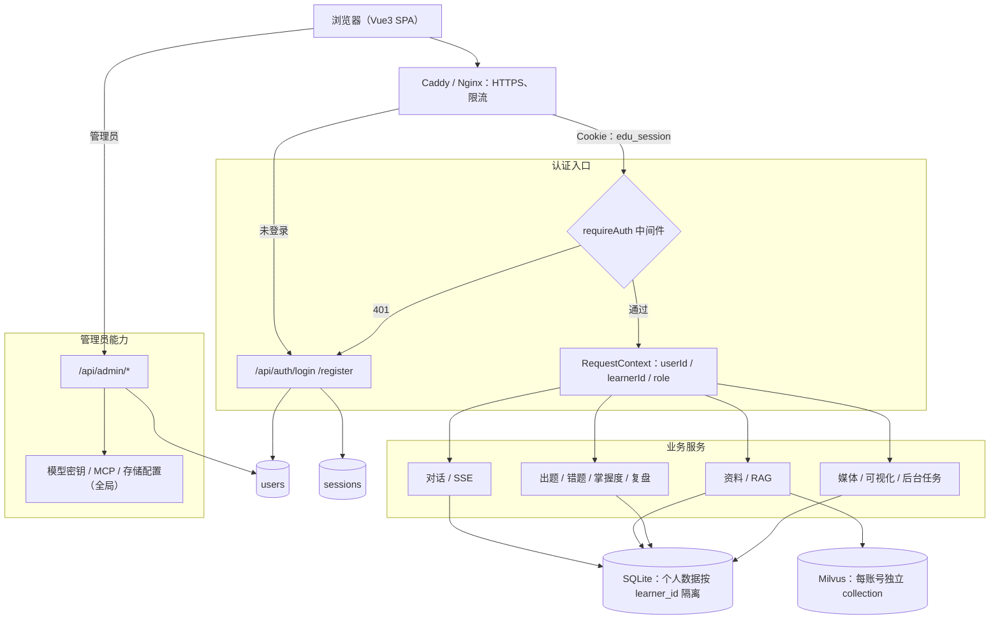

关键约束：

* 登录态使用服务端会话 + `HttpOnly` Cookie，不在前端保存 token；会话可随时撤销。
* 公网流量必须经过反向代理终止 HTTPS，应用端口不直接暴露；限流与上传大小在代理层和应用层各做一层。
* 注册默认开放；数据隔离完成后，任何访客都可注册，设置 `REGISTRATION_OPEN=0` 可关闭。本期不发送邮箱验证码，手机号/邮箱只作联系信息。
* 管理员重置密码是唯一找回方式；重置密码、改角色等高风险操作必须审计。
* 个人数据统一以 `learner_id = user_id` 归属；不引入第二套 owner 字段。
* 模型密钥、Provider 配置、MCP、存储配额属于实例级资源，仅管理员可读写；普通用户只能使用，不能查看密钥。
* 管理员默认不能读取他人的对话、资料、错题与复盘内容，只可管理账号状态、邀请与聚合用量。
* SSE `/api/chat`、文件下载、WebSocket `/ws` 必须与 REST 走同一套会话校验，事件只推送给任务所属账号。

### 5.10 多用户运行护栏（v0.32）

单实例部署下，多个用户共享同一个 Node 进程、SQLite 文件与 provider 额度。为防止“一个用户拖垮所有人”，在进入 Agent 前增加四层护栏：

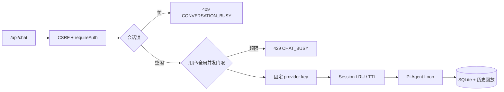

关键约束：

* **单实例**：默认一个 Node 进程 + 一个 SQLite 文件；不要让多个应用容器共享同一个 `app_data` 卷。SQLite 已启用 WAL 与 `busy_timeout=5000`，但不支持多写实例。
* **会话固定 key**：同一 `agent + conversation` 正常路径固定一个 provider key；只有调用失败才切换，切换时只丢弃该角色在该会话下的旧 session，并从数据库历史重建，避免上下文跳变。
* **会话互斥**：同一会话同时只允许一个生成任务；第二个请求返回 `409 CONVERSATION_BUSY`，且在写入用户消息前拒绝。
* **并发门限**：`AGENT_MAX_CONCURRENT`（默认 6）与 `AGENT_MAX_CONCURRENT_PER_USER`（默认 2）；全局满时最多排队 `AGENT_QUEUE_WAIT_MS`（默认 15s），超时返回 `429 CHAT_BUSY`。
* **缓存上限**：Pi `AgentSession` 使用 LRU + 空闲 TTL（默认 300 条 / 60 分钟），避免长期运行内存无界增长。
* **周期清理**：每 `MAINTENANCE_INTERVAL_HOURS`（默认 6h）清理过期 `chat_idempotency`、`answer_cache` 与已结束 `tasks`。
* **容器运维护栏**：`docker-compose.cloud.yml` 带 `/health` healthcheck 与 json-file 日志轮转；Nginx 上传上限 210m，与应用 200MB 单批限制对齐。
* **生产默认**：公网多用户设 `REGISTRATION_OPEN=0`，由管理员建号；`.env` 权限 600，`EDUPI_SETTINGS_SECRET` 必须异地备份。


***

## 6. 核心模块设计

### 6.1 自定义工具（registerTool）


| 工具名                   | 输入（要点）         | 输出                              | 持久化            |
| --------------------- | -------------- | ------------------------------- | -------------- |
| knowledge.search      | 问题、学科、教材范围     | 混合检索 + RRF+Cross-Encoder 精排，带引用 | 读知识库           |
| quiz.generate         | 知识点、难度、题量      | 题目 + 答案 + 解析                    | 写测验记录          |
| bank.extract          | 试卷文件           | 结构化题目集                          | 写题库            |
| wrongbook.add         | 题目、学生答案、错因     | 错题记录                            | 写错题本           |
| mastery.update        | 知识点、作答结果       | 更新后的掌握概率                        | 写掌握度           |
| memory.recall / write | 记忆内容           | 画像 / 记忆                         | 写画像            |
| plan.make             | 目标、时间、薄弱点      | 学习计划                            | 写计划            |
| exam.recognize        | 整卷照片 / PDF（多页） | 结构化试卷（题目 / 作答 / 批改 / 分数）        | 写考试记录          |
| exam.analyze          | 考试 ID          | 逐题判分、错因、复盘报告                    | 写复盘 / 掌握度 / 错题 |
| exam.compare          | 科目、时间范围        | 多次考试趋势对比                        | 读考试记录          |

实现命名对照（v0.31）：表内点号命名实际为下划线——`knowledge_search`、`memory_write` / `memory_recall`、`wrongbook_add`、`mastery_update`、`quiz_generate`、`plan_make`、`exam_analyze`、`exam_compare`、`visualize_generate`；另增 `wrongbook_due`、`mastery_report` 与动态 `mcp__*`。`bank.extract`、`exam.recognize` 无对应 Pi 工具，功能由 REST 接口承担；注册方式为 `defineTool` 而非 `registerTool`。

### 6.2 技能（Skills，SKILL.md）


* socratic：规定 "先提问启发、不直接给答案" 的对话流程。

* quiz-gen：出题规范、难度分级与解析模板。

* mind：心智理论，先推断学生理解状态再讲解。

* edulab：生成可离线打开的 MathJax/3D 交互 HTML 课件。【未实现，v0.31】

### 6.3 MCP 服务（mcp.json）


| 服务           | 用途                                   | 阶段 |
| ------------ | ------------------------------------ | -- |
| Milvus 向量库   | 文档向量化、BM25 与混合检索（Node SDK 直连，可选 MCP） | P0 |
| OCR / 视觉 MCP | 拍照题目识别、整卷 OCR 与批改痕迹识别                | P1 |
| TTS / 视频 MCP | 解题配音与视频 | P2 |
| 安全 MCP | 防注入、脱敏、输出过滤 | P2 |

> 实现口径（v0.31）：MCP 服务由管理页配置并存加密 DB；`server/data/pi-agent/mcp.json` 仅同步命令 / URL / 工具开关，不写解密后的 env/headers。远程 MCP 只允许 `http` / `https`，可用 `MCP_ALLOWED_HOSTS` 收紧来源主机。断线重连、长期健康检查、管理页日志与推荐模板未实现。

### 6.4 关键钩子（Hooks）


未注册 Pi 自定义 hook 扩展；以下为等价实现清单：

* `before_agent_start` → `server/src/pi.ts` 画像注入 + `server/src/agents/roles.ts` 工具白名单。

* `tool_call` → `server/src/chat/handler.ts` 输入拦截（**危险工具拦截未实现**，工具集无系统级工具）。

* `turn_end` → `chat/handler.ts` done 落库 + 工具主动写回。

* `session_before_compact` → `server/src/config.ts` 历史回放 16 条 / 单条 6000 字。

> v0.32 补充：会话互斥与缓存生命周期不是 Pi hook，而由 `server/src/chat/lock.ts`（同会话互斥）与 `server/src/chat/session-cache.ts`（LRU/TTL）在 `pi.ts` 外层管理；删除会话时同步清理该会话全部角色 session 与 key 绑定。

### 6.5 后端 API 接口（REST）

| 方法 | 路径 | 用途 |
| --- | --- | --- |
| POST | /api/chat | 发起对话（SSE 流式返回；支持 `clientRequestId` 幂等） |
| GET | /api/conversations/:id/messages | 拉取会话消息历史 |
| POST | /api/documents、/api/documents/batch | 单文件 / 批量上传知识库文件 |
| GET | /api/documents/:id/ocr | OCR 任务详情 |
| GET/PUT | /api/documents/:id/ocr/pages/:page(/image) | 扫描页原图与 Markdown 校对 |
| POST | /api/documents/:id/ocr/confirm、/ocr/retry | OCR 确认写回与重试 |
| GET/PUT | /api/settings/generation | 读取 / 更新生成参数 |
| GET | /api/settings/keys | 模型密钥列表（脱敏） |
| GET/POST | /api/mcp/servers；POST /api/mcp/servers/:id/test | MCP 服务管理与连接测试 |
| PUT/POST | /api/mcp/servers/:id/tools/:toolName(/confirm) | 工具启停与副作用确认 |
| POST | /api/tasks/:id/cancel | 取消后台任务 |
| GET/DELETE | /api/visualize/:id | 可视化详情与删除 |
| GET/POST | /api/asr、/api/tts | 语音识别与服务端 TTS |
| GET | /api/admin/system-check | 上线检查 |
| GET | /api/wrongbook | 错题列表 |
| POST | /api/quiz/generate、/api/quiz/answer | 生成题目 / 提交作答 |
| GET | /api/mastery | 掌握度 |
| POST | /api/reviews/recognize、/api/reviews/:id/analyze | 试卷识别与复盘分析 |
| GET | /api/plan | 学习计划 |

> 本表为主要 API 摘要，非完整清单；完整路由以 `server/src/routes` 为准。POST /api/chat 由请求体 stream 字段决定是否 SSE。
### 6.6 BKT 贝叶斯知识追踪

BKT 把每个知识点视为二元隐状态（已掌握 / 未掌握），根据每次答题对错用贝叶斯更新掌握概率。

#### 6.6.1 模型参数（每个知识点一组）


| 参数    | 含义                 | 建议初始值 |
| ----- | ------------------ | ----- |
| P(L₀) | 初始掌握概率             | 0.3   |
| P(T)  | 学习转移概率（一次练习后由不会变会） | 0.1   |
| P(S)  | 失误概率（已掌握却答错）       | 0.1   |
| P(G)  | 猜测概率（未掌握却答对）       | 0.2   |

P (S)、P (G) 一般限制在 0.3 以下，避免模型把答对都解释为猜测、答错都解释为失误而退化。

#### 6.6.2 状态更新流程


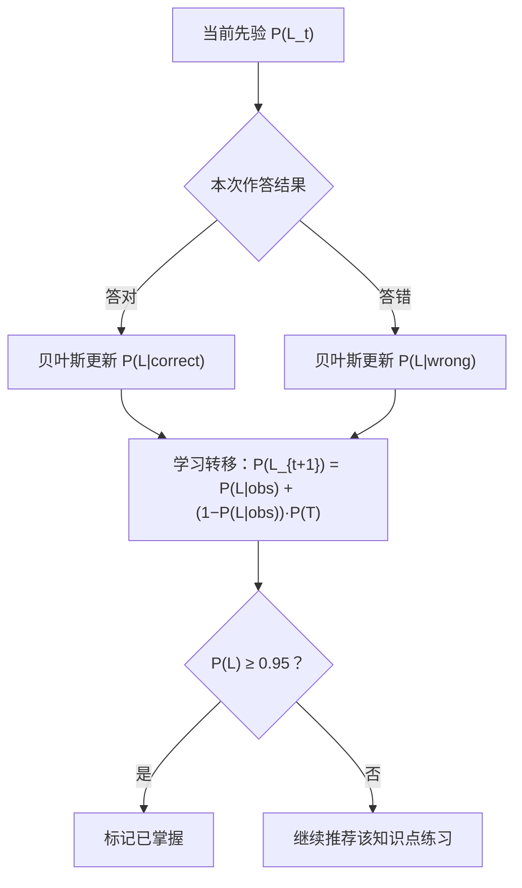

#### 6.6.3 贝叶斯更新公式

答对时：

$P(L_t \mid correct) = \frac{P(L_t)(1-P(S))}{P(L_t)(1-P(S)) + (1-P(L_t))P(G)}$

答错时：

$P(L_t \mid wrong) = \frac{P(L_t)P(S)}{P(L_t)P(S) + (1-P(L_t))(1-P(G))}$

再经学习转移得到下一次先验：

$P(L_{t+1}) = P(L_t\mid obs) + (1-P(L_t\mid obs))P(T)$

#### 6.6.4 参数估计与冷启动


* 单个学习者数据少，冷启动先用保守经验先验，随答题在线更新。

* 数据积累后用观测序列拟合（MLE/EM 或网格搜索），可先借用题库全局先验再做个体调整。

* 掌握阈值取 P (L) ≥ 0.95。

#### 6.6.5 与其他模块联动


* 出题 / 组卷：优先选 P (L) 低的知识点，难度自适应。

* 考试复盘：错题对应知识点 P (L) 下调，复习答对后回升。

* 掌握度页面：用 Element Plus 进度条展示各知识点 P (L) 与薄弱点；ECharts 图表未使用。

#### 6.6.6 局限与扩展

标准 BKT 假设知识点相互独立、不区分题目难度。后续可加入题目难度、知识点前置依赖（知识图谱约束），或升级为深度知识追踪（DKT），P1 阶段先采用标准 BKT。

### 6.7 子智能体职责与系统提示词

#### 6.7.1 职责总表（以 `server/src/agents/roles.ts` 为准）

| 子智能体 | 核心职责 | 可调用工具 | 触发场景 |
| --- | --- | --- | --- |
| Tutor 主讲 | 启发式对话、概念讲解、统一入口 | `knowledge_search`、`memory_write`、`memory_recall`、`wrongbook_add`、`plan_make`、`visualize_generate`、`mcp__*` | 日常答疑、概念讲解 |
| Quizzer 出题 | 出题、组卷、难度校准、解析 | `quiz_generate`、`mastery_update`、`mastery_report`、`knowledge_search`、`mcp__*` | 自动出题、模考、每日练习 |
| Analyst 诊断 | 掌握度、薄弱点、考试复盘、趋势 | `mastery_report`、`wrongbook_due`、`knowledge_search`、`exam_analyze`、`exam_compare`、`plan_make`、`mcp__*` | 诊断报告、考试复盘 |
| Solver 解题 | 复杂题分步推理、验算、拍照题讲解 | `knowledge_search`、`visualize_generate`、`mcp__*` | 难题、多步推理、拍照答疑 |

`mcp__*` 表示管理页启用后动态注册的 MCP 工具（命名格式 `mcp__<server>__<tool>`）。

#### 6.7.2 系统提示词

系统提示词以仓库内文件为唯一来源，不在设计文档中维护副本：

* `server/agent-workspace/roles/tutor/AGENTS.md`
* `server/agent-workspace/roles/quizzer/AGENTS.md`
* `server/agent-workspace/roles/analyst/AGENTS.md`
* `server/agent-workspace/roles/solver/AGENTS.md`

各角色技能位于同目录 `.pi/skills/*/SKILL.md`。当前每个角色是独立 Pi 会话，`spawn` 子智能体未实现（见附录 B）。
#### 6.7.3 协作与路由规则


* Tutor 为默认入口，简单问题自行处理；需出题转 Quizzer，需诊断 / 复盘转 Analyst，复杂推理转 Solver。

* 子智能体上下文隔离，结果经共享记忆 / 画像回传，由编排器统一汇总回复。

* 对应 5.5 的 Router/Worker：Tutor 侧协调逻辑即轻量 Router，其余子智能体为 Worker。

### 6.8 知识库文件上传与解析

用户可上传属于自己的资料构建个人知识库，支持 PDF、Word、TXT、Markdown 四类文件。

#### 6.8.1 上传接口规范


| 项            | 内容                                    |
| ------------ | ------------------------------------- |
| 接口           | POST /api/documents                   |
| Content-Type | multipart/form-data                   |
| 表单字段         | file（单 / 多文件）、subject（学科，可选）、tags（可选） |
| 支持格式         | .pdf、.docx、.doc、.txt、.md、.markdown    |
| 大小限制         | 单文件建议 ≤ 50MB（可配置）                     |
| 校验           | 扩展名 + MIME 双重校验，非法类型直接拒绝              |

响应字段：


| 字段                    | 说明                          |
| --------------------- | --------------------------- |
| document\_id          | 文档唯一 ID                     |
| filename / file\_type | 文件名、类型                      |
| chunk\_count          | 解析后的切片数                     |
| status                | uploaded → parsed → indexed |

#### 6.8.2 多格式解析方案


| 格式         | 解析库（Node/TS）       | 说明                      |
| ---------- | ------------------ | ----------------------- |
| PDF        | pdfjs-dist         | 提取文本；扫描件后续走 OCR         |
| Word .docx | mammoth            | 转文本 / Markdown，保留标题层级   |
| Word .doc  | word-extractor     | 老二进制格式，建议优先使用 .docx     |
| TXT        | fs + iconv-lite    | 自动识别 UTF-8/GBK 编码       |
| Markdown   | 直接读取 + gray-matter | 保留标题结构，可选处理 frontmatter |

#### 6.8.3 处理流程


1. 接收并校验文件，原文件保存到本地 `uploads/`。

2. 按类型选择解析器提取纯文本。

3. 清洗多余空白、页眉页脚。

4. 按 5.7.11 切片策略切分，附 source/chapter/page 元数据。

5. 写文档记录，状态置为 parsed；后续向量化灌库（S06）后置为 indexed。

6. 返回 document\_id 与切片数。

#### 6.8.4 文档管理接口


| 方法     | 路径                          | 用途            |
| ------ | --------------------------- | ------------- |
| GET    | /api/documents              | 文档列表          |
| GET    | /api/documents/{id}         | 文档详情与切片       |
| DELETE | /api/documents/{id}         | 删除文档（连同切片与向量） |
| POST   | /api/documents/{id}/reparse | 重新解析          |

#### 6.8.5 前端上传组件


* 基于 el-upload：支持拖拽与点选、多文件，accept 限定四类格式。

* 前置校验格式与大小，显示上传进度条。

* 列表展示处理状态（解析中 / 已入库 / 失败），支持删除与重新解析。

#### 6.8.6 错误码与异常返回约定

统一错误响应结构：


```
{
  "code": "FILE_TYPE_UNSUPPORTED",
  "message": "不支持的文件类型",
  "detail": { "filename": "notes.epub", "allowed": ["pdf", "docx", "doc", "txt", "md"] }
}
```

常见错误码：


| HTTP | code                    | 含义                 | 处理建议    |
| ---- | ----------------------- | ------------------ | ------- |
| 400  | FILE\_TYPE\_UNSUPPORTED | 不支持的文件类型           | 检查扩展名   |
| 400  | FILE\_EMPTY             | 空文件                | 重新选择    |
| 409  | DOCUMENT\_EXISTS        | 重复上传（哈希命中）         | 去重或覆盖   |
| 413  | FILE\_TOO\_LARGE        | 超过大小限制             | 拆分或调高限制 |
| 415  | INVALID\_MIME           | MIME 与扩展名不符        | 确认真实格式  |
| 422  | PARSE\_FAILED           | 解析失败（损坏 / 加密 / 乱码） | 解密或换文件  |
| 500  | STORAGE\_ERROR          | 本地存储 / 磁盘异常        | 检查磁盘与权限 |
| 507  | DISK\_FULL              | 磁盘空间不足             | 清理空间    |

多文件上传采用 "部分成功"：每个文件独立返回状态，整体返回 207 Multi-Status，成功的入库、失败的给出原因。

#### 6.8.7 文件夹批量导入


* 前端：通过 webkitdirectory 选择整个文件夹（或拖拽文件夹），递归收集四类文件，相对路径作为章节 / 分类元数据。

* 后端：接口仍走 /api/documents（多文件），或新增 POST /api/documents/batch；按目录结构组织，逐个解析并汇总，按文件哈希去重。

* 限制：设文件总数与总大小上限，超限分批；返回每个文件的处理状态汇总。

#### 6.8.8 扫描件 / 图片型 PDF 的 OCR 兜底

部分 PDF 正文为整页图片（如本资料 108 页全为位图，仅页脚有文字），常规文本提取为空，需走 OCR。

**判定与处理流程：**

- 提取文本后若正文长度低于阈值（或页面含大图、文本极少），判定为图片型。
- 页面按 200–300 DPI 渲染为图片，逐页 OCR，版面恢复为 Markdown 后再切片。

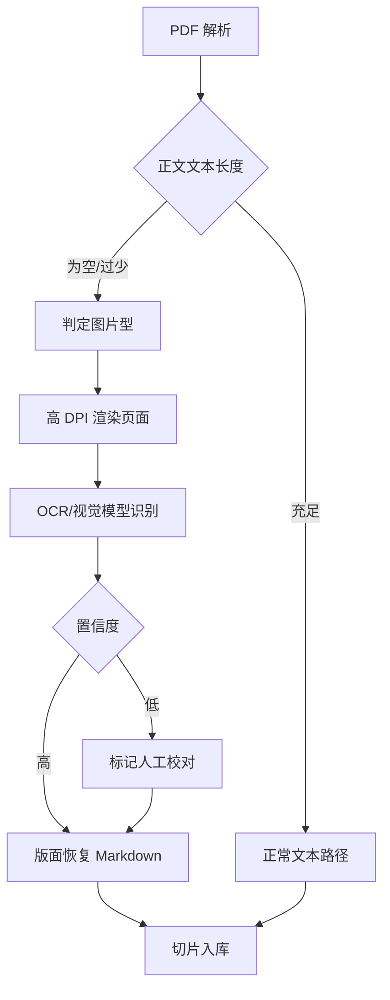

**OCR 技术选型：**

| 方案 | 技术 | 优点 | 适用 |
|---|---|---|---|
| 本地 OCR | RapidOCR / PaddleOCR、Tesseract(chi_sim) | 离线、隐私、免费 | 常规中文文字 |
| 公式 OCR | pix2tex(LaTeX-OCR)、UniMERNet | 公式转 LaTeX | 数学公式 |
| 视觉大模型 | GPT-4o / Qwen-VL / Gemini 整页识别 | 排版、表格、公式结构好，直接出 Markdown | 复杂版面（本资料推荐） |

**工程与前端：**

- 多页 OCR 异步执行，复用可续任务与 WS 进度，结果缓存不重复识别；文本页直接提取、图片页 OCR 混合处理。
- 质量校验：按 OCR 平均置信度逐页打分，低于阈值的页面标记待校对，提供原文图与识别文本对照的人工校对界面，校对后写回。
- 前端检测到图片型 PDF 时提示"扫描件将进行 OCR，需几分钟"，显示进度与低置信页校对入口。

**同类开源方案与选型：**

端到端文档解析（扫描件 OCR + 版面/表格/公式 → Markdown）：

| 项目 | 维护方 | Star（约） | 协议 | 特点 |
|---|---|---|---|---|
| MinerU | OpenDataLab | 83k | 基于 Apache-2.0 | 中文/公式强，CPU/GPU 可跑 |
| Docling | IBM | 70k | MIT | 格式广、OCR 可插拔、CPU 友好、有 Rust 版 |
| Marker | Datalab | 40k | 权重有商业限制 | 准确率高、速度快 |
| Surya / Nougat | 社区 / Meta | — | 注意授权 | 多语言 OCR；学术文档 |

组件级 OCR / 公式：

| 项目 | 定位 | 协议 |
|---|---|---|
| PaddleOCR | 百度，中文 OCR 强、手写/公式 | Apache-2.0（模型版权归百度） |
| RapidOCR | PaddleOCR ONNX 轻量版，Windows 简单 | Apache-2.0 |
| pix2tex / UniMERNet | 公式图片转 LaTeX | 开源 |

最终选型（含后续上线个人网站）：**Docling**

- **协议可商用**：Docling 与 docling-serve 均为 MIT；官方镜像内置 RapidOCR（PP-OCR，Apache-2.0），官方确认随附模型无研究专用/非商用限制、非受限基座微调，整体上线无法律风险。
- **部署轻**：官方提供 CPU Docker 镜像（docling-serve-cpu，FastAPI，端口 5001），支持 RQ（Redis+worker）横向扩展，可部署云主机或 Railway 等平台，不强制 GPU。
- **能力全**：覆盖 PDF/Office/HTML/图片/扫描，OCR 可插拔（默认 RapidOCR，中文可用），版面、表格、公式结构化输出 Markdown/JSON，直接对接 RAG。
- **备选与排除**：MinerU 仅在公式要求极高且有 GPU 时作局部增强；Marker/Surya 因权重商业授权不用于上线。

### 6.9 模型与密钥管理

用户可输入自己的 API Key 接入并切换不同厂商模型，并设置思考强度（推理预算）。密钥仅本地加密存储，不上传。

#### 6.9.1 支持的 Provider


| Provider  | 接入方式               | 典型模型           |
| --------- | ------------------ | -------------- |
| OpenAI    | 官方 API / OpenAI 兼容 | GPT、o 系列       |
| Anthropic | 官方 API             | Claude 系列      |
| Google    | 官方 API             | Gemini 系列      |
| DeepSeek  | OpenAI 兼容          | DeepSeek-V3/R1 |
| 通义 / 智谱等  | OpenAI 兼容          | Qwen、GLM 等     |
| Ollama 本地 | OpenAI 兼容，无需 Key   | 本地开源模型         |

#### 6.9.2 API Key 安全存储


* 各 provider 的 key 独立保存，本地 AES 加密（密钥结合本机信息派生）。

* 同一 Provider 可配置多把 key；主对话与学习模块都按 `LLM_KEY_MAX_ATTEMPTS`（默认 3，范围 1–20）限制单次请求最多尝试的 key 数，失败 key 进入冷却。主对话同一会话正常路径固定一个 key（`server/src/chat/key-selection.ts`），只有失败才切换；切换时丢弃该角色在该会话下的旧 session，并用数据库历史重建，避免多 key 轮换造成上下文跳变。

* 前端密码框掩码输入、可切换显隐，回显仅显示掩码；支持更新与删除。

* 保存前做一次最小调用校验 key 有效性；切换 / 删除不影响已有学习数据。

#### 6.9.3 思考强度（Reasoning Effort）


| 档位    | 映射参数                                     | 适用           |
| ----- | ---------------------------------------- | ------------ |
| 低（节能） | reasoning\_effort=low / 小 budget\_tokens | 日常对话、快速问答    |
| 中（均衡） | medium / 中等预算                            | 一般讲解、出题      |
| 高（深度） | high / 大 budget\_tokens                  | 难题、多步推理、考试复盘 |


* 不同厂商参数名不同，由后端统一映射；非推理模型忽略该参数。

* 可设全局默认，也可单次对话临时调整；强度越高推理越充分，但延迟更长、消耗更多。

#### 6.9.4 接口


| 方法   | 路径                      | 用途                   |
| ---- | ----------------------- | -------------------- |
| GET  | /api/settings/providers | 可用 provider 与模型列表    |
| GET  | /api/settings/model     | 当前模型与思考强度            |
| PUT  | /api/settings/model     | 切换 provider / 模型     |
| PUT  | /api/settings/apikey    | 保存 / 更新 / 删除 API Key |
| PUT  | /api/settings/reasoning | 设置思考强度               |
| POST | /api/settings/test      | 测试连接、校验 Key          |

#### 6.9.5 前端设置页


* Provider 与模型下拉选择；API Key 密码输入（掩码、显隐切换）+ 测试连接状态提示。

* 思考强度分段控件，附各档说明；本地 Ollama 无需 key，仅配置 base\_url。

#### 6.9.6 生成参数配置


| 参数              | 含义                | 建议值             |
| --------------- | ----------------- | --------------- |
| temperature     | 采样温度，控制随机性        | 0.3–0.7（学习场景偏低） |
| top\_p          | 核采样比例             | 0.9–1           |
| max\_tokens     | 单次最大输出长度          | 按模型能力设置         |
| context\_length | 上下文窗口，超出触发压缩 / 截断 | 按模型上限配置         |

可按场景（答疑 / 出题 / 复盘）设默认值，前端可调整并保存。

#### 6.9.7 多 Key 与故障切换


* 同一 provider 支持配置多个 key，按轮询 / 随机负载分担。

* 出现 429 限流、401 失效、5xx、超时等自动切换下一个 key 或备用模型。

* 主对话按“会话固定 key”优先：同一 `agent + conversation` 成功后把 key 写入内存绑定；后续请求优先复用该 key，只有该 key 冷却或调用失败才切换。

* 切换 key 时删除该角色在该会话下的旧 AgentSession，并从 SQLite 历史完整回放，保证新 key 看到的上下文与旧 key 一致。

* 连续失败的 key 进入冷却熔断，健康检查通过后恢复；记录每次失败与切换原因。

### 6.10 模型用量统计

#### 6.10.1 记录字段（USAGE\_RECORD）


| 字段                                                  | 说明                |
| --------------------------------------------------- | ----------------- |
| usage\_id                                           | 主键                |
| provider / model                                    | 厂商、模型             |
| scenario / subject                                  | 场景（答疑 / 出题 / 复盘等）与学科 |
| prompt\_tokens / completion\_tokens / total\_tokens | token 用量          |
| reasoning\_tokens                                   | 思考 token          |
| latency\_ms                                         | 延迟                |
| cost                                                | 估算费用（本地模型为 0）     |
| success / error                                     | 是否成功、错误信息         |
| key\_id / trace\_id | 命中的密钥与链路 ID |
| created\_at                                         | 时间                |

#### 6.10.2 统计维度


* 按天 / 模型 / 场景 / 学科统计调用次数、token、成本、成功率、平均延迟。

* 支持累计与趋势；月度预算 / 配额与接近阈值告警【未实现，v0.31】。

* 数据取自模型响应的 usage 字段，本地模型按可用字段估算。

#### 6.10.3 接口


| 方法  | 路径                 | 用途           |
| --- | ------------------ | ------------ |
| GET | /api/usage/summary | 汇总（时间范围、维度）  |
| GET | /api/usage/daily   | 每日明细         |
| GET | /api/usage/cost    | 成本统计         |
| GET | /api/usage/export  | 导出（CSV/JSON）；管理员可导出跨账号明细，普通用户仅导出本人 |

#### 6.10.4 前端


* ECharts 展示 token 用量、成本趋势、调用次数、成功率与延迟。

* 预算进度条与超阈值告警提示。

### 6.11 回复完整性保障（防截断与自动续写）

针对回复在中途被截断（如句子未说完、括号未闭合、代码 / Mermaid 未结束）的问题，建立 "检测 — 自动续写 — 手动兜底" 机制。

#### 6.11.1 根因与信号


| 根因             | 检测信号                   |
| -------------- | ---------------------- |
| max\_tokens 不足 | finish\_reason=length  |
| 流式中断 / 网络异常    | SSE 断开、未收到结束事件         |
| 上下文超限          | 输入长度超过 context\_length |
| 结构未闭合          | 代码围栏数为奇数、括号 / 表格未闭合    |
| 模型 / 网关错误      | 5xx、多 key 切换失败         |

#### 6.11.2 截断检测


* 响应 finish\_reason 为 length 即判定截断。

* 文本末尾无句末标点，或括号、Markdown 围栏、Mermaid、表格未成对闭合。

* 流式未收到正常结束事件即按异常中断处理。

#### 6.11.3 自动续写流程


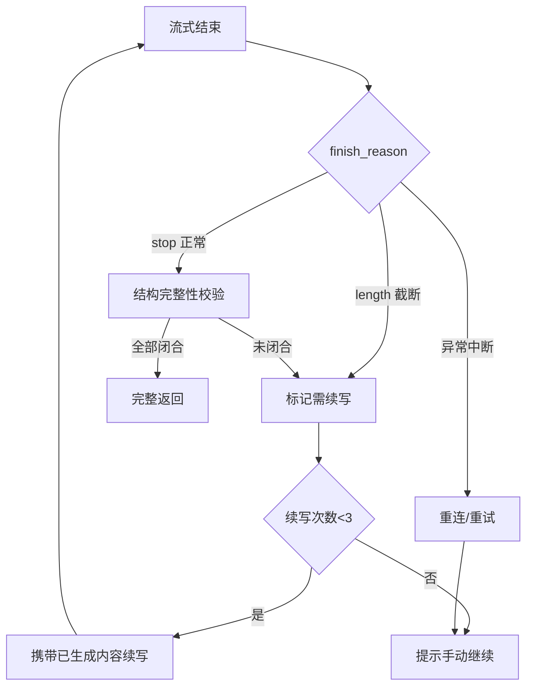

#### 6.11.4 续写与重试策略


* 自动续写：携带已生成内容，提示 "从断点继续，不要重复"，最多 3 次，防止死循环。

* 动态 max\_tokens：按场景给足上限，长输出（讲解 / 复盘）预留空间并结合 context 预算。

* 异常中断先重连 / 重试再续写，续写片段去重后拼接。

#### 6.11.5 处理逻辑（伪代码）


```
流式结束(响应, 已生成文本):
    截断 = 响应.finish_reason == "length" 或 结构不完整(已生成文本)
    if 截断:
        if 续写次数 < 3:
            追加 = 调用模型("从断点继续，勿重复", 前缀=已生成文本)
            已生成文本 += 追加
            流式结束(追加, 已生成文本)
        else:
            显示"点击继续"按钮
    else:
        返回完整文本
```

#### 6.11.6 前端兜底


* 检测到截断显示 "输出被截断，点击继续" 按钮，支持手动续写与重新生成。

* 展示加载 / 重试状态和异常提示，已生成内容不丢失。

### 6.12 会话管理与多模态输入

#### 6.12.1 历史会话缓存与继续


* 每个会话与消息持久化到本地 SQLite，开新对话后旧会话完整保留。

* 历史会话列表支持按时间分组、搜索、重命名、置顶、删除；标题取首条消息截断，不做自动摘要。

* 重新打开即加载历史消息，可在原上下文继续对话；消息分页加载，前端缓存最近会话。

* 同一会话同时只允许一个生成任务（`server/src/chat/lock.ts`）；并发请求返回 `409 CONVERSATION_BUSY`，且不会写入第二条用户消息。

* Pi `AgentSession` 使用 LRU + 空闲 TTL（`AGENT_SESSION_MAX=300`、`AGENT_SESSION_TTL_MIN=60`），不再无限增长；删除会话时同步清理其全部角色 session 与 key 绑定。

* 同一会话正常路径固定一个 provider key；只有失败才切换，并用数据库历史重建 session（见 §6.9.7）。


| 方法     | 路径                               | 用途            |
| ------ | -------------------------------- | ------------- |
| GET    | /api/conversations               | 会话列表（搜索 / 分页） |
| POST   | /api/conversations               | 新建会话          |
| GET    | /api/conversations/{id}          | 会话详情与消息       |
| PUT    | /api/conversations/{id}          | 重命名 / 置顶      |
| DELETE | /api/conversations/{id}          | 删除会话          |
| POST   | /api/conversations/{id}/messages | 在该会话继续对话      |

#### 6.12.2 拍照与图片发送


* 对话框支持拍照（调用摄像头）或选择本地图片，可多图、预览、压缩。

* 图片本地存储，以 base64/URL 传入视觉模型（GPT-4o、Gemini、Qwen-VL 等）。

* 非视觉模型先走 OCR 提取文字；用于拍照答疑、试卷识别、错题截图。

* 接口：POST /api/media/upload；对话接口支持 image 类型消息。

#### 6.12.3 语音输入与语音识别


* 麦克风录音，支持按住说话 / 点击录音，显示波形与时长。

* ASR 方案：本地 `sherpa-onnx Paraformer`（`sherpa-onnx-node`），只接受 16-bit PCM WAV；云端 ASR 未实现。

* 识别文字进入输入框，可编辑后再发送。

* 接口：GET /api/asr（能力探测）、POST /api/asr（音频转文字）。

#### 6.12.4 输入处理流程


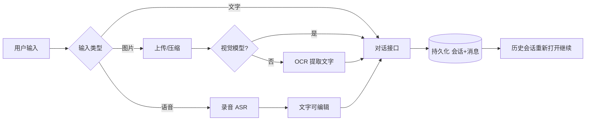

#### 6.12.5 语音播报（TTS）


* 模型回复支持一键朗读；自动播放、暂停 / 恢复与逐句跟读【未实现，v0.31】，当前只有停止。


| 方案 | 说明 |
| --- | --- |
| 浏览器 speechSynthesis | 默认；零配置、离线可用 |
| 服务端 OpenAI 兼容 `/audio/speech` | 配置 `TTS_BASE_URL` / `TTS_MODEL` 后启用；支持 `TTS_VOICE`、语速、音量参数 |


* 支持音色、语速、音量参数；播放控制当前只有停止。

* 接口：GET /api/tts（能力与默认参数）、POST /api/tts（文字转音频）。

#### 6.12.6 多媒体存储与清理


* 当前 `media` 目录只存储图片（上传与对话图片）；ASR 录音与 TTS 音频不落库、不持久化。

* 清理策略：删除会话连带删除关联媒体；定期检测孤儿文件（无引用）并清理；可配置保留周期与存储配额，超阈值告警；图片压缩。音频统一码率与统一入库未实现。

* 接口：GET /api/media/storage（用量）、POST /api/media/cleanup（清理）。

### 6.13 MCP 自选接入

**结论：可行。** 自研 @modelcontextprotocol/sdk 客户端：配置存 mcp_servers 表 → listTools 发现 → defineTool 生成 customTools 注入 createAgentSession，工具名前缀 mcp__<server>__<tool>，并同步 server/data/pi-agent/mcp.json，用户可像安装浏览器扩展一样自选接入 MCP server，其暴露的工具自动注册给智能体调用。

#### 6.13.1 配置结构


```
{
  "name": "web-search",
  "transport": "stdio",
  "command": "npx",
  "args": ["-y", "@modelcontextprotocol/server-xxx"],
  "env": { "API_KEY": "***" },
  "enabled": true
}
```

远程服务改用 transport=http/sse 并填写 url；env 中的密钥加密存储。`server/data/pi-agent/mcp.json` 只同步命令 / URL / 工具开关，不写解密后的 env/headers；数据库加密不等于所有落盘副本都加密。

#### 6.13.2 接入流程


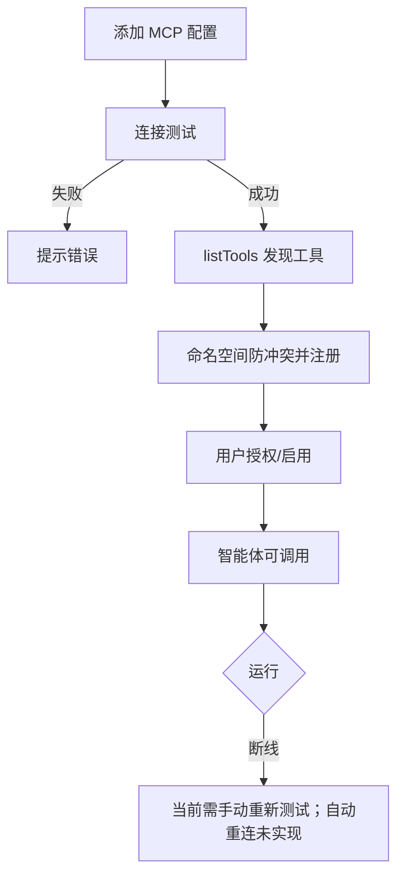

#### 6.13.3 工具发现与注册


* 连接后 listTools 自动发现工具，注册到 Pi 工具表，与内置 / 自定义工具统一管理。

* 以 server 名加前缀避免命名冲突，工具可单独启用 / 禁用。

* 传输支持 stdio 本地进程（npx/uvx）与远程 SSE/HTTP，含连接超时；断线重连与长期健康检查【未实现，v0.31】。

#### 6.13.4 安全与权限


* 安装前提示来源与权限风险（本地命令、远程服务）。

* 敏感 env/key 加密存储，不回传给模型；stdio 子进程只继承最小运行环境，不默认下传实例密钥。

* 配置期显式授权：无 readOnlyHint 即视为副作用，未确认返回 MCP_CONFIRMATION_REQUIRED；升级时用 server/scripts/migrate-mcp-confirmations.ts（默认 dry-run，--apply 写入）一次性回填存量已授权工具，支持白名单与最小权限；远程 URL 仅允许 http/https，可用 `MCP_ALLOWED_HOSTS` 收紧来源主机；`server/src/security/guard.ts` 仅用于对话输入注入拦截，未接入安全 SDK。

#### 6.13.5 接口


| 方法     | 路径                         | 用途            |
| ------ | -------------------------- | ------------- |
| GET    | /api/mcp/servers           | MCP server 列表 |
| POST   | /api/mcp/servers           | 添加配置          |
| PUT    | /api/mcp/servers/{id}      | 编辑 / 启停       |
| DELETE | /api/mcp/servers/{id}      | 删除并断开         |
| POST   | /api/mcp/servers/{id}/test | 连接测试          |
| GET    | /api/mcp/tools             | 已发现工具与授权状态    |

#### 6.13.6 前端与生态


* MCP 管理页：添加向导、连接状态、工具列表与授权开关；管理页日志【未实现，v0.31】。

* 内置常用 MCP 推荐清单与一键安装模板【未实现，v0.31】（本地维护，不做中心化商店）。

### 6.14 统一可视化引擎（交互课件 + 自动可视化合并）

将原 "交互课件" 与 "自动可视化" 两个入口合并为一个统一可视化模块，前端只保留一个入口，后端同一套 spec 与渲染组件。


* 统一入口：拍照 / 提问后自动判定，先做确定性建模；未命中具体结构时再匹配预置交互课件库（edulab）；两条路径输出统一可视化对象。

* 统一渲染：所有新记录使用 VizPlan v2 严格语义 scene；3D 用 Three.js、函数 2D/圆锥曲线用项目内 SVG（CartesianPlot）、分子用 3Dmol、物理/示意图用内联 SVG，预置课件与动态生成共用渲染器。

* 统一管理：课件与生成结果在同一面板展示，支持旋转缩放、标注、辅助线与截图；动画未实现。

后续 6.14.1–6.14.8 为该引擎的判定、规格与渲染细节。

#### 6.14.1 识别与判定


* 拍照后经多模态 / OCR 识别题目（复用 exam.recognize）。

* 后端按题目文本做确定性解析与建模：函数表达式、圆锥曲线方程、几何点与尺寸、分子式、物理场景等直接转成结构化 spec，不调用对话模型生成图形。

* 类型：geometry3d（立体几何）、function2d/function3d（函数）、conic（圆锥曲线）、molecule（化学分子）、terrain（地理地形）、biology（生物结构）、physics（受力 / 电路 / 光路）、diagram（通用示意）。

* 无法从题目解析出具体结构时不出图，不用通用示意图硬凑；纯主题问题才回退预置模板。

#### 6.14.1.1 确定性建模范围

| 类型 | 可解析内容 | 例子 |
|---|---|---|
| function2d | `y=`、`f(x)=`/`g(x)=` 定义与复合、多条函数、交点、不等式区域、区间、参数滑块、`\begin{cases}` 分段函数 | `y=x^2-4x+3`、`y=2x+1 与 y=x^2 的交点`、`x^2-3x+2>0`、`f(x)=g(x)g(|x|)`、三段分段函数 |
| conic | 椭圆、双曲线、抛物线的隐式方程 | `x^2/9+y^2/4=1`、`y^2=4x` |
| geometry3d | 正方体/棱锥的命名点、棱长、底面边长、高、中点、定比分点、截面与连线 | `正方体 ABCD-A1B1C1D1，E 为 BB1 中点，过 A、C、E 作截面，棱长 2` |
| molecule | 常见分子式与中文名，按真实键长/键角生成 XYZ | `H2O`、`CH4`、`NH3`、`CO2`、`C2H4`、`C6H6`、`NaCl` 晶体 |
| physics | 打印机进纸、斜面受力、串并联电路、透镜成像、水平面受力 | `滚轮压住第1张纸，摩擦片压住最下层纸`、`倾角 30°，质量 2kg，摩擦因数 0.2` |
| biology | 动物/植物细胞及题目提到的细胞器 | `动物细胞结构`、含叶绿体/液泡的植物细胞 |
| diagram | 直角三角形、正方形、矩形、圆的边长/半径 | `直角三角形两直角边 3 和 4`、`圆半径 2`、`矩形长 5 宽 3` |

解析失败时返回 422 / “未从题目中解析到可建模结构”，提示用户补充题目；智能体不再传 type+spec，手动新建走专用表单。

#### 6.14.2 可视化规格（spec）


```json
{
  "schema": "edupi.viz/v2",
  "kind": "solid-geometry",
  "title": "正方体与截面",
  "input": { "text": "正方体 ABCD-A1B1C1D1，过 A、C、E 作截面，棱长 2" },
  "provenance": { "generator": "modeler", "version": "modeler@2.0.0" },
  "scene": {
    "points": [
      { "id": "A", "coord": [0, 0, 0] },
      { "id": "B", "coord": [2, 0, 0] }
    ],
    "edges": [["A", "B"]],
    "faces": [["A", "B", "C", "D"]],
    "auxiliary": [{ "kind": "plane", "points": ["A", "C", "E"] }],
    "labels": true
  },
  "diagnostics": []
}
```

9 种类型都走严格 scene 校验：`function-graph`、`conic`、`solid-geometry`、`function-3d`、`molecule`、`terrain`、`biology`、`physics`、`diagram`。function-graph 禁止 `fill/stroke/attr/color/style/opacity/lineWidth`；其他类型只允许白名单内的领域样式字段（如辅助线 `style.color/opacity/dash`、物理箭头 `color`、生物结构 `color`），未知字段一律返回 `VIZ_SCENE_INVALID`。

函数场景使用语义定义、曲线引用、参数、视图、特征与区域：

```json
{
  "schema": "edupi.viz/v2",
  "kind": "function-graph",
  "title": "函数 f(x)=分段函数",
  "input": { "text": "画出分段函数 f(x)=..." },
  "provenance": { "generator": "modeler", "version": "modeler@2.0.0" },
  "scene": {
    "definitions": [{
      "name": "f",
      "params": ["x"],
      "display": "f(x)=分段函数",
      "piecewise": [
        { "when": "x<=-3", "then": "6" },
        { "when": "(-3<x)&&(x<3)", "then": "-2*x" },
        { "when": "x>=3", "then": "-6" }
      ]
    }],
    "curves": [{ "def": "f", "role": "primary", "visible": true }],
    "parameters": [],
    "view": { "x": [-8, 8], "mode": "auto" },
    "features": [{ "kind": "roots", "of": ["f"], "limit": 20 }],
    "regions": []
  },
  "diagnostics": []
}
```

条件支持 `x<=a`、`a<x<b`、`x>=b`；未命中任何分支时返回 `NaN`，前端不绘制该点。表达式在落库前会先编译，不可编译返回 `VIZ_EXPRESSION_UNSUPPORTED`，分段分支非法返回 `VIZ_PIECEWISE_INVALID`。`schema_version=2`、`input_text` 落库；旧 v1 记录由 `web/src/utils/vizPlan.ts` 降级或 `migrate:viz` 批量迁移。`visualize_generate` 只接受 `question/subject/hint`，不接受智能体手写 spec；`function-plot` 已移除，`FunctionChart.vue` 已删除。

#### 6.14.3 分学科渲染方案


| 类型    | 渲染技术                           | 能力                          |
| ----- | ------------------------------ | --------------------------- |
| 立体几何 | Three.js | 旋转 / 缩放、点线面标注、辅助线、截面；展开与动画未实现 |
| 函数 2D | 项目内 SVG（CartesianPlot）+ 自适应 marching squares（GeoGebra 未实现） | 显式 / 隐式、坐标轴、根/交点/极值/端点、x/y 双向条件区域、参数滑块、函数定义/复合、cases 分段；渐近线/切点/对称轴未实现 |
| 函数 3D | Three.js 曲面                    | 二元函数曲面、等高线                  |
| 化学分子  | 3Dmol.js                       | 分子 / 蛋白结构、球棍 / 空间填充模型       |
| 地理    | Three.js 地形 / 地图               | 地形、等高线、地球仪、洋流大气             |
| 生物 | Three.js 球体 + 标签近似 | 细胞结构示意；预置生物 3D 模型库未实现 |
| 物理    | SVG / Three.js                 | 受力、电路、光路、运动轨迹               |

#### 6.14.4 生成流程


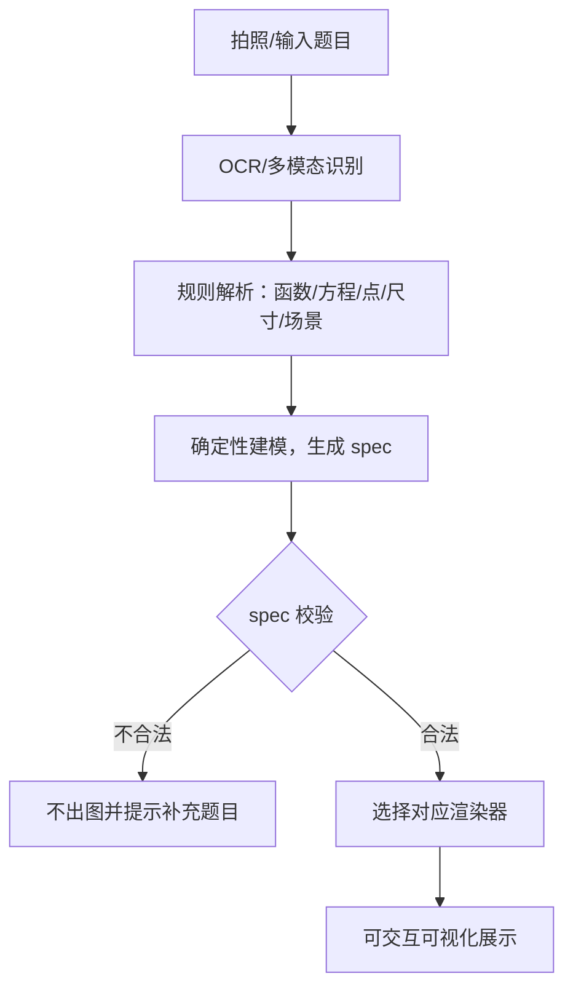

#### 6.14.5 前端交互


* 可视化内嵌对话，支持旋转、缩放、重置视角、全屏与截图。

* 标注 / 辅助线 / 截面开关与截图；动画播放与题目元素联动高亮【未实现，v0.31】。
* 表达式不可编译时显示红色错误提示与具体原因，不再只留空白坐标轴。
* v2 渲染器在曲线为空、区域过大、特征点数量不符时显示诊断；旧版 v1 记录显示“旧版图形已降级显示”提示。
* 预置模板直接保存 v2，打开时不再触发 legacy 降级提示。

#### 6.14.6 安全与兜底


* 函数表达式用安全求值器解析，禁用 eval，防注入。

* spec 做类型、数值与范围校验；解析不到具体结构时不出图并提示补充方程、点、尺寸或场景，不用无关预置图硬凑。

* 预置模板仅用于纯主题问题；旧版单文件 HTML 课件可查看与删除，不提供编辑。

#### 6.14.7 几何辅助元素增强

模型根据解题需要自动补全辅助元素，可逐条显示 / 隐藏。


| 辅助元素 | 状态 | 说明 |
| --- | --- | --- |
| 辅助平面 / 截面 | 已实现 | 半透明延展平面 |
| 辅助线段 | 已实现 | 连接关键点，可设虚线 |
| 棱锥高（垂线） | 已实现 | 顶点到底面中心的垂线 |
| 标注 | 已实现 | 点标签、长度 / 角度基础标注 |
| 垂线 / 垂足、角平分线、中线、平行线、投影、隐藏线、动点轨迹 | 规划 | 【未实现，v0.31】 |
| 旋转翻折动画、逐条出现理由 | 规划 | 【未实现，v0.31】 |


* 辅助线可带 `reason` 字段说明添加理由；按讲解步骤逐条出现【未实现，v0.31】。

* spec 用 auxiliary 数组，kind 区分类型，style 控制虚线 / 颜色 / 透明度。

#### 6.14.8 多函数数形结合

同一坐标系叠加多个函数并做关系分析。


```json
{
  "schema": "edupi.viz/v2",
  "kind": "function-graph",
  "title": "二次函数与直线的交点",
  "input": { "text": "y=x^2 与 y=x+2 的交点" },
  "provenance": { "generator": "preset", "version": "preset@2.0.0" },
  "scene": {
    "definitions": [
      { "name": "f", "params": ["x"], "body": "x^2", "display": "y=x²" },
      { "name": "g", "params": ["x"], "body": "x+2", "display": "y=x+2" }
    ],
    "curves": [
      { "def": "f", "role": "primary", "visible": true },
      { "def": "g", "role": "secondary", "visible": true }
    ],
    "parameters": [],
    "view": { "x": [-3, 4], "mode": "auto" },
    "features": [
      { "kind": "roots", "of": ["f"], "limit": 20 },
      { "kind": "intersections", "of": ["f", "g"], "limit": 20 }
    ],
    "regions": [
      { "kind": "between", "lower": { "kind": "function", "def": "f" }, "upper": { "kind": "function", "def": "g" }, "role": "solution" }
    ]
  },
  "diagnostics": []
}
```


* 多函数同图：不同颜色 / 线型 / 图例，可单独显隐。

* 自动标注：交点（解方程 f=g）、零点、不等式区域与参数滑块已实现；极值、渐近线、切点、对称轴【未实现，v0.31】。

* 数形结合：方程看交点、不等式看区域填充、cases 分段函数分段绘制已实现（支持 `x≤a`、`a<x<b`、`x≥b`）；区域 `condition` 可按 `axis='x'` 生成竖条或按 `axis='y'` 生成水平带；分段函数支持顶层复合 `f(x)=g(x)`，`f(x)=g(x)+1` 这类外层复合仍不支持。

* 动态：参数滑块驱动动直线 / 动曲线，观察根与交点变化；并与解析几何（直线与圆锥曲线）联动。

#### 6.14.9 校验、迁移与视觉回归

* 严格校验：`shared/viz/schema.ts` 对所有 kind 做未知字段拒绝、引用完整性、数量/长度/数值上限校验；function-graph 额外拒绝样式字段。
* 解析器拆分：`visualize-modeler.ts` 只做编排，规则解析拆到 `viz/modeler/{core,function-model,conic-model,geometry-model,molecule-model,physics-model,biology-model}.ts`。
* 批量迁移：`migrate:viz` 默认 dry-run，`--apply` 写库，支持 `--limit`、`--batch-size`、`--strict-input`；缺少 `input_text` 的记录用标题回填并写 `VIZ_INPUT_RECOVERED` 诊断。
* 像素基线：`server/scripts/check-viz-snapshots.ts` 用 `shared/viz/svg.ts` 输出确定性 SVG，再栅格化为 PNG，对比 `server/testdata/viz/snapshots/*.png`；`--update` 更新基线。
* CI：`.github/workflows/viz-ci.yml` 运行服务端类型检查、Web 构建与 `npm run check:viz`（契约 + 渲染 + 像素快照）。
* 保留限制：像素基线覆盖函数/圆锥曲线 SVG，不替代 WebGL/3D 浏览器截图；圆锥曲线自适应细分 `maxDepth=4`；生产库迁移需在备份后手工执行。

### 6.15 响应速度优化方案

针对回答过慢，从 "感知速度" 与 "实际速度" 两条线优化，按优先级落地。

#### 6.15.1 优化措施总表


| 类别   | 措施                                | 优先级 | 主要收益          |
| ---- | --------------------------------- | --- | ------------- |
| 流式体验 | 全程 SSE，首字优先返回（TTFT）               | P0  | 降低感知等待        |
| 模型路由 | 快模型仅 `routing` 场景且默认关闭；主对话用所选模型 | P1 | 降低轻量场景耗时 |
| 上下文  | 精简 RAG 片段、历史与提示词                  | P0  | 减少 prefill 耗时 |
| 缓存 | 检索结果缓存、精确指纹答案缓存、embedding 缓存 | P1 | 命中即秒回 |
| 检索链路 | 简化 Cross-Encoder、减少 agent 层数 | P1 | 减少串行等待 |
| 工程网络 | 就近节点、连接池、本地 GPU / 量化              | P1  | 降低网络与推理延迟     |

#### 6.15.2 关键措施说明


* **首字优先**：后端先建立 SSE 连接并推送起始事件，模型流式输出，用户无需等待完整结果。

* **模型分级路由**：`FAST_MODEL_ID` 仅用于 `routing` 等轻量场景且默认关闭；主对话未接入快模型分级，仍使用所选对话模型。

* **精简输入**：RAG 只传 Top 3–5 最相关片段；历史按条数回放 + 单条截断（`CHAT_HISTORY_LIMIT=16`、`HISTORY_ITEM_MAX_CHARS=6000`），不做摘要生成；画像 / 记忆按需注入。

* **缓存与预热**：检索结果缓存（相似度阈值）+ 精确指纹答案缓存 + embedding 缓存；答案语义缓存与常见知识点预生成未实现。

* **检索与链路**：简单查询跳过 Cross-Encoder；减少子智能体跳转层数，简单问题单轮直出；工具并行调用未实现；限制 `max_tokens` 避免冗长。

* **工程网络**：选择就近低延迟 endpoint，连接池 keep-alive 复用；本地模型用 GPU 与量化加速，媒体 / 模型服务本地部署减少往返。

#### 6.15.3 效果度量

借助 6.10 用量统计的 latency\_ms，持续监控首字延迟与端到端 P50/P95，按数据验证每项优化的实际收益。

### 6.16 用户注册登录

#### 6.16.1 目标与边界

目标：提供简单的账号密码登录，让一个实例可以由多名学生使用。注册时填写手机号、邮箱作为联系信息，不做验证码、不做邮箱验证、不做第三方登录。登录后只看到自己的资料、对话、错题、复盘与用量；管理员能建号、停用账号和重置密码。

本期不做：邮箱/短信验证码、邮件找回密码、OAuth/SSO、管理员 2FA、CAPTCHA、邀请码、按账号配额。找回密码由管理员或本机 CLI 重置。共享资料库/题库不在本期。

#### 6.16.2 账号模型与部署模式

* 账号表 `users`，角色只有 `admin` 与 `user`。第一个创建的账号自动成为管理员。
* 一个账号对应一名学习者：`users.user_id` 与 `learners.learner_id` 一对一，个人数据继续使用现有 `learner_id` 字段归属，不新增第二套归属字段。
* 注册默认开放；设置 `REGISTRATION_OPEN=0` 可关闭，关闭后只能由管理员建号。
* 管理员建号使用 `npm run user:create`，首次登录必须修改临时密码；忘记密码用 `npm run auth:reset`。
* 首次管理员必须通过 `npm run auth:bootstrap` 在本机创建，或显式设置 `AUTH_BOOTSTRAP=1` 且仅允许本机访问注册页。禁止在公网默认开放“第一个注册的人成为管理员”。
* 手机号、邮箱仅作联系信息，不验证、不唯一、不作为登录凭据；登录只用用户名 + 密码。

#### 6.16.3 注册与登录

* 注册字段：用户名、密码、手机号（可选）、邮箱（可选）、显示名（可选）。不收集真实姓名和学校信息。
* 用户名 3–32 字符，只允许字母、数字、下划线和中划线，大小写不敏感唯一；显示名 1–32 字符。
* 密码 6–128 字符，允许长口令与空格，不强制大小写/符号组合；不得与用户名相同。前端提供强度提示。
* 密码使用 Node 内置 `crypto.scrypt` 派生（N=32768、r=8、p=1、16 字节随机盐、32 字节摘要，显式设置 `maxmem=64MB`），存储格式 `scrypt$N$r$p$salt$hash`，比较使用恒定时间函数；不引入原生加密依赖，Windows 与 Docker 均可直接运行。
* 登录失败统一返回“用户名或密码错误”，不区分账号是否存在；注册重名返回 409。
* 登录成功后轮换新会话；同一账号允许多个设备会话，默认最多 10 个，超出时撤销最旧会话。
* 管理员重置密码：生成临时密码、设置 `must_change_password=1`，不自动登录，审计记录操作人；这是本期唯一的找回密码方式。
* 注册与登录接口都做频率限制；密码、会话 token 明文不得写入日志、错误信息或审计详情。

#### 6.16.4 会话与登录态

* 会话 token 为 32 字节随机值；HTTPS 部署使用 `__Host-edu_session`（`HttpOnly; Secure; SameSite=Lax; Path=/`，无 Domain），本地 HTTP 使用 `edu_session`（不加 `Secure`）。
* 数据库只存 token 的 SHA-256 摘要，不存明文；服务端可随时撤销单个会话或全部会话。
* 默认空闲有效期 7 天、绝对有效期 30 天；`last_seen_at` 最多每 10 分钟更新一次，避免频繁写库。
* 退出登录删除当前会话并清 Cookie；“退出所有设备”删除该账号全部会话。
* CSRF 防护：SameSite=Lax + 对 POST/PUT/PATCH/DELETE 校验 `Origin`/`Referer` 与实例同源。默认不开放跨域前端。
* 未登录访问 API 返回 401 JSON；SPA 路由跳转登录页并保留 `redirect` 参数。SSE 与 WebSocket 同样校验会话，WebSocket 未授权以关闭码 4401 结束。

#### 6.16.5 权限与数据隔离

| 资源 | 归属 | 隔离方式 |
| --- | --- | --- |
| 对话、消息、记忆、错题、掌握度、测验、考试复盘、学习计划、每日练习 | 个人 | `learner_id = user_id` |
| 资料、题库、试卷、媒体、可视化、后台任务（切片等子资源随父资源） | 个人 | 新增 `learner_id` 字段，所有查询带当前账号 |
| 用量记录 | 个人明细 / 管理员聚合 | `learner_id` 归属；管理员只看汇总与成本，不看内容 |
| 模型设置、Provider 密钥、MCP 服务、存储配额 | 实例全局 | 仅管理员读写；普通用户不可见密钥 |
| 账号、会话、认证审计 | 账号体系 | 管理员管理账号；本人可管理自己的会话 |

* 管理员默认不能打开他人的对话、资料、错题与复盘；需要家长监护或教师查看时，另立功能并单独授权，不混入本期。
* 管理员重置密码等同于可接管账号，属于高权限操作，必须审计。
* 禁止停用或降级最后一个管理员，避免实例失去管理入口。
* 访问他人资源统一返回 404，避免通过状态码探测资源是否存在。
* 禁止业务代码继续使用全局常量 `DEFAULT_LEARNER`；改为从请求上下文取 `learnerId` 并显式传参。回归脚本增加静态检查，发现新增的 `DEFAULT_LEARNER` 直接失败。
* Milvus 按账号使用独立 collection（如 `edu_chunks_<user_id>`；首个账号沿用旧 `edu_chunks` 以兼容已有向量），从存储层避免漏加过滤条件导致跨账号检索。
* 媒体、OCR 原文图、资料原文件等下载接口必须先从数据库确认归属，再读磁盘；不能只凭路径或 id 直接返回文件。
* 后台任务与 WebSocket 事件按 `learner_id` 路由，只推送给任务所属账号；管理员不能订阅他人任务内容。

#### 6.16.6 接口设计

| 方法 | 路径 | 权限 | 用途 |
| --- | --- | --- | --- |
| GET | /api/auth/bootstrap | 公开 | 是否已完成初始化、是否开放注册 |
| POST | /api/auth/register | 公开（受注册开关控制） | 注册并建立会话 |
| POST | /api/auth/login | 公开 | 登录并建立会话 |
| POST | /api/auth/logout | 登录 | 退出当前会话 |
| GET | /api/auth/me | 登录 | 当前账号、角色、是否需改密 |
| PUT | /api/auth/password | 登录 | 修改自己的密码，撤销其他会话 |
| GET | /api/auth/sessions | 登录 | 活跃会话列表 |
| DELETE | /api/auth/sessions/{id} | 登录 | 撤销指定会话 |
| POST | /api/auth/sessions/revoke-all | 登录 | 退出所有设备 |
| GET | /api/admin/users | 管理员 | 账号列表、状态、最近登录 |
| POST | /api/admin/users | 管理员 | 创建账号并生成临时密码 |
| PUT | /api/admin/users/{id} | 管理员 | 启用/停用、调整角色、改显示名、改手机号/邮箱 |
| POST | /api/admin/users/{id}/reset-password | 管理员 | 生成临时密码并强制改密 |
| GET | /api/admin/audit | 管理员 | 登录与管理员操作审计 |

错误约定：401 未登录或会话过期；403 权限不足；409 用户名已存在或未完成初始化；422 密码策略不满足；429 频率限制（返回 `Retry-After`）。

#### 6.16.7 前端交互

* 新增 `/login`、`/register`、`/account` 页面；除登录/注册外，路由统一标记 `requiresAuth`。
* 注册页只收集用户名、密码、手机号、邮箱、显示名；手机号/邮箱明确提示“仅作联系方式，不验证”。
* 账号页提供修改密码、活跃设备、退出所有设备；管理员从侧栏进入 `/admin` 账号管理页。
* 应用启动先请求 `/api/auth/me` 再挂载受保护路由，避免先闪出页面再跳登录；401 拦截器清除本地账号状态并跳转 `/login?redirect=...`。
* 未登录时不要探测业务接口（首页的 `/api/model`、错题提醒、任务 WebSocket 等全部延后到登录成功后启动），避免登录页出现 401 报错与重连噪音。
* `/admin` 账号管理页提供账号列表、创建账号、启停、改角色/联系方式、重置密码、认证审计与上线检查；普通用户不显示该入口，直接访问会被重定向。
* 模型设置、MCP、存储治理页仅管理员可进入；用量页普通用户只看自己的记录，管理员可查看聚合与成本，但不能查看他人对话内容。
* SSE 请求与 WebSocket 使用同源 Cookie；收到 401/4401 时停止重连并跳转登录。

#### 6.16.8 安全要求

* 公网部署必须 HTTPS；反向代理传递 `X-Forwarded-Proto`，服务端据此设置 `Secure` Cookie。
* 登录失败默认 5 次/15 分钟锁定 15 分钟，按账号 + 来源 IP 计数；管理员或 CLI 可解锁。注册默认 10 次/小时/IP。
* 认证审计记录登录成功/失败、注册、改密、管理员操作、会话撤销；只记录账号 id、时间、IP、User-Agent 与结果，不记录密码或 token。
* 会话 Cookie 不参与前端 JS 读取；前端不把 token 写入 localStorage。
* 密码哈希、会话摘要不得通过任何接口回传；错误响应不包含堆栈与数据库细节。
* 本期不提供自助找回密码；管理员重置是唯一路径，必须在页面上说明。
* 仅测试环境允许 `AUTH_ENABLED=0` 绕过登录，且启动时打印醒目警告；生产环境检测到该值直接拒绝启动。
* 备份与迁移包含 `users/sessions` 表；恢复后建议撤销全部会话，防止旧 Cookie 继续可用。

#### 6.16.9 配置项

| 变量 | 默认 | 说明 |
| --- | --- | --- |
| AUTH_ENABLED | 1 | 关闭仅用于隔离测试，生产禁止 |
| AUTH_BOOTSTRAP | 0 | 允许本机首次注册成为管理员 |
| REGISTRATION_OPEN | 1 | 开发默认开放；生产多用户建议 0，关闭后仅管理员建号 |
| SESSION_TTL_DAYS | 7 | 空闲有效期 |
| SESSION_ABSOLUTE_DAYS | 30 | 绝对有效期 |
| SESSION_MAX_PER_USER | 10 | 单账号最大会话数 |
| COOKIE_SECURE | auto | auto 按请求协议；也可强制 1/0 |
| LOGIN_MAX_FAILURES | 5 | 触发锁定的失败次数 |
| LOGIN_WINDOW_MIN | 15 | 失败计数窗口 |
| LOGIN_LOCK_MIN | 15 | 锁定时长 |
| TRUST_PROXY | 1 | 信任反向代理的转发头，仅在有可信代理时开启 |
| AGENT_SESSION_MAX | 300 | Pi AgentSession 缓存条数上限，0=不限制 |
| AGENT_SESSION_TTL_MIN | 60 | AgentSession 空闲过期分钟数，0=不过期 |
| AGENT_MAX_CONCURRENT | 6 | 聊天全局并发上限，0=不限制 |
| AGENT_MAX_CONCURRENT_PER_USER | 2 | 单用户聊天并发上限，0=不限制 |
| AGENT_QUEUE_WAIT_MS | 15000 | 全局并发满时最长排队时间，0=不排队 |
| MAINTENANCE_INTERVAL_HOURS | 6 | 运行时表清理周期，0=关闭 |
| IDEMPOTENCY_RETENTION_HOURS | 24 | chat_idempotency 保留小时数 |
| TASK_RETENTION_DAYS | 30 | 已结束 tasks 保留天数 |

#### 实现新增配置项（v0.31–v0.32）

实现中新增（相对 v0.30 规划态）的配置项：`CSRF_ENABLED`、`CSRF_ALLOWED_ORIGINS`、`BOOTSTRAP_LOCAL_ONLY`、`MCP_CONFIRM_SIDE_EFFECTS`、`DOCUMENT_PII_REDACT`、`TRACE_LOG`、`AGENT_MAX_TOOL_STEPS`、`AGENT_WALL_CLOCK_MS`、`AGENT_TOKEN_BUDGET`、`RAG_TIMEOUT_MS`、`MILVUS_TIMEOUT_MS`、`RAG_RETRY_MAX`、`TASK_TIMEOUT_MS`、`TASK_RETRY_MAX`、`LLM_KEY_MAX_ATTEMPTS`、`AGENT_SESSION_MAX`、`AGENT_SESSION_TTL_MIN`、`AGENT_MAX_CONCURRENT`、`AGENT_MAX_CONCURRENT_PER_USER`、`AGENT_QUEUE_WAIT_MS`、`MAINTENANCE_INTERVAL_HOURS`、`IDEMPOTENCY_RETENTION_HOURS`、`TASK_RETENTION_DAYS`、`FAST_MODEL_ID`、`SSE_RETRY_MAX` / `VITE_SSE_RETRY_MAX`、`TTS_DEFAULT_VOLUME`、`EVAL_ENABLE_ADVANCED`、`CHAT_HISTORY_LIMIT`、`HISTORY_ITEM_MAX_CHARS`、`RAG_TOP_K` / `RAG_CANDIDATE_K` / `RAG_RECALL_LIMIT`、`RERANK_MIN_QUERY_CHARS`、`ROUTE_LLM_MIN_CHARS`。

默认值以 `server/src/config.ts`、`server/src/tasks/queue.ts`、`server/tsconfig.json` 为准；完整表见 `README.md` 配置节与本节表格。

#### 6.16.10 验收标准

1. 首次初始化后可用管理员登录；关闭注册后公开注册接口返回 403。
2. 注册只需用户名、密码、手机号/邮箱（可留空）；不发送验证码，注册后可直接登录。
3. 登录、刷新、退出、修改密码、退出所有设备均生效；Cookie 为 HttpOnly，前端读不到 token。
4. 用户 A 无法通过列表、详情、下载、SSE、WebSocket 获取用户 B 的任何个人数据；越权请求返回 404。
5. 连续错误密码达到阈值后返回 429/锁定，窗口结束或管理员解锁后可正常登录；错误信息不泄露账号是否存在。
6. 管理员可创建/停用/启用账号、修改联系信息、重置密码并强制改密；不能读取他人对话、资料与复盘内容。
7. 现有 `default` 学习者数据迁移后完整归属首个管理员，数量与内容不变；RAG 检索只返回本账号资料。
8. 认证开启后原有回归脚本与前端页面全部通过；SSE 对话、文件上传、OCR 校对、后台任务、WebSocket 推送均带登录态正常工作。
9. 公网部署通过 HTTPS、Secure Cookie 与每日备份检查；关闭注册时新用户无法注册。

10. 同一会话并发发送两条消息时，第二条返回 `409 CONVERSATION_BUSY`，且数据库只保留第一条用户消息；可通过 `check-conversation-lock.ts` 验证。

11. 单用户超过并发上限返回 `429 CHAT_BUSY`；全局并发满时按 `AGENT_QUEUE_WAIT_MS` 排队，超时返回 429；可通过 `check-chat-gate.ts` 验证。

12. 配置两个及以上 provider key 时，同一会话连续三轮固定同一 key；只有调用失败才切换，并通过数据库历史重建 session；可通过 `check-session-pinning.ts` 验证。

13. Session LRU/TTL、幂等表/答案缓存/已结束任务清理可通过 `check-multiuser.ts` 验证；SQLite `busy_timeout=5000` 生效。

### 6.17 上线最低要求

本期账号以“简单可用”为目标，不引入邮件验证、CAPTCHA、2FA 和按账号配额。做到以下几条即可上线；后续需要再逐项加。

* 绑定域名并使用 HTTPS（Caddy 自动证书或 Nginx + Let's Encrypt），只开放 80/443，应用端口不直接暴露。
* 反向代理与应用双层限流；开发默认开放注册，生产多用户建议设 `REGISTRATION_OPEN=0`，由管理员建号。
* 多用户运行护栏：只跑一个应用容器，不要让多个容器共享同一个 SQLite 卷；配置 `AGENT_MAX_CONCURRENT` / `AGENT_MAX_CONCURRENT_PER_USER` / `AGENT_QUEUE_WAIT_MS`；compose healthcheck 为 `healthy`；日志轮转开启；Nginx 上传上限与后端 200MB 单批限制对齐。
* `server/.env` 权限 600；`EDUPI_SETTINGS_SECRET` 必须单独异地备份，否则数据库内的加密模型密钥/MCP 配置无法解密。
* 每日备份 SQLite、uploads 与 `.env`：运行 `npm run backup`（可加 `-- --with-uploads`），备份写入 `data/backups/`；每月至少做一次恢复检查，恢复后撤销全部会话。
* 配置外部 uptime 与磁盘/内存告警；日志不记录密码、Cookie、token。
* 提供 `/privacy`、`/terms` 与联系方式；大陆节点需完成 ICP 备案。
* 管理员使用强口令，生产环境不存在默认密码；演示账号上线前删除。
* 本期不做：邮箱验证码、邮件找回、CAPTCHA、管理员 2FA、邀请码、按账号用量配额；需要时在后续迭代补齐。


***

## 7. 数据设计

### 7.1 数据模型关系图（ER 图）

> 下图为当前 SQLite 实际 schema（`server/src/store.ts`），不含规划表；个人资源统一通过 `learner_id` 归属。

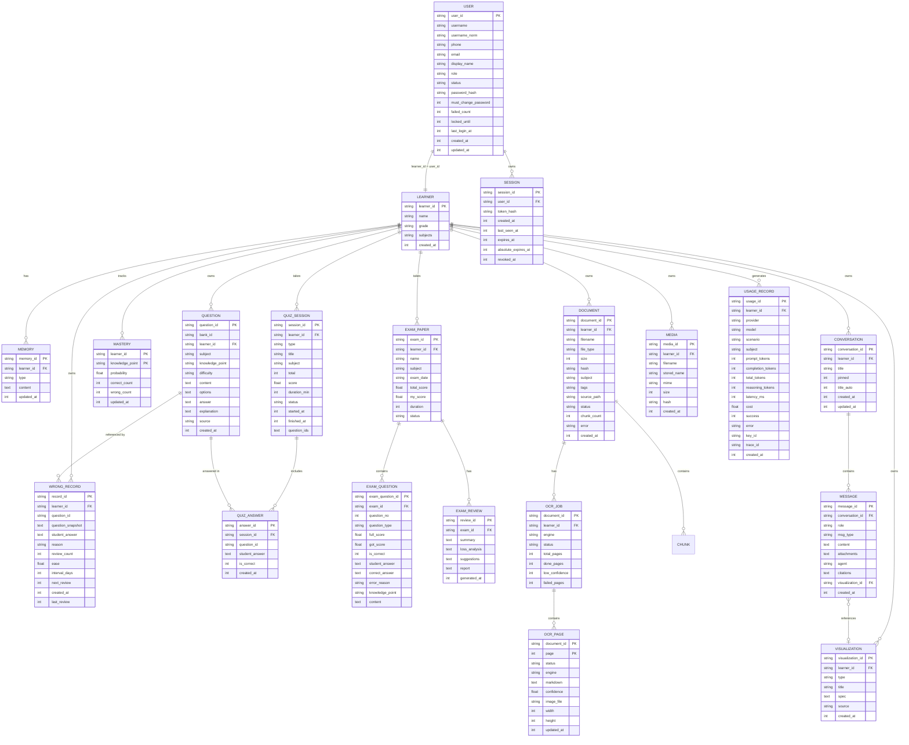
### 7.2 存储策略


* 结构化数据（画像、题库、错题、掌握度、测验）：本地 SQLite。

* 非结构化内容（长期记忆、笔记、生成的课件）：Markdown/JSON 文件，便于查看与迁移。

* 全部数据默认仅存本地，不上传；云端模型仅在调用时发送必要内容。

### 7.3 账号数据表与迁移

#### 7.3.1 认证相关表

| 表 | 关键字段 | 说明 |
| --- | --- | --- |
| users | user_id、username、username_norm、phone、email、display_name、role、status、password_hash、must_change_password、failed_count、locked_until、last_login_at、created_at、updated_at | 账号主表；username_norm 唯一；手机号/邮箱仅联系信息 |
| sessions | session_id、user_id、token_hash、created_at、last_seen_at、expires_at、absolute_expires_at、ip、user_agent、revoked_at | 服务端会话；token 只存摘要 |
| auth_events | event_id、user_id、type、ip、user_agent、result、detail、created_at | 登录与管理员操作审计，不含密码与 token |

索引：`users(username_norm)` 唯一；`sessions(token_hash)` 唯一、`sessions(user_id, expires_at)`；`auth_events(created_at)`。

#### 7.3.2 个人资源归属

现有已带 `learner_id` 的表直接复用，值改为当前 `user_id`：memories、wrong_records、mastery、quiz_sessions、usage_records、conversations、learning_plans、daily_practices。

需要新增 `learner_id NOT NULL` 的表：documents、questions、exam_papers、courseware、media、visualizations、tasks。以下表不单独加字段，通过父资源判断归属：chunks（document）、quiz_answers（quiz_session）、exam_questions / exam_reviews（exam_paper）、messages（conversation）、ocr_jobs / ocr_pages（document）。`questions`、`ocr_jobs` 等当前均已带 `learner_id`，以 7.1 的实际 schema 为准。

实例级表不加 `learner_id`，仅管理员可操作：model_settings、provider_keys、mcp_servers、storage_cleanups。

预置可视化保持全局只读：固定 id 为 `preset:<id>` 的记录归属用 `learner_id='__global__'` 标记，所有账号可读；用户生成的可视化写自己的 `learner_id`，生成、删除、列表均校验归属。

多账号前必须处理两个旧约束：

* `daily_practices.date` 原为主键，两个账号同一天会冲突；改为 `(learner_id, date)` 联合主键。
* `documents.hash` 原为全局唯一；实现按账号写入 `learner_id:sha256`，查询同时带账号，达到按账号去重，无需重建表。

#### 7.3.3 迁移步骤

1. 备份 `edu.db`、`uploads/`、Milvus 数据目录，记录各表行数。
2. 建 users / sessions / auth_events 表；如 users 已存在则补 phone、email、must_change_password、failed_count、locked_until 等列。
3. 用 `ALTER TABLE ... ADD COLUMN learner_id TEXT NOT NULL DEFAULT 'default'` 给需要归属的表加列并回填；旧 documents/media 的 hash 补上 `default:` 前缀。
4. 重建 `daily_practices`（联合主键 `learner_id, date`）：建新表、复制数据、校验行数、替换旧表；完成后执行 `PRAGMA foreign_key_check`。
5. 首个管理员 `user_id` 固定为 `default`，沿用现有数据；同时在 learners 表补一条 `learner_id='default'` 的记录。后续每创建一个账号，同步插入对应 learners 行。
6. Milvus：首个账号沿用旧 collection `edu_chunks`，新账号使用 `edu_chunks_<sanitized_user_id>`；`npm run auth:migrate -- --reindex` 可强制重建向量，正常迁移不需要重跑。
7. 媒体与 OCR 原文件继续放共享目录，数据库补归属；下载接口先查归属再读文件，禁止直接暴露路径。
8. 业务代码改用请求上下文取 `learnerId`，删除 `DEFAULT_LEARNER`；回归脚本增加静态检查。
9. 跑 `npm run auth:check` 与 `npm run auth:isolation`，验证 A/B 账号的资料、对话、媒体、RAG、任务互不可见。

#### 7.3.4 回滚与兼容

* 迁移前备份可整体恢复；新增列对旧代码无副作用。
* 紧急情况下本机可临时 `AUTH_ENABLED=0` 绕过登录排查问题，生产环境禁止，启动时检测到即拒绝。
* 旧版脚本若未带登录态，统一在测试环境使用 `AUTH_ENABLED=0` 或测试账号登录，不把绕过开关带进生产。


***

## 8. 开发路线


| 阶段     | 目标       | 交付内容                                                                       | 参考周期  |
| ------ | -------- | -------------------------------------------------------------------------- | ----- |
| P0 MVP | 跑通最小学习闭环 | Node 本地服务 + Vue3 前端（对话 / 错题 / 出题页面）+ 记忆画像、错题本、出题 3 个工具 + 1 个 RAG MCP       | 数天    |
| P1     | 完整学习与诊断  | 前端完整页面（模考 / 复盘 / 掌握度）、题库提取、模考、BKT 掌握度、4 个子智能体、拍照答疑、考试复盘、Router/Worker 双层编排 | 1–2 周 |
| P1.5   | 账号与多用户   | 用户名密码注册登录、手机号/邮箱联系信息、服务端会话、首个管理员、按账号隔离数据与文件、管理员建号/停用/重置密码 | 1–2 周 |
| P2     | 体验增强与安全  | edulab 交互课件、解题视频、安全 MCP、事件驱动后台与 Watchdog                                   | 数周    |


***

## 9. 部署与运行环境

### 9.1 环境要求


* 操作系统：Windows /macOS/ Linux（本机为 Windows）。

* 运行时：Node.js（Pi 运行环境）。

* 向量库：Docker Desktop（运行 Milvus Standalone）；Python 路线在 WSL2/macOS 下可用 Milvus Lite。

* 可选本地模型：Ollama，提供 OpenAI 兼容接口（`http://localhost:11434/v1`）。

### 9.2 模型配置策略


| 模式        | 适用            | 特点                       |
| --------- | ------------- | ------------------------ |
| 云端模型      | 追求效果、有网络      | 能力强，按 token 计费，需 API Key |
| 本地 Ollama | 隐私优先、零 API 费用 | 数据不出本机，对硬件有一定要求          |

### 9.3 启动方式（规划）


* 后端服务：`npm run dev:server` 启动 Node 本地服务（内嵌 Pi）。

* 前端开发：`npm run dev` 启动 Vite（默认 [http://localhost:5173](http://localhost:5173)）。

* 生产运行：`npm run build` 构建前端，由后端托管，浏览器访问本地端口。

* 首次初始化：`npm run auth:bootstrap` 创建管理员；未初始化时登录页提示先执行该命令。公网部署必须 HTTPS，并在反向代理层确认 `X-Forwarded-Proto`。

* 扩展调试：`pi -e ./src/index.ts` 可单独快速测试扩展逻辑。

### 9.4 公网部署最低配置

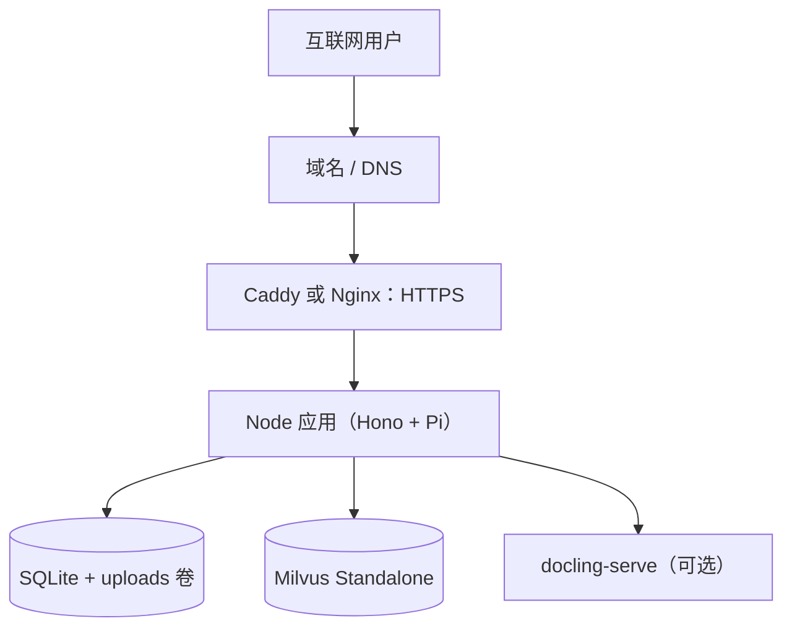

* 资源：仅对话/资料/出题用 2 vCPU / 4GB / 60GB；含扫描件 OCR 用 4 vCPU / 8GB / 80GB，并配置 2GB swap。
* 端口：只暴露 80/443；应用容器只绑定 `127.0.0.1:3001`，由宿主机 Nginx 对外；Milvus 19530、Docling 5001 只监听内网或 Docker 网络；SSH 用密钥登录。
* 配置：`.env` 权限 600，生产 `AUTH_ENABLED=1`、`COOKIE_SECURE=1`（HTTPS 就绪时）或 `auto`、`TRUST_PROXY=1`；多用户建议 `REGISTRATION_OPEN=0`；配置 `AGENT_MAX_CONCURRENT` / `AGENT_MAX_CONCURRENT_PER_USER` / `AGENT_QUEUE_WAIT_MS`。首次管理员用 `npm run auth:bootstrap` 创建，不设默认密码。

* 运行形态：只跑一个 `edu-agent` 容器，SQLite 放在命名卷 `app_data`；compose healthcheck 请求 `/health`，日志使用 json-file 10m×3 轮转；`deploy/deploy.sh` 同步时排除 `server/.env`、`server/data`、`server/uploads`、`server/models`。
* 发布：备份 SQLite/uploads/`.env` → 构建/拉镜像 → 迁移 → 启动 → 容器 `healthy` 且 `/health` 通过 → 冒烟（登录、对话、检索、上传、`check:multiuser:all`）；失败回滚上一版本镜像与数据库备份。

* 当前生产 `8.148.185.212` 为 HTTP + Nginx 3000 直连，尚无域名证书；HTTPS 未完成前仅适合邀请制小范围使用。
* 备份、监控与合规的最低要求见 §6.17；邮件验证、CAPTCHA、2FA、按账号配额本期不配置。


***

## 10. 安全与隐私


1. 本地优先：学习数据默认存储在本机，不主动外发。

2. 扩展安全：扩展拥有系统权限，仅加载可信来源，危险工具调用经 `tool_call` 拦截。

3. 预留安全 MCP：P2 接入安全 SDK，实现 prompt 注入防护、不当输出过滤、PII 脱敏。

4. 最小上传：调用云端模型时仅发送必要上下文，敏感信息先脱敏。

5. 账号安全：密码用 scrypt 加盐哈希；登录失败限流与短期锁定；会话使用 HttpOnly Cookie 并支持随时撤销；不在前端保存 token。

6. 越权防护：所有个人数据查询带 `learner_id`；管理员不能读取他人学习内容；越权访问统一返回 404；文件下载先查归属再读盘。

7. 公网部署：必须 HTTPS 与 Secure Cookie；数据隔离完成后默认开放注册，可按需设置 `REGISTRATION_OPEN=0` 关闭；首次管理员只允许本机 CLI 创建，禁止公网抢占。

8. 审计与日志：记录登录、注册、改密、重置、会话撤销与管理员操作；日志不含密码、会话 token 与模型密钥。

9. 测试开关：`AUTH_ENABLED=0` 仅限隔离测试环境，生产启动检测到即拒绝；备份与恢复后撤销全部会话。

10. 传输与浏览器安全：强制 HTTPS；会话 Cookie 使用 `HttpOnly` 与 `__Host-` 前缀；反向代理与应用双层限流。

11. 成本与滥用：用注册开关、登录限流和现有月度预算控制；本期不引入邮箱验证、CAPTCHA、2FA 或按账号配额。


***

## 11. 风险与权衡


| 风险 / 问题     | 说明                         | 应对                          |
| ----------- | -------------------------- | --------------------------- |
| 代码不能直接搬运    | DeepTutor 为 Python，Pi 为 TS | 复用思路、Skill、MCP，有状态工具用 TS 重写 |
| 掌握度 / 题库需自研 | BKT、抽题、记忆为确定性逻辑            | 算法复杂度可控，分阶段实现并单测            |
| 解题视频工作量大    | 涉及 TTS 与渲染管线               | 优先接外部 MCP，不早期自研             |
| 本地模型能力受限    | 小模型在复杂推理上较弱                | 关键任务可切换云端模型，混合使用            |
| 框架演进风险      | 依赖 Pi 与 MCP 生态             | 关注官方仓库活跃度，核心逻辑与框架解耦         |
| 公网滥用与模型成本   | 公开注册可能被刷号、刷 token，直接消耗 API 额度 | 生产默认关闭注册 + 登录限流 + 单用户/全局并发门限 + 现有月预算；发现异常可停用账号 |
| 未成年人合规      | 目标用户含高中生，公开收集个人信息有监护人同意要求 | 最小化收集；隐私政策与协议；无法落实监护人同意时只做家庭部署 |
| 单机运维风险      | 磁盘、内存、Docling 峰值导致服务不可用或数据丢失 | 资源余量、swap、磁盘/内存告警、每日备份与恢复演练 |
| SQLite 并发上限   | 多账号同时长任务写入可能锁等待          | WAL、`busy_timeout=5000`、短事务、单 Worker、单实例；规模增长后再评估 PostgreSQL |
| 多 Key 会话漂移 | 同一会话轮换不同 key 会复用旧 session，导致上下文跳变 | 会话固定 key；失败切换时删除旧 session 并从 DB 历史重建；`check-session-pinning.ts` 回归 |
| 并发与内存增长 | 多用户同时聊天可能打满 provider 额度；会话缓存长期无界 | 全局/单用户并发门限 + 排队超时；AgentSession LRU/TTL；周期清理运行时表 |


***

## 12. 验收标准（P0 MVP + 公网上线）


1. 扩展可被 Pi 自动发现并加载，无报错。

2. 可上传一份资料并完成一次带引用的 RAG 问答。

3. 可针对指定知识点生成题目并记录作答。

4. 答错的题目可自动进入错题本并持久化，重启后仍存在。

5. 学习者画像可在新会话中被读取并注入上下文。

6. 可通过浏览器访问 Vue3 前端，完成一次流式对话并看到引用来源。

7. 可注册/登录并保持登录态；未登录访问受保护页面自动跳转登录，退出后旧会话立即失效。

8. 两个账号的数据、文件、对话与后台事件互相不可见；管理员可建号、停用账号、重置密码，但读不到他人学习内容。

9. 现有 `default` 数据迁移后完整归属首个管理员；RAG 检索、媒体下载与 WebSocket 推送均按账号隔离。

10. 注册只需用户名、密码和可选手机号/邮箱，不发送验证码；关闭注册后新用户无法注册。

11. 公网部署通过 HTTPS、Secure Cookie 与每日备份检查；隐私政策、用户协议与联系方式可访问。

12. CSRF、bootstrap 本机限定、MCP 配置期确认与存量回填可通过 npm run auth:check 与 check-mcp.ts 验证。

13. Agent 循环具备工具步数上限 / 墙钟上限 / token 预算与 incomplete 人工接管点，可通过 check-resilience.ts 验证。

14. 检索外部调用有显式超时、重试与降级；quiz 与 analysis 后台任务均可被 watchdog 中止。

15. SSE 断线重发按 (learner_id, clientRequestId) 去重，可通过 check-sse-idempotency.ts 与 check-config-keys.ts 验证。

16. 同一会话并发生成返回 409 `CONVERSATION_BUSY`，且只保留一条用户消息；可通过 `check-conversation-lock.ts` 验证。

17. 单用户超过并发上限返回 429 `CHAT_BUSY`；全局满时排队，超时返回 429；可通过 `check-chat-gate.ts` 验证。

18. 配置两个以上 provider key 时，同一会话连续三轮固定同一 key；失败切换用 DB 历史重建 session；可通过 `check-session-pinning.ts` 验证。

19. AgentSession LRU/TTL、幂等表/答案缓存/已结束任务清理、SQLite `busy_timeout` 可通过 `check-multiuser.ts` 验证；生产 compose healthcheck 为 `healthy`。


***

## 13. 多轮对话实施计划

本项目无法在一次对话内完成，按 "**每次对话只做一个可独立验收的小闭环**" 拆分为 A–K 多个阶段，任务编号以 13.4 表为准，严格按依赖推进。

### 13.1 总体原则


* 单次对话只完成表中一个任务（S01–S23），不贪多；任务过大当场再拆。

* 每次产出必须可运行、可验证，再进入下一次对话。

* 本计划基于当前 TS + Node + Vue3 技术栈；若最终改用 Pi Python 路线，工具 / 服务实现语言改为 Python，对话拆分与验收逻辑不变。

### 13.2 会话衔接机制

每次新对话的固定开场动作：让 AI 先读 ①本设计文档 ②`PROGRESS.md` ③本次模块相关代码，确认进度后再动手。每次对话收尾：更新 `PROGRESS.md` 并 git commit。

`PROGRESS.md` 模板：


```
# 智学 实施进度
当前阶段：
已完成对话：
下一步对话（编号+目标）：
关键文件/接口：
遗留问题与风险：
```

### 13.3 阶段路线图


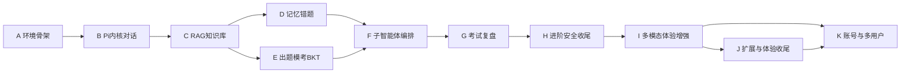

### 13.4 对话任务表

> S23（性能优化与压测）属于阶段 I；J 为仓库扩展批次（S24–S31）；K 为本次新增的账号体系（S32–S34）。仓库扩展批次已使用 S24–S31（学习计划、回复完整性、每日练习、文件夹导入、难度校准、MCP、自动可视化、3D 课件），账号体系从 S32 起编号，避免撞号。

**阶段 A：环境与骨架**


| 编号  | 主题   | 目标与产出                                                  | 验收               | 前置  |
| --- | ---- | ------------------------------------------------------ | ---------------- | --- |
| S01 | 环境搭建 | Node、Docker Desktop、Milvus Standalone（19530）、可选 Ollama | Milvus 健康检查通过    | —   |
| S02 | 工程骨架 | monorepo：server (Hono)+web (Vite/Vue3)、目录与 TS 配置       | 前后端启动，/health 联通 | S01 |

**阶段 B：Pi 内核与对话**


| 编号  | 主题     | 目标与产出                                      | 验收       | 前置  |
| --- | ------ | ------------------------------------------ | -------- | --- |
| S03 | 接入 Pi  | 后端内嵌 Pi，封装 /api/chat（非流式）+ provider/key 配置 | 接口可完成对话  | S02 |
| S04 | 流式与对话页 | SSE 流式 + 前端对话页（EventSource、气泡、KaTeX）       | 浏览器可流式对话 | S03 |

**阶段 C：RAG 知识库**


| 编号  | 主题        | 目标与产出                                            | 验收           | 前置  |
| --- | --------- | ------------------------------------------------ | ------------ | --- |
| S05 | 文档解析切片    | /api/documents 上传，PDF/Word/MD 解析与 chunk          | 切片结果正确、带元数据  | S04 |
| S06 | Milvus 灌库 | 建 collection，text-embedding-v4 dense + BM25 Function sparse | 数据可写入并检索 | S05 |
| S07 | 混合检索闭环    | 混合检索 + RRFRanker+Cross-Encoder + 引用，前端问答 / 引用展示  | 带引用 RAG 问答跑通 | S06 |

**阶段 D：记忆与错题（可与 E 并行）**


| 编号  | 主题     | 目标与产出                                 | 验收          | 前置  |
| --- | ------ | ------------------------------------- | ----------- | --- |
| S08 | 记忆画像   | SQLite 表、memory 工具、钩子注入、wrongbook.add | 画像可跨会话读取    | S07 |
| S09 | 错题本与复习 | 错题前端列表 + 间隔复习调度（SM-2 简化）              | 错题持久化、复习可推送 | S08 |

**阶段 E：出题模考与 BKT（可与 D 并行）**


| 编号  | 主题      | 目标与产出                                | 验收       | 前置  |
| --- | ------- | ------------------------------------ | -------- | --- |
| S10 | 出题工具    | quiz.generate + 前端答题组件               | 可出题并记录作答 | S07 |
| S11 | 题库与模考   | bank.extract、模考计时 / 交卷 / 解析          | 完整模考流程跑通 | S10 |
| S12 | BKT 掌握度 | BKT 算法、mastery.update、掌握度页面（Element Plus 进度） | 掌握度随作答更新 | S11 |

**阶段 F：子智能体与编排**


| 编号  | 主题   | 目标与产出                                  | 验收         | 前置      |
| --- | ---- | -------------------------------------- | ---------- | ------- |
| S13 | 子智能体 | Tutor/Quizzer/Analyst/Solver 封装、提示词与路由 | 任务可正确分派    | S09、S12 |
| S14 | 双层编排 | Router/Worker【未实现，v0.31】、可续任务、WebSocket           | 后台任务可续、不阻塞 | S13     |

**阶段 G：考试复盘**


| 编号  | 主题   | 目标与产出                           | 验收        | 前置  |
| --- | ---- | ------------------------------- | --------- | --- |
| S15 | 整卷识别 | OCR / 多模态 exam.recognize        | 整卷可结构化    | S14 |
| S16 | 复盘报告 | exam.analyze、exam.compare、前端复盘页 | 生成报告与趋势对比 | S15 |

**阶段 H：进阶、安全与收尾**


| 编号  | 主题       | 目标与产出                                    | 验收            | 前置  |
| --- | -------- | ---------------------------------------- | ------------- | --- |
| S17 | 统一可视化与安全 | 统一可视化引擎（预置课件 + 题目自动生成，含辅助线 / 多函数）、安全 SDK | 可视化可交互、安全策略生效 | S16 |
| S18 | 评测与交付    | 评测集回归、构建托管、文档收尾                          | 全流程回归通过       | S17 |

**阶段 I：多模态与体验增强**


| 编号  | 主题      | 目标与产出                                          | 验收          | 前置      |
| --- | ------- | ---------------------------------------------- | ----------- | ------- |
| S19 | 会话管理    | CONVERSATION/MESSAGE 持久化、历史列表、重开继续             | 旧会话可重开续聊    | S18     |
| S20 | 图片输入    | 拍照 / 上传、视觉模型 / OCR、图片存储                        | 可发图并获解答     | S19     |
| S21 | 语音能力    | ASR 识别 + TTS 播报                                | 语音可输入、回复可朗读 | S19     |
| S22 | 存储治理    | 媒体清理、配额、孤儿文件回收                                 | 用量可查、可清理    | S20、S21 |
| S23 | 性能优化与压测 | 检索结果缓存、上下文精简、Cross-Encoder 裁剪，TTFT/P95 压测 | 延迟达标、缓存命中 | S22 |

> 提速为贯穿性要求：P0 措施（流式、快模型、精简上下文）自 S04 起即执行，S23 集中优化与压测。

**阶段 K：账号与多用户（新增）**


| 编号  | 主题         | 目标与产出                                                                 | 验收                     | 前置  |
| --- | ---------- | --------------------------------------------------------------------- | ---------------------- | --- |
| S32 | 账号认证与登录页   | users/sessions/auth_events 表、scrypt 密码、用户名密码注册（手机号/邮箱可选）、登录/退出/me、HttpOnly 会话、路由守卫、首个管理员初始化 | 可注册登录、刷新保持登录、退出即失效 | S18 |
| S33 | 多账号数据隔离与迁移 | 个人资源补 learner_id、请求上下文替换 DEFAULT_LEARNER、Milvus 分账号 collection、文件与 SSE/WS 归属、迁移脚本 | A/B 账号互不可见，旧 default 数据完整迁移 | S32 |
| S34 | 账号管理与会话安全 | 管理员建号/停用/改角色、登录限流与锁定、会话管理、管理员重置密码、审计、HTTPS 与备份最低检查 | 账号管理可用，越权测试与全量回归通过 | S33 |

### 13.5 里程碑与裁剪


* 里程碑 1（S04）：浏览器可流式对话。

* 里程碑 2（S07）：带引用 RAG 闭环，对应 P0 MVP。

* 里程碑 3（S12）：个性化出题、错题与掌握度闭环，对应 P1。

* 里程碑 4（S18）：全功能 + 安全 + 可部署，对应 P2。

* 里程碑 5（S22）：多模态输入、语音与历史会话体验完善。

* 里程碑 6（S23）：响应延迟达标（TTFT/P95），检索结果缓存生效。

* 里程碑 7（S34）：账号注册登录与数据隔离生效，完成 HTTPS、备份与基本账号管理，可按个人网站上线。

* D、E 两阶段可并行；时间紧时 S17 可视化、S14 WebSocket 可后置，S23 性能压测与功能开发迭代进行。

### 13.6 风险备注


* Milvus 全文 BM25 需 Standalone，Lite 不支持；Windows 原生不可用 Lite，需 WSL2。

* 每次对话务必先核对 `PROGRESS.md`，避免重复造轮子或遗漏依赖。

* 核心教学逻辑与框架解耦，降低 Pi/Milvus 版本演进带来的返工风险。


***

## 14. 逐次对话详细实施手册

每次对话开场先读 `PROGRESS.md` 与本章对应编号，按步骤执行；收尾更新进度并 git commit。

> 本章 S01–S34 是历史实施记录，保留当时的分步计划与验收口径；与当前代码不一致处，以第 5–7 章和附录 B 为准。

### 阶段 A：环境与骨架

#### S01 环境搭建


* 目标：就绪 Node、Docker、Milvus 与版本管理。

* 步骤：

1. 校验 Node ≥ 22.19；安装并启动 Docker Desktop。

2. 编写 docker-compose.yml，启动 Milvus Standalone（含 etcd、minio），映射 19530、9091。

3. 可选安装 Ollama 并拉取一个本地模型。

4. git init，配置 .gitignore（忽略 node\_modules、.env、data、uploads、media）。

* 产出：docker-compose.yml、运行中的 Milvus。

* 验收：docker ps 三容器正常，Milvus 健康检查返回 ok。

#### S02 工程骨架


* 目标：搭建前后端 monorepo 并打通。

* 步骤：

1. 建 server/（Hono + tsx + TS）、web/（Vite + Vue3 + TS + Element Plus + Pinia）。

2. 配置 tsconfig；Vite 配置 /api 代理到后端端口。

3. server 实现 GET /health，前端启动页调用并展示。

* 产出：基础目录与 package.json。

* 验收：前后端均可启动，页面显示后端健康状态。

### 阶段 B：Pi 内核与对话

#### S03 接入 Pi（非流式）


* 目标：后端能调用模型完成对话。

* 步骤：

1. server 安装 Pi 内核依赖，封装 LLM 客户端与 provider 配置加载。

2. 实现 POST /api/chat，接收 messages 并返回完整回复。

3. provider/key 从 settings 配置读取（对应 6.9）。

* 产出：chat 服务、配置模块。

* 验收：调用 /api/chat 能返回模型回答。

#### S04 SSE 流式与对话页


* 目标：浏览器可流式对话。

* 步骤：

1. /api/chat 改为流式，Hono 以 SSE 逐 chunk 推送。

2. 前端读取流并实时渲染气泡，集成 KaTeX 渲染公式。

3. 加输入框、发送、停止按钮与加载态。

* 产出：流式接口、对话主界面。

* 验收：浏览器可流式输出、可中途停止、公式正常。

### 阶段 C：RAG 知识库

#### S05 文档解析切片


* 目标：上传四类文件并解析切片。

* 步骤：

1. 实现 POST /api/documents（multipart），校验类型与大小（对应 6.8）。

2. 安装 pdfjs-dist、mammoth、word-extractor、iconv-lite、gray-matter。

3. 原文件存 uploads/，按类型提取文本并清洗。

4. 图片型 PDF 判定：检查正文文本长度与整页图片，文本过少且含大图即按 6.8.8 高 DPI 渲染并 OCR（本地 OCR/公式 OCR/视觉模型）。

5. OCR 质量校验：按置信度筛查，低置信页标记人工校对，校对通过后再进入下一步。

6. 按 500–800 字、overlap 50–100 切片，附 source/chapter/page 元数据。

* 产出：document.ts 解析模块（含 OCR 兜底与校对标记）。

* 验收：四类文件及扫描件均可解析，切片正确带元数据，低置信页有校对入口。

#### S06 Milvus 灌库


* 目标：切片向量化写入 Milvus。

* 步骤：

1. 安装 @zilliz/milvus2-sdk-node，创建 collection 与 schema（dense 1024 + sparse + 元数据）。

2. 接入 text-embedding-v4 生成 dense，配置 BM25 Function 生成 sparse。

3. 批量 upsert 并建 HNSW 索引，文档状态置 indexed。

* 产出：灌库服务、collection。

* 验收：数据写入成功，基础向量 / 稀疏检索可用。

#### S07 混合检索闭环


* 目标：RRF + Cross-Encoder 带引用问答跑通。

* 步骤：

1. 实现 hybrid\_search：dense/sparse 各取 50，RRFRanker (k=60) 粗融合。

2. Cross-Encoder 精排取 Top 5–10。

3. 拼接上下文与引用交 LLM，生成带出处回答。

4. 前端支持上传、问答并展示引用。

* 产出：knowledge.ts 全链路。

* 验收：带引用 RAG 问答完整跑通（P0 里程碑）。

### 阶段 D：记忆与错题

#### S08 记忆画像


* 目标：记忆与画像可跨会话。

* 步骤：

1. SQLite 建 learner\_profile、memory\_entry、wrong\_record 等表。

2. 实现 memory.recall/save 与 wrongbook.add 工具。

3. 用生命周期钩子在会话开始注入画像、结束保存记忆。

* 产出：memory.ts、SQLite 初始化与钩子。

* 验收：画像与记忆在新会话可读取并注入。

#### S09 错题本与复习


* 目标：错题持久化与间隔复习。

* 步骤：

1. 前端错题列表页（筛选 / 搜索 / 重做）。

2. 实现 SM-2 简化间隔算法，计算下次复习时间。

3. 到期复习推送与重做闭环。

* 产出：错题页、复习调度。

* 验收：错题重启后仍存在，到期可推送复习。

### 阶段 E：出题模考与 BKT

#### S10 出题工具


* 目标：按知识点出题并作答。

* 步骤：

1. 实现 quiz.generate（选择 / 填空 / 解答，结构化输出）。

2. 前端答题组件（选项、提交、判定、解析）。

* 产出：quiz.ts、答题组件。

* 验收：可出题、作答并记录结果。

#### S11 题库与模考


* 目标：题库提取与完整模考。

* 步骤：

1. 实现 bank.extract 从资料提取题目入题库。

2. 模考流程：组卷、计时、交卷、评分、解析。

* 产出：题库模块、模考页。

* 验收：完整模考流程可跑通。

#### S12 BKT 掌握度


* 目标：BKT 建模并可视化。

* 步骤：

1. 实现四参数 BKT 与 mastery.update（对应 9.3）。

2. 作答后更新各知识点掌握概率。

3. 前端掌握度页（Element Plus 进度条）。

* 产出：BKT 算法、掌握度页。

* 验收：掌握度随作答正确更新（P1 里程碑）。

### 阶段 F：子智能体与编排

#### S13 子智能体


* 目标：四子智能体封装与路由。

* 步骤：

1. 按 6.7 封装 Tutor/Quizzer/Analyst/Solver，配置提示词与可用工具。

2. 实现 Tutor 入口的任务路由（答疑 / 出题 / 复盘 / 推理分派）。

3. 上下文隔离，结果经共享记忆回传汇总。

* 产出：子智能体模块、路由。

* 验收：不同任务可正确分派。

#### S14 双层编排


* 目标：可续任务与 WebSocket。

* 步骤：

1. 实现 Router/Worker、任务队列与状态持久化（可续）。

2. 引入 WebSocket 推送后台任务进度，长任务不阻塞主对话。

* 产出：编排层、WS 通道。

* 验收：后台任务可续跑、进度实时推送。

### 阶段 G：考试复盘

#### S15 整卷识别


* 目标：拍照 / 上传整卷结构化。

* 步骤：

1. 实现 exam.recognize，多模态 / OCR 识别题号、题型、作答、得分。

2. 结构化存储 EXAM\_PAPER/EXAM\_QUESTION。

* 产出：识别服务。

* 验收：整卷可识别为结构化数据。

#### S16 复盘报告


* 目标：生成复盘与趋势。

* 步骤：

1. 实现 exam.analyze（失分分析、薄弱点、建议）与 exam.compare（趋势）。

2. 前端复盘页展示报告与图表。

* 产出：复盘模块、复盘页。

* 验收：可生成报告并做跨次对比。

### 阶段 H：进阶、安全与收尾

#### S17 统一可视化与安全


* 目标：统一可视化引擎与安全加固。

* 步骤：

1. 合并交互课件与自动可视化，统一入口与 spec，前端同一渲染组件。

2. 接入预置课件库（edulab）与题目自动生成（Three.js/CartesianPlot/3Dmol，含辅助线、多函数）。

3. 接入安全 SDK：注入防护、PII 脱敏、工具调用校验。

* 产出：统一可视化模块、安全策略。

* 验收：预置课件与动态生成均可交互，安全策略对恶意输入生效。

#### S18 评测与交付


* 目标：回归、构建与托管。

* 步骤：

1. 跑检索评测集（Recall/MRR/nDCG）与全流程回归。

2. 前后端构建打包，配置本地一键启动。

3. 完善文档与使用说明。

* 产出：构建产物、完整文档。

* 验收：全流程回归通过、可一键启动（P2 里程碑）。

### 阶段 I：多模态与体验增强

#### S19 会话管理


* 目标：历史会话持久化与重开续聊。

* 步骤：

1. SQLite 建 CONVERSATION、MESSAGE 表（对应 7.1）。

2. 对话落库并生成首条消息截断标题。

3. 实现历史列表（搜索 / 重命名 / 置顶 / 删除）、重开加载与继续对话。

4. 消息分页加载，前端缓存最近会话。

* 产出：会话服务与历史侧栏。

* 验收：新开对话后旧会话可重开并在原上下文续聊。

#### S20 图片输入


* 目标：拍照 / 发图可获解答。

* 步骤：

1. 前端调用摄像头 / 选图，支持多图预览压缩。

2. 实现 POST /api/media/upload，图片本地存储。

3. 视觉模型直接读图，非视觉模型先走 OCR。

* 产出：图片上传与多模态链路。

* 验收：可发图并获得对应解答。

#### S21 语音能力


* 目标：ASR 输入与 TTS 播报。

* 步骤：

1. 前端录音（按住说话 / 波形 / 时长），实现 POST /api/asr，接入 faster-whisper 或云端。

2. 识别文字进入输入框可编辑。

3. 实现 POST /api/tts（edge-tts/piper 或云端），回复可朗读、音色语速可调。

* 产出：ASR/TTS 服务与语音组件。

* 验收：语音可转文字发送，回复可播报。

#### S22 存储治理


* 目标：多媒体用量可控、可清理。

* 步骤：

1. 实现 GET /api/media/storage 用量统计与配额告警。

2. 实现 POST /api/media/cleanup：孤儿文件回收、按周期清理、删会话连带删除。

* 产出：存储治理服务。

* 验收：用量可查、清理生效（体验增强里程碑）。

#### S23 性能优化与压测


* 目标：响应延迟达标、缓存生效。

* 步骤：

1. 实现检索结果缓存、prompt 精确缓存与 embedding 缓存。

2. 落地上下文精简（RAG Top 3–5、历史按条数回放 + 单条截断）；快模型分级路由未接入主对话。

3. 简单查询跳过 Cross-Encoder，减少 agent 层数，工具并行调用。

4. 配置就近节点与连接池，用 6.10 数据压测 TTFT 与端到端 P50/P95。

* 产出：缓存与路由模块、性能压测报告。

* 验收：TTFT/P95 达标，缓存命中可秒回（性能里程碑）。

### 阶段 K：账号与多用户

#### S32 账号认证与登录页

* 目标：先把“用户名密码注册、登录、退出”跑通，不碰业务数据。

* 步骤：

1. 在 `server/src/store.ts` 增加 users / sessions / auth_events 表与索引；`users.user_id` 允许固定为 `default`，便于后续迁移。
2. 新增 `server/src/auth/`：scrypt 哈希与校验、会话签发/校验/撤销、登录限流与锁定。
3. 新增 `server/src/routes/auth.ts`：bootstrap、register、login、logout、me、password、sessions。
4. 在 `server/src/index.ts` 增加 `requireAuth` 中间件，挂在 `/api/*` 与 `/ws` 上；放行 `/health`、`/api/auth/*` 和静态资源。
5. 后端提供 `npm run auth:bootstrap`（本机创建管理员）与 `auth:reset`（管理员重置密码）脚本；未初始化时登录页给出提示。
6. 前端新增 `/login`、`/register`、`/account` 页面；注册只收集用户名、密码、手机号、邮箱、显示名；在 `web/src/router/index.ts` 增加 `requiresAuth` 元信息与全局守卫；`web/src/api/http.ts` 增加 401 拦截与跳转。
7. 未登录时不探测业务接口，避免登录页出现 401 噪音；SSE 与 WebSocket 接入同一套会话校验，收到 401/4401 停止重连并跳登录。

* 产出：账号表、认证服务、登录/注册/账号页、路由守卫、初始化与重置脚本。

* 验收：注册只需用户名密码和可选手机号/邮箱，不发验证码即可登录；刷新保持登录；退出后旧 Cookie 调用 `/api/auth/me` 返回 401；错误密码达到阈值返回 429；前端读不到会话 token。

#### S33 多账号数据隔离与迁移

* 目标：让第二个账号看不到第一个账号的任何个人数据。

* 步骤：

1. 给 documents、questions、exam_papers、courseware、media、visualizations、tasks 增加 `learner_id`；重建 `daily_practices` 联合主键与 `documents` 的 `(learner_id, hash)` 唯一约束；其余个人表复用现有 `learner_id`。
2. 删除全局 `DEFAULT_LEARNER`，所有服务改为从请求上下文取当前 `learnerId`；列表、详情、更新、删除全部带归属条件。
3. Milvus 改为每账号独立 collection，检索、灌库、删除都使用当前账号 collection；旧数据迁入首个管理员的 collection。
4. 媒体、OCR 原文图、资料原文件的下载与删除先查归属；后台任务与 WebSocket 事件按账号路由。
5. 编写 `scripts/auth-migrate.ts`：备份、加列、回填 `default`、建管理员、重建 Milvus collection；编写 `scripts/check-auth.ts` 做 A/B 账号越权测试。
6. 回归脚本统一使用测试账号登录；仅测试环境允许 `AUTH_ENABLED=0`。

* 产出：数据归属迁移、按账号检索与文件访问、隔离测试脚本。

* 验收：A/B 两账号的对话、资料、错题、掌握度、用量、媒体、可视化、后台任务互不可见；直接改 URL 访问他人资源返回 404；旧 `default` 数据数量与内容不变；RAG 只召回本账号资料。

#### S34 账号管理与会话安全

* 目标：完成管理员建号、停用、重置密码与基础会话安全，具备上线条件。

* 步骤：

1. 增加管理员接口与页面：账号列表、创建账号、启用/停用、角色调整、改手机号/邮箱、重置密码并强制改密、审计查询。
2. 完成登录限流、锁定、审计事件；错误信息统一化，避免账号枚举；禁止停用/降级最后一个管理员。
3. 增加会话列表与撤销、退出所有设备；修改密码后撤销其他会话。
4. 增加注册开关 `REGISTRATION_OPEN` 与 HTTPS/Secure Cookie/每日备份的上线检查；不引入邮件、CAPTCHA、2FA 或按账号配额。
5. 补充 `check-auth.ts`：锁定与解锁、管理员越权读取、会话撤销、注册开关、审计字段不含敏感信息。

* 产出：管理员页面与接口、登录限流、会话管理、管理员重置密码、账号安全回归。

* 验收：管理员可建号/停用/改角色/重置密码但不能读取他人内容；关闭注册后新用户无法注册；锁定与解锁符合配置；全量回归与前端构建通过；HTTPS 与备份检查通过。

***

## 附录：参考项目与来源


* Pi 官方文档：[https://pi.dev/docs/latest/extensions](https://pi.dev/docs/latest/extensions)

* DeepTutor：[https://github.com/HKUDS/DeepTutor](https://github.com/HKUDS/DeepTutor)

* StudyAlpha：[https://github.com/ShubhamMahajan880/studyAlpha-Ai-Agent](https://github.com/ShubhamMahajan880/studyAlpha-Ai-Agent)

* Open TutorAI：[https://github.com/Open-TutorAi/open-tutor-ai-CE](https://github.com/Open-TutorAi/open-tutor-ai-CE)

* OATutor：[https://github.com/CAHLR/OATutor](https://github.com/CAHLR/OATutor)

* edulab：[https://github.com/wy51ai/edulab](https://github.com/wy51ai/edulab)

* SuperAgent（当前为安全 SDK）：[https://github.com/superagent-ai/superagent](https://github.com/superagent-ai/superagent)

* DSH（DeepSeek Harness）：[https://dshai.org/](https://dshai.org/) ；官方介绍：[https://www.deepseek.com/harness/en/](https://www.deepseek.com/harness/en/)

## 附录 B：实现对齐清单（v0.31）

| 维度 | 实现文件或模块 | 与规划态的差异 |
| --- | --- | --- |
| 分层架构 | `server/src/**` 扁平模块 + 单 `AgentSession` + `server/agent-workspace/roles/<role>/` 角色目录 | 规划态为 `~/.pi/agent/extensions/edu-agent/` 扩展 + 多子智能体分层；实现为扁平模块 + 单层路由 |
| 技术选型 | `typebox@1.3.27`、`node:sqlite`、自研 `@modelcontextprotocol/sdk` 客户端、`text-embedding-v4`、`gte-rerank-v2`、Node.js 24 | TypeBox / better-sqlite3 / pi-mcp-adapter / pi-subagents / BGE / E5 / Cohere 等替换为清单所列实现 |
| 扩展目录 | `server/src/**`（rag/、learning/、auth/、chat/、mcp/、documents/、config.ts、pi.ts、store.ts）、`server/agent-workspace/roles/<role>/.pi/skills/`、`server/data/pi-agent/mcp.json` | 规划态 `edu-agent/src/hooks/`、`skills/`、扩展根 `mcp.json`；实现无 `src/hooks/`，`mcp.json` 生成到 `server/data/pi-agent/`，Skills 按角色分发 |
| Hooks | `server/src/pi.ts`、`server/src/agents/roles.ts`、`server/src/chat/handler.ts`、`server/src/config.ts` | 未注册 Pi 自定义 hook 扩展；四个规划态 hook 由等价实现替代（见 §6.4） |
| MCP | `server/src/mcp/`、`mcp_servers` 表、`defineTool` customTools、`server/scripts/migrate-mcp-confirmations.ts`、`server/src/security/guard.ts` | 非 Pi 原生；自研 SDK 客户端，工具名前缀 `mcp__<server>__<tool>`；配置期显式授权，未接入安全 SDK |
| 子智能体 | `server/src/agents/roles.ts`（角色目录）、`server/src/agents/router.ts`（规则 + LLM 路由） | 规划态 pi-subagents spawn；spawn 子智能体未实现，仅角色提示词 + 规则 / LLM 路由 |
| Router-Worker | `server/src/agents/router.ts`（7 条带权正则 + LLM 分类）、`server/src/tasks/queue.ts`（单 Worker 队列） | 双层 Router/Worker 运行时、可续子会话、append-only 会话日志、外部 Watchdog 均未实现；watchdog 用 AbortController 真正中止 |
| 数据模型 | `server/src/store.ts`、`mcp_servers` 表 | 移除 `INVITE` 实体与关系、`email_verified_at` / `totp_enabled` / `terms_accepted_at` 三列 |
| 配置项 | `server/src/config.ts`、`server/src/tasks/queue.ts`、`server/tsconfig.json` | 新增 `CSRF_ENABLED`、`AGENT_*`、`RAG_*`、`TASK_*`、`EVAL_*` 等（见 §6.16.9），默认值以上述文件为准 |
| 接口 | `/api/reviews/recognize`、`/api/reviews/{id}`、`/api/reviews/{id}/analyze` | `/api/exam/recognize` 与 `/api/exam/{id}/review` 更名 / 拆分；完整清单见 README「主要 API」 |
| 页面 | 前端路由：`/documents`、`/quiz`、`/tasks`、`/visualize`、`/settings`、`/usage`、`/storage`、`/mcp`、首页学习台 | 课件页合并（`/courseware` 重定向到 `/visualize`）；隐私 / 协议页仅占位视图，正文 / 备案 / 联系方式待提供，登记为上线阻断 |
| 评测 | 评测脚本 + `EVAL_ENABLE_ADVANCED`、`ROUTE_LLM_MIN_CHARS` | 已实现 Hit@1/3/5、Recall@5、MRR、P50/P95、Precision@5、nDCG@5、Citation Precision@5；引用正确率答案级不可计算；四方案离线对比未实现；8 题小样本，缺失输出「不可计算」且退出码 0 |
| 有界自主 | `AGENT_MAX_TOOL_STEPS`、`AGENT_WALL_CLOCK_MS`、`AGENT_TOKEN_BUDGET`、`incomplete` 人工接管点 | 规划态无工具步数 / 墙钟 / token 上限；实现加入上限与接管点，`check-resilience.ts` 验证 |
| 可观测 | `TRACE_LOG` | 规划态为健康检查 + 外部 uptime；实现新增 `TRACE_LOG` 追踪开关 |
| 幂等 | `check-sse-idempotency.ts`、SSE `(learner_id, clientRequestId)` 去重 | 规划态未定义断线重发去重；实现按二元组去重，`check-config-keys.ts` 验证 |
| 多用户运行护栏 | `server/src/chat/lock.ts`、`gate.ts`、`session-cache.ts`、`key-selection.ts`、`server/src/maintenance.ts`、compose healthcheck / logging | 规划态无会话锁、并发门限、session 上限；实现加入同会话 409、单用户/全局 429、固定 key、LRU/TTL、`busy_timeout=5000` 与周期清理 |
| 多用户回归 | `check-multiuser.ts`、`check-session-pinning.ts`、`check-conversation-lock.ts`、`check-chat-gate.ts`、`npm run check:multiuser:all` | 规划态无并发/多 key 回归；实现覆盖固定 key、409、429、缓存淘汰、维护清理与排队 |
| 错误响应 | `MCP_CONFIRMATION_REQUIRED`；统一错误响应（不含堆栈 / 数据库细节） | 规划态未定义 MCP 确认错误码；实现返回 `MCP_CONFIRMATION_REQUIRED` 且错误响应不泄露细节 |

> 本附录与正文冲突时，以本附录与当前代码为准；代码为最终事实基线。